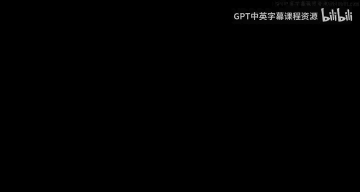
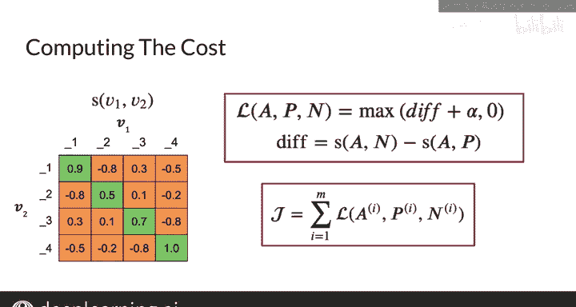

# 吴恩达《自然语言处理｜natural language processing》中英字幕 - P135：28_计算成本I.zh_en - GPT中英字幕课程资源 - BV1Hc5ezDEWQ

As promised， you will see how everything fits together right now。

 You will start by building a cost function， and then you will use gradient descent to optimize this cost function。

 Let's take a look at how this works。😊，To compute the costs， begin by preparing the data and batches。

Here you have the questions。 What is your age and how old are you。

 You can see these are duplicates because they mean the same thing。

Can you see me and are you seeing me are also duplicates。

Where are thou and where are you our duplicates too。As R when is the game and what time is the game。

So with four pairs， you have batch size of four here。

 we will use the letter B to stand for batch size。Something that's very important to note is that each question has its corresponding duplicate to the left or right of it。

 that is in each row， all of the sentences in the columns are duplicates。

But you'll notice that each question has no duplicate above or below it。 That is for any column。

 None of the rows in that column contain a sentence。

 That is a duplicate of another sentence in that column。So this is how you prepare the batches。Now。

 let me show you how you will want to organize the data in this way。Given the first batch。

 you are going to run it through this model to get a vector V1 with dimensions 1 row by5 columns。

 the number of columns shown in this matrix is equal to the dimension of your embedding layer。

 which in this case， is 5。I'll refer to this dimension of the embedding layer as D model for each question in the batch。

I haven't talked about the dimension of the embedding layer yet， but don't worry。

 it will become more clear once you're working with the code。

The important takeaway is that the dimension of the embedding the model is a parameter that determines the dimensions of the weights through each layer in the model and thus determines the size of the output vector。

The model is running a batch size that is greater than one。

 So the V1 output is actually a matrix of stacked vectors like this。 In this visual example。

 there are four rows in this matrix to indicate that there are four observations in this batch and the batch size is 4。

 I'll sub the observations in the batch as V1，1， V1，2。

 and so on corresponding to the vector output for each question in the batch。

You'll do the same thing for the batch of V2 vectors。

 each question in the batch1 is a duplicate of its corresponding question in batch 2。

But none of the questions in batch1 are duplicates of each other， and the same applies to batch soon。

Here， for example， V11 is a duplicate of V to 1， as are the rest of the respective row pairs。

 But V11 is not a duplicate of any other rows in V1。

The last step is to combine the two branches of the Siamese network by calculating the similarity between all vector pair combinations of V1 with V2。

For this example， with a batch size of4， you must get a matrix of similarities that looks like this。

The diagonal is a key feature here。 These values are the similarities for all your positive examples。

 the question duplicates。Notice that all the values are generally greater than the numbers in the of diagonals。

 so the model is performing， as you would expect for duplicate questions。

 because you would expect the question duplicates to have higher similarity compared to the non duplicateups。

In the upper right and lower left， you have the similarities for all the negative examples。

 These are the results for the non duplicateup pairs。

Notice that most of these numbers are lower than the similarities that are along the diagonal。

Also notice that you can have negative example question pairs that still have a similarity greater than0。

The range of similarity ranges from negative one to positive1。

But there isn't any special requirement that a similarity greater than0 indicates duplicates or that a similarity less than0 indicates non duplicates。

What matters for a properly functioning model is that it generally finds that duplicates have a higher similarity relative to non duplicateups。

Creating non duplicateuplicated pairs like this removes the need for additional non duplicateuplicates examples in the input data。

Which turns out to be a big deal instead of needing to set up specific batches with negative examples。

 your model can learn from them in the existing question duplicates batches。Now。

 you could just stop here and use these similarities with the triplet loss function you already know shown here。

Then the overall costs for your Siese network will be the sum of these individual losses over the training sets。

Here you can see that superscripts I refers to a specific training example。

 and there are M observations， but there are more techniques available this can vastly improve upon model performance。

 I'll show you those next。

You have now seen how hard negative mining is used when confusing the costs and during training。

You only need to have two similar texts， which you put on the diagonals and you use the of diagonals as the nons examples。

