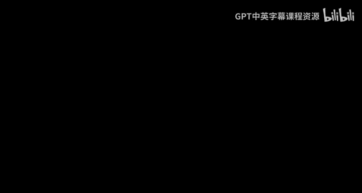
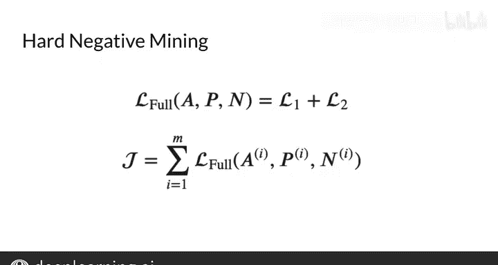

# 吴恩达《自然语言处理｜natural language processing》中英字幕 - P136：29_计算成本II.zh_en - GPT中英字幕课程资源 - BV1Hc5ezDEWQ

In the last video， I briefly mentioned the diagonals and the off diagonals in our cost matrix。

We will now define these terms and use them to compute the overall costs。 Let's dive in。Previously。

 you set up the training data into two specific batches。

Each batch containing no duplicate questions within it。You ran those batches through one subnet each。

 and has produced a vector outputs per question， which has dimension 1 by D model。

 where D model is the embedding dimension and is equal to the number of columns in the matrix。

 which is5， at least in this example。The V1 vectors for a single batch are stacked together。

And in this case， the batch size is the number of rows shown in this matrix， which is4。

You can see a similar batch of V2 vectors as well。The last step was to combine the two branches of the Siamese network by calculating the similarity between all vector pair combinations of the V1 vectors and V2 vectors。

For this example， with a batch size of four， that last step would produce a matrix of similarities that looks something like this。

This matrix has some important attributes。 The similarities along the green diagonal contain similarities for the duplicate's questions。

For a well trained model， these values should be greater than similarities for the of diagonals。

 reflecting the fact that the network produces similar vector output for duplicate questions。

The orange values in the upper right and lower left are similarities for the non duplicateuplic questions。

Now this is where things get really interesting。 You can use this of diagonal information to make some modifications to the loss function and really improve your model's performance To do so。

 I'm going to make use of two concepts。The first concept is the mean negative。

Which is just the mean or average of all the off diagonal values in each row。

Notes that of diagonal elements can still be positive numbers， so when I say mean negative。

 I am referring to the mean of the similarity for negative examples。

 not the mean of negative numbers in  error。For example。

 the mean negative of the first row is just the mean of all the off diagonal values in that row。

 in this case， negative 0。8，0。3 and negative 0。5， excluding the value 0。9， which is on the diagonal。

You can use the mean negative to help speed up training by modifying the loss function。

 which I'll show you soon。The next concept is what's called the closest negative。

As mentioned earlier， because of the way you define the triplet loss function。

 you'll need to choose so called hard triplets to train on。What this means is that for training。

 you want to choose triplet where the cosine similarity of the negative example is close to the similarity of the positive example。

This forces your model to learn what differentiates these examples and ultimately drive those similarity values further apart through training。

To do this， youll search each row and your outputs matrix for the closest negative。

Which is to say the of diagonal value， which is closest to。

 but still less than the value on the on diagonal for that row。So in this first row。

 the value on the diagonal is 0。9。So the closest of diagonal elements in this case is 0。3。

What this means is that this negative example with a similarity of 0。

3 has the most to offer your model in terms of learning opportunity。

To make use of these new concepts， recall that the triplet loss was defined as the max of the similarity of A and N minus the similarity of A and B。

Plus， the margin， alpha and 0。Also recall that refer to the difference between the two similarities with the variable named diiff。

Here we're just writing out the definition of diff。

So in order to minimize the loss you want this diff plus the margin alpha to be less than or equal to 0。

 I'll introduce loss 1 to be the max of the mean negative minus the similarity of a and B plus alpha and 0。

 the change between the formulas for triplet loss and loss 1 is the replacement of similarity of a and N with the mean negative this helps the model converge faster during training by reducing noise。

It reduces noise by training on just the average of several observations。

 rather than training the model on each of these off diagonal examples。

So why does taking the average of several observations usually reduce noise， Well。

 we define noise to be a small value that comes from a distribution that is centered around 0。

So in other words， the average of several noise values is usually0。

So if we took the average of several examples， this has the effect of canceling out the individual noise from those observations。

Then loss 2 will be the max of the closest negative minus the similarity of A and B plus alpha and 0。

The difference between the formulas this time is the replacement of the cosine of A and N。

With the closest negative， this helps create a slightly larger penalty by diminishing the effects of the otherwise more negative similarity of aid and that it replaces。

You can think of the closest negative as finding the negative example that results in the smallest difference between the two cosine similarities。

If you had that small difference to alpha， then youre able to generate the largest loss among all of the other examples in that row。

By focusing the training on the examples that produce higher loss values。

 you make the model update its weights more。To learn from these more difficult examples。

 then you can define the full loss as loss  one， loss loss2。

And you will use this new full loss as an improved triplet loss in the assignment。

The overall costs for your Siese network will be the sum of these individual losses over the training sets。

In the next video， you will use this cost function in One shot learning One shot learning is a very effective technique that can save you a lot of time when comparing the authenticity of checks or of any other type of input。

