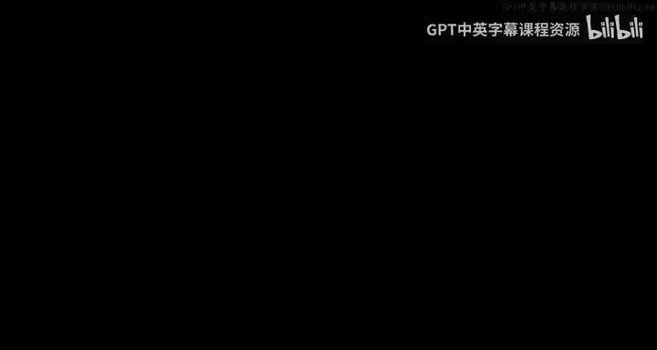
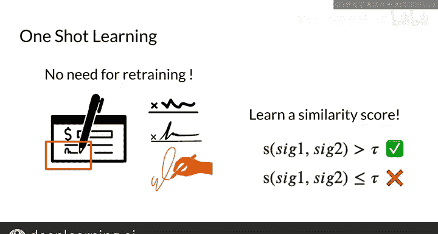

# 吴恩达《自然语言处理｜natural language processing》中英字幕 - P137：30_一次性学习.zh_en - GPT中英字幕课程资源 - BV1Hc5ezDEWQ

Hello， let's say that you are trying to identify whether the author for a certain poem is Lucas or not。

You can either take all of Lucas's poems and put them into dataset sets。

 and instead of predicting K classes， you now predicts K plus1 classes。

 all the previous poems of other authors plus Lucas。

 so that's why it's K+1 or you can compare one of Lucas's poems to another poem and that is where one shot learning comes in in this video I'll show you how you can do that to understand the difference between classification and one shot learning first consider identifying or classifying signatures based on one through K possible classes。

😊，You might use some kind of classification model trained on decay K classes。

 probably with a softmax function at the end to find the maximum probability。

Then at recognition time， classify the input signature to one of those corresponding classes。

 That's great。 If you have a signature list that rarely changes。😊。

But what if you get a new signature to classify。It would be expensive to retrain the model every time this happens。

 And besides， unless you have a great many examples of that new signature。

 model training won't work very well。 In one shot learning。

 you need to be able to recognize this signature repeatedly from just one example。

 you can do this with a learn similarity function。Then you can test a similarity score against some threshold to see if two signatures are the same。

So the problem changes to determining which class to instead measuring similarity between two classes。

And this is very useful。Especially in banks， for example。Every time there is a new signature。

 you can't retrain your entire system to classify the signatures into K possible outputs。So instead。

 you just learn a similarity function that can be used to calculate a similarity score that can。

 in turn， be used to identify whether two signatures are the same。

 You already did this using cosine similarity as a similarity function。

If the result was greater than some threshold tau， you determine the input to be the same in the case of comparing signatures。

 if the similarity is less than or equal to tau， then the signatures are different。

In this video， I spoke about one shot learning， and I told you why it is a very effective technique。

 One shot learning makes use of Siamese networks。 In the next video。

 I'll show you how you can train and test your Siamese network。

