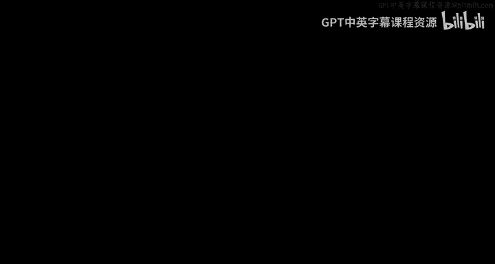
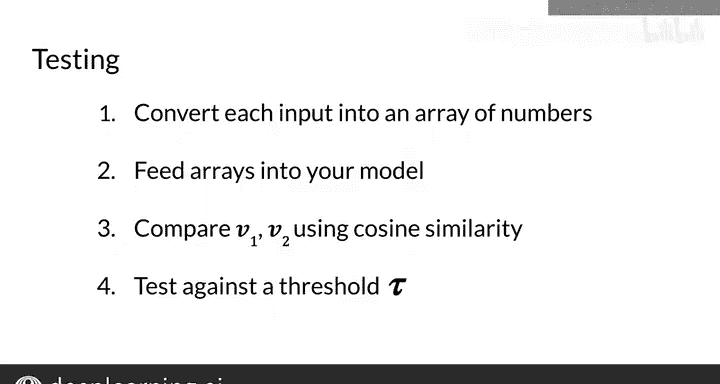

# 吴恩达《自然语言处理｜natural language processing》中英字幕 - P138：31_训练与测试.zh_en - GPT中英字幕课程资源 - BV1Hc5ezDEWQ

Welcome to the last video of the week you're going to see what the dataset sets would look like for a Siamese network。

 I'll show you how you can train your model and then you can use that model to test your Siamese network。

 Let's take a look at how you can do this。Youll be using the Q question duplicate dataset sets for this week's programming assignment。

 and it looks like this。 It consists of a collection of question pairs within is duplicates Boolean for each question。

For example， for question 1 and question 2， what is your age and how old are you is duplicate equals true because these two questions are duplicates。

Where are you from and where are you going are not duplicate。 So it's false and so on。

 This dataset set gives your model plenty of examples to learn from。 First。

 youll process the dataset set so that it looks like this。

You will preprocess the data into batches of size B。

 The corresponding questions from each batch are duplicates。 So for example。

 the first question in batch 1， what is your age is a duplicate of the first question in batch2。

 How old are you and the second question in batch 1 is a duplicate of the second question in batch 2 and so on。

Notes however， that there are no duplicates within an individual batch。

 so if I call this Q1A and this Q2 a， then Q1 A and Q2A are duplicates。

 if this was Q1 B and this was Q2 B， then Q1 B and Q2 B are duplicates， however。

 Q1 A and Q1 B are not duplicates Similarlyly Q2 A and Q2 B are not duplicates。

 I'll show you how to prepare the batches in such a way that no question within the same batch is duplicated。

Finally。😊，You'll use these inputs to get output vectors for each batch then you can calculate the cosine similarity between each pair of output vectors This is the Siese model that you will be implementing in the assignment。

 you will create a subnetwork which is then duplicated and drawn in parallel in each subnetwork you get the embedding。

 run it through the LSTM， take your vector output， and then use them to find the cosine similarity。

An important note here is that the learned parameters of the sub networks are exactly the same between the two sub networks。

 so you are actually only training one set of weights， not two。When testing the model。

 you will perform one shot learning， the goal is to find a similarity score between two input questions。

First， convert each input into an array of numbers， feed these into your model。

 compareare the sub network outputs V1 and V2， using cosine similarity for a similarity score。

 then test the score against some threshold tau， and if the cosine similarities greater than tau。

 then the questions are classified as duplicates。Note that both tau and the margin alpha from the loss function are tunable hyperparmeters。

 Congratulations， you now know how to train your Siamese network and you know how to test it。

 In this week' programming exercise， you'll be using a Siamese network to identify whether a question is a duplicate or not。

😊。

Specifically， you'll be using the core question duplicate datasets， and using that。

 you'll be able to get a very good accuracy。