# 吴恩达《自然语言处理｜natural language processing》中英字幕 - P13：12_逻辑回归成本函数.zh_en - GPT中英字幕课程资源 - BV1Hc5ezDEWQ

Good to see you again In this optional video， you're going to learn about the intuition behind the logistic regression cost function。

Specifically， you will understand why the cost function is designed that way。

 You will see what happens when you predict the true label。

 and you'll see what happens when you predict the wrong label。

 Let's dive in and see how this logistic regression cost function is designed。😊。

Let's have a look now at the equation of the cost function。

 While this might look like a big complicated equation。

 it's actually rather straightforward once you break it down into its components。 First。

 have a look at the left hand side of the equation where you find a sum over the variable M。

 which is just the number of training examples in your training set。

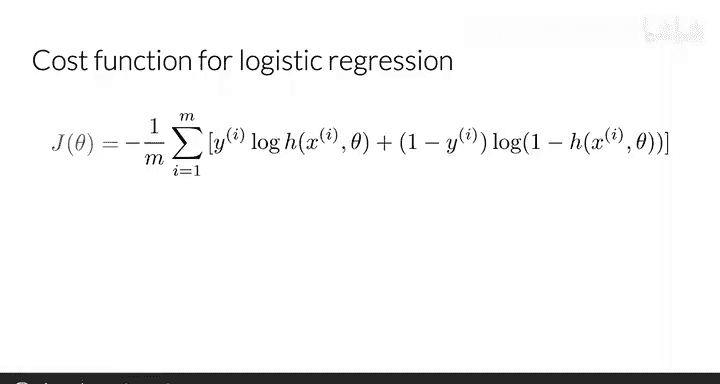

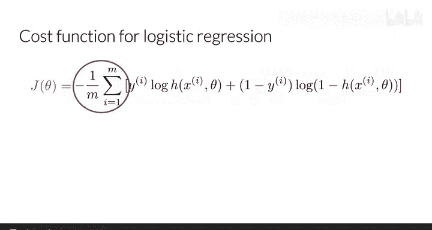

This indicates that you're going to sum over the cost of each training example。Out front。

 there is a-1 over M indicating that when combined with the sum， this will be some kind of average。

 the minus sign ensures that your overall cost will always be a positive number。

 As you'll see clearly later in this video。

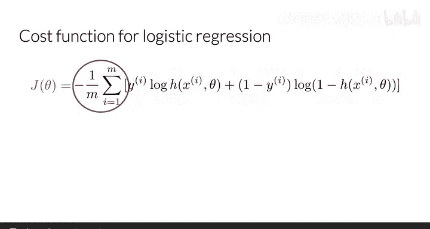

Inside the square brackets， the equation has two terms that are added together。

To consider what each of these terms contribute to the cost function for each training example。

 let's have a look at each of them separately。

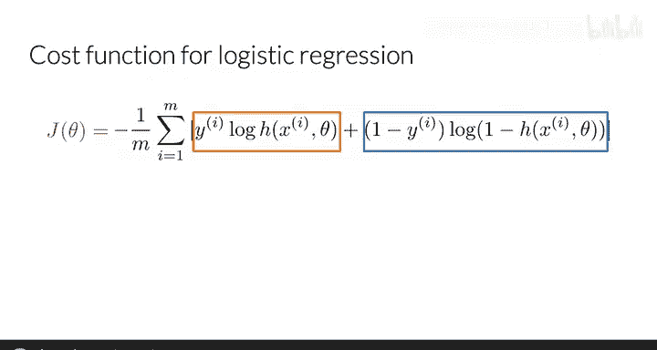

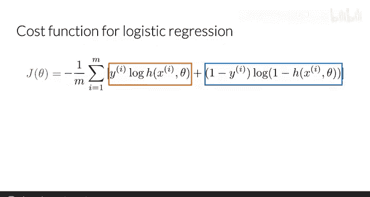

The term on the left。Is the product of Y superscripts I。

 which is the label for each training example multiplied by the log of the prediction。

 which is the logistic regression function applied to each training example represented as H of superscript I and a parameter theta。

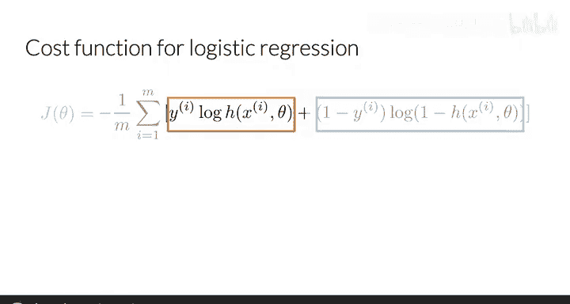

Now， consider the case when your label is 0。

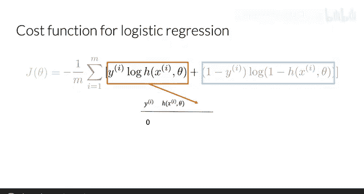

In this case， the function H can return any value。And the entire term will be 0 because 0 times anything is just 0。

 What about the case when your label is  one， If your prediction is close to  one。

 then the log of your prediction will be close to 0。 because as you may recall， the log of  one is 0。

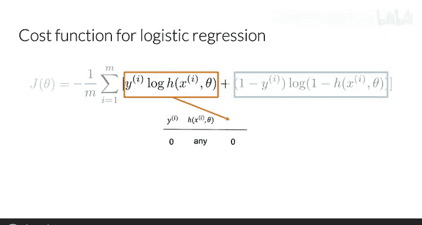

And the product will also be near 0。

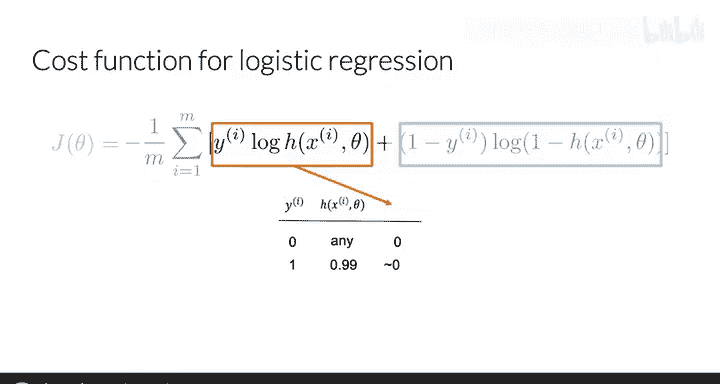

If your label is one and your prediction is close to 0， then this term blows up。

And approaches negative infinity intuitivetuly， now you can see that this is the relevant term in your cost function when your label is one。

 when your prediction is close to the label value， the loss is small。

 And when your label and prediction disagree， the overall cost goes up。

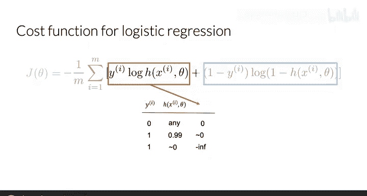

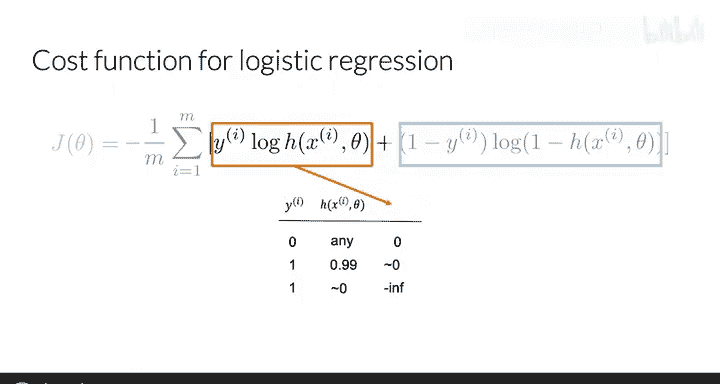

Now， consider the term on the right hand side of the cost function equation。In this case。

 if your label is1， then the 1 minus y term goes to 0。

 and so any value returned by the logistic regression function will result in a0 for the entire term because again。

0 times anything is just 0。

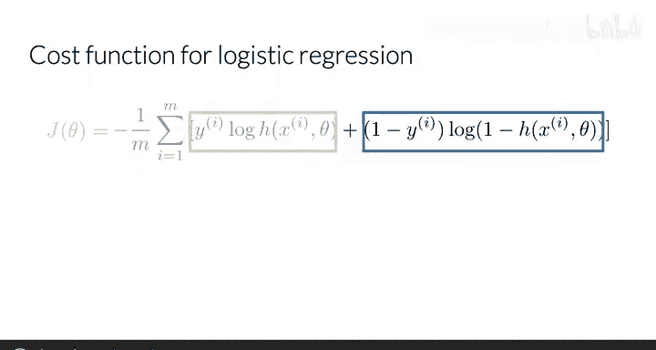

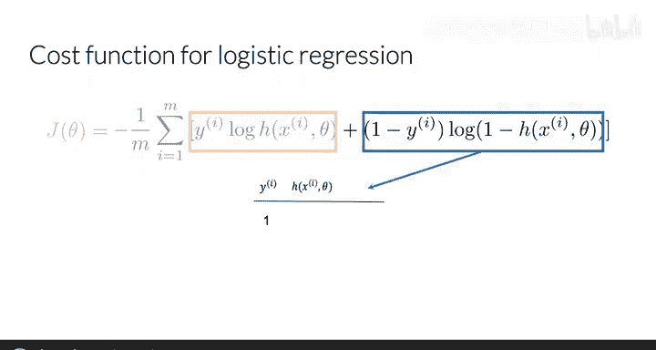

If your label is 0 and the logistic regression function returns a value close to 0。

 then the products in this term will again be close to 0。 If， on the other hand。

 your label is 0 and your prediction is close to1， then the log term will blow up。

 and the overall term will approach to negative infinity。

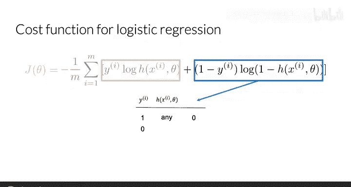

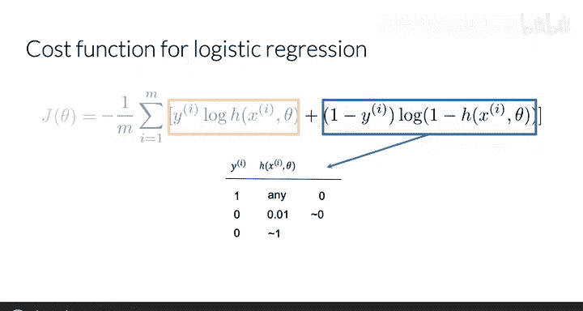

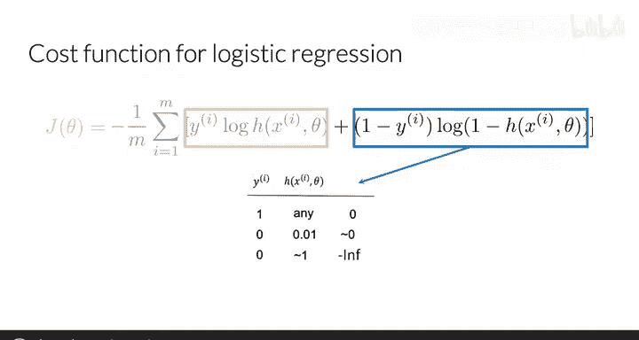

From this exercise， you can see now that there is one term in the cost function that is relevant when your label is0 and another that is relevant when the label is1 in each of these terms。

 your taking the log of a value between 0 and 1， which will always return a negative number。

 and so the minus sign out front ensures that the overall cost will always be a positive number。

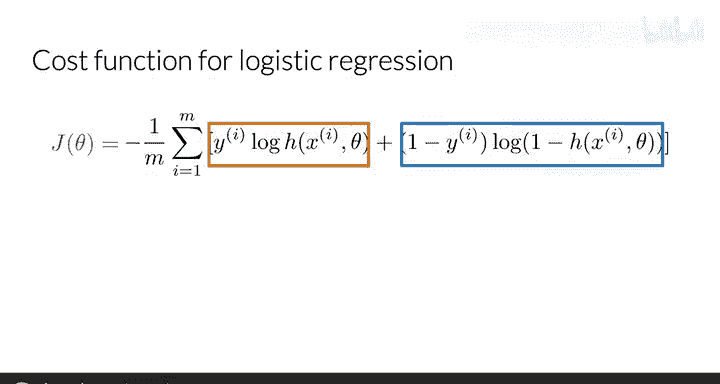

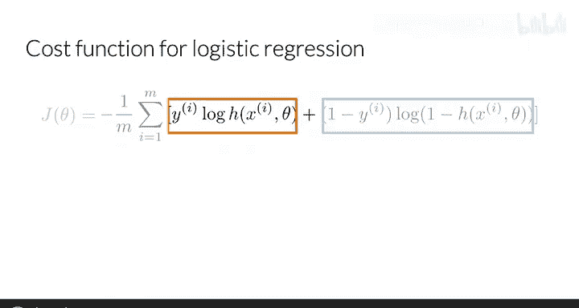

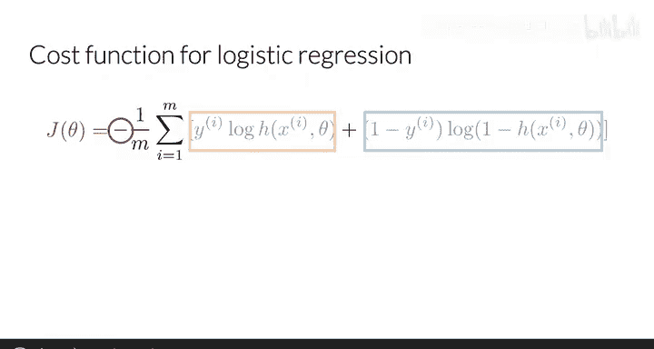

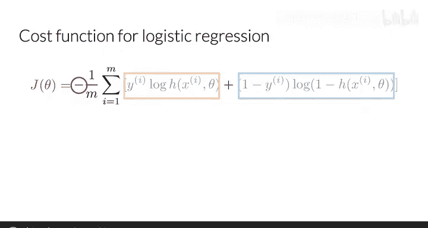

Now let's have a look at what the cost function looks like for each of the labels。

0 and one overall possible prediction values。 First。

 we're going to look at the loss when the label is one。

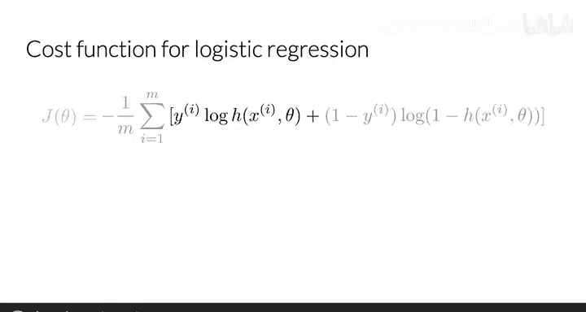

In this plot， you have your prediction value on the horizontal ax and the cost associated with a single training example on the vertical ax。

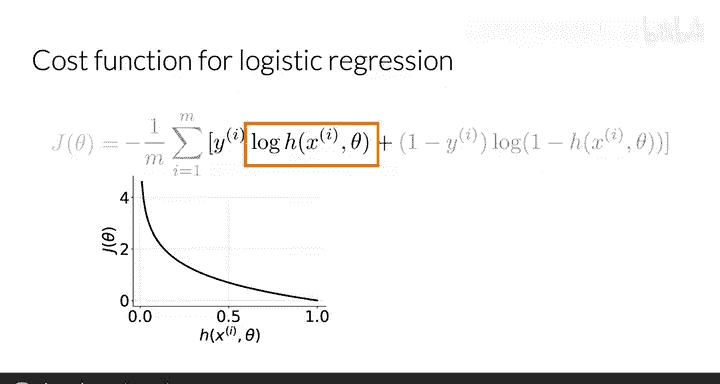

In this case， J of theta simplifies to just negative log h x of theta。

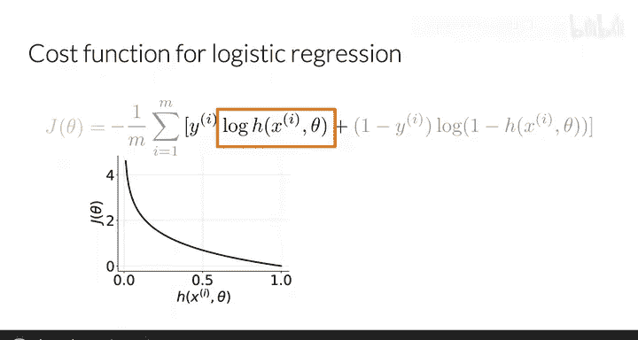

When your prediction is close to1， the loss is close to zero because your prediction agrees well with the label。

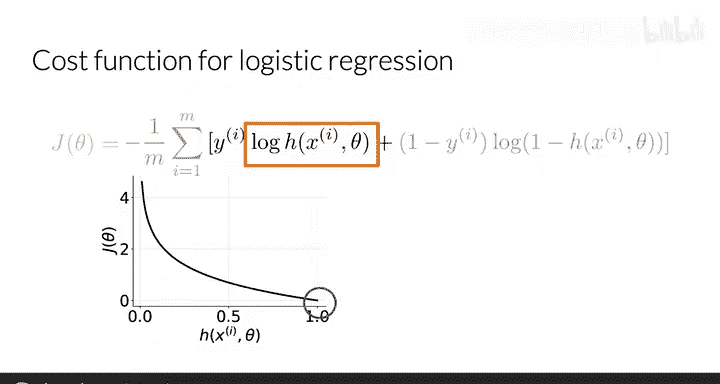

And when the prediction is close to 0， the loss approaches infinity because your prediction and the label disagree strongly。

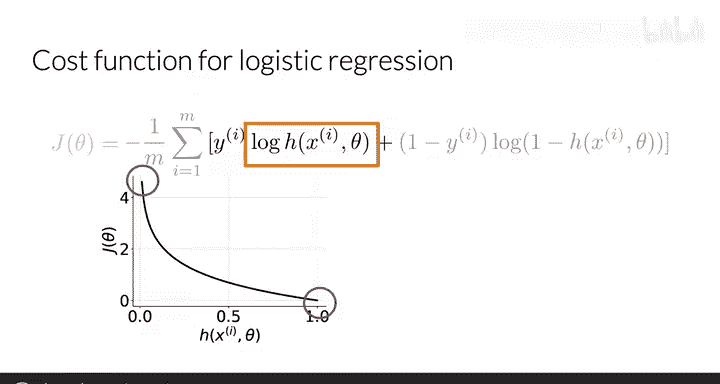

The opposite is true when the label is 0。 In this case。

 J of theta reduces to just minus log1 minus H of x theta。

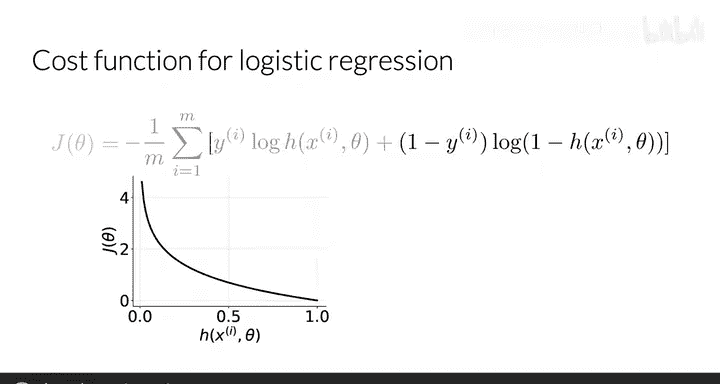

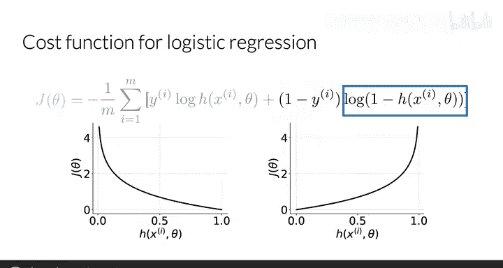

Now， when your prediction is close to zero， the loss is also close to zero。

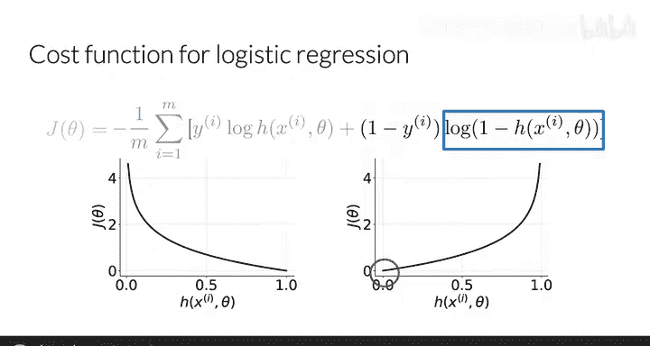

And when your prediction is close to one， the loss approaches infinity。

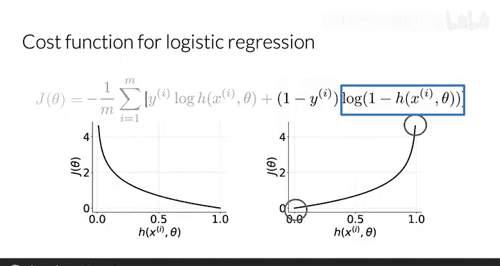

You now understand how the logistic regression cost function works。

 You saw what's happened when you predict a A1 and the true label was a1。

 you also saw what happened when you predict a a0 and the true label was a0 in the next week you'll learn about naive base。

 which is a different type of classification algorithm。

 which also allows you to predict whether a tweet is positive or negative。

