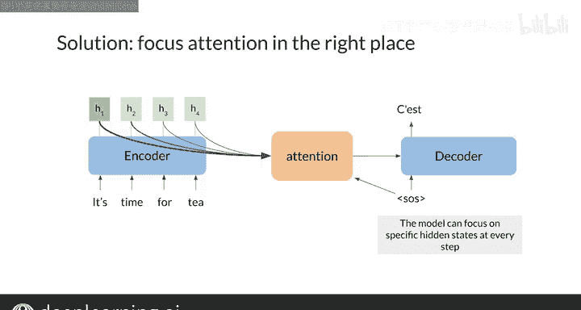

# 吴恩达《自然语言处理｜natural language processing》中英字幕 - P142：2_序列到序列.zh_en - GPT中英字幕课程资源 - BV1Hc5ezDEWQ

Great to see you again， you will now learn about neural machine translation and you'll see what the architecture for this neural network looks like you will also learn which words the neural network is focusing on when translating from one language to another。

Let's formalize this task。To get started on this week's material。

 I'll introduce you to neural machine translation along with the model that was traditionally used for its implementation。

 the See to seek model。Then I'll talk about some of this model shortcomings and the solution as a lead to the model that youll be using in this week's assignment。

 excitinging stuff。 So let's go in your machine translation you are using an encodeder and a decoder to translate from one language to another for example。

 you could translate its time 40 from English to French Se lo Duin to do this。

 You could use a machine translation system that has LSTms for both encoding and decoding。

The traditional Sk to seek model was introduced by Google in 2014。

 and it was a revelation at the time。Basically， it works by taking one sequence of items。

 such as words and it outputs another sequence。The way this is done is by mapping variable length sequences to a fixed length memory。

 which in machine translation encodes the overall meaning of sentences， for example。

 you can have a text of length that varies and you can encode it into a vector of fixed dimension like 300 for example。

 this feature is what's made this model a powerhouse for machine translation。Additionally。

 the input and outputs don't need to have matching lengths。

 which is a desirable feature when translating text。

And then you might recall the vanishing and exping problems from earlier in the specialization in Si to seek models。

 LSTMs and GRUs are typically used to avoid these problems。As I mentioned， in a seek to seek model。

 you have an encoder and a decoder。The encoder takes word tokens as input。

And it returns its final hidden states as outputs。This hidden state is used by the decoder to generate the translated sentence in the target language。

Before moving on。Let's look closer at the encodeder and decoder。

The encoder typically consists of an embedding layer and an LSTM module with one or more layers。

The embedding layer transforms words tokenized first into a vector for input to the LSTM module。

At each step in the input sequence， the LSTM module receives input from the embedding layer。

 as well as the hidden states from the previous step。

The encoder returns the hidden states of the final step shown here as H 4。

 This final hidden state has information from the whole sentence， and it encodes its overall meaning。

The decoder is constructed similarly with an embedding layer and an LSTM layer。

 You use the outputs word of a step as the input word for the next step。

 You also pass the LSTM hidden state to the next step。

You start the input sequence with a start of sequence token denoted as SOSs here。

The first step returns C as the most probable next word。

Then you use say as the input word for the next step and repeat to generate the rest of the sentence。

 Love， do。对。One major limitation of the traditional Sik to seek model is what's referred to as the information bottleneck Since Si to seek uses a fixed length memory for the hidden state。

 long sequences become problematic。And this is due to the facts that in traditional seek to seek models。

 only a fixed amount of information can be passed from the encoder to the decoder。

 no matter how much information is contained in the input sequence。So the power of seek to seek。

 which allows for inputs and outputs to be different sizes。

 becomes not effective when the input sequence is long。

The result is lower model performance as sequence size increases， and that's no good。

So the issue with having one fixed size encoder hidden states is that it struggles to compress longer sequences。

 and it ends up throtling itself and punishing the decoder who only wants to make a good prediction。

One work around is to use the encoder hidden states for each word instead of trying to smash it all into one big vector。

But this model would have flaws with memory in context。

 So how could you build a time and memory efficient model that predicts accurately from a long sequence。

This becomes possible if the model has a way to select and focus on the most important words at each time step。

You can think of this as giving the model a new layer to process this information。

Which in this slide， is called attention。If you provide information specific to each input word。

 you can give the model a way to focus its attention in the right place at each step of the decoding process。

 and that is good progress Up next， you'll get a conceptual idea of what this new layer is doing and why。

You now have an overview of neural machine translation and you have a rough idea of what attention is looking like。

 You know which words the model is focusing on when translating from one language to another language。

