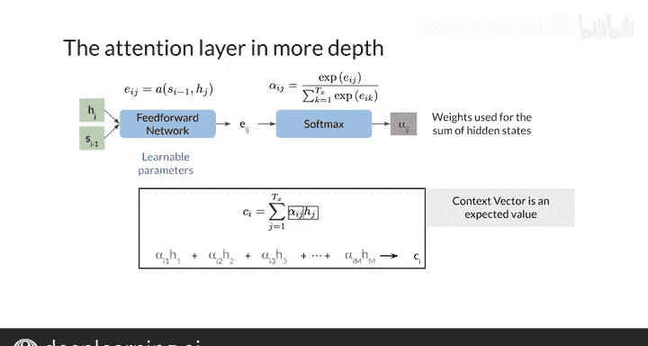

# 吴恩达《自然语言处理｜natural language processing》中英字幕 - P143：3_带注意力的序列到序列模型.zh_en - GPT中英字幕课程资源 - BV1Hc5ezDEWQ

Welcome Attention is a very important concept and allows you to focus where the model is looking at whenever making a prediction。

 for example， when translating one paragraph from English to French。

 you can focus on translating one sentence at a time or even more a couple of words at a time let's dive into this concept。

What we call attention now was introduced in a landmark paper from Zmetry Baanu。

 Gang Chohou and Yohua Benio。The authors developed a method to fix the seek to seek models in ability to translate longer sentences。

As you can see， attention was originally developed for machine translation。

 but it has since been used in many other domains with great success。 So before we move forward。

 I want to skip ahead a bit and show you how well attention works。 It's sort of surprising。😊。

Here is a comparison of the performance between different models from the Baannu paper using the blue score。

 a performance metric that you will learn about later In brief。

 higher scores are better indicating more correct translations。The dashed lines。

 they show the scores for bidirectional seek to seek models as the length of the input sentence is increased。

The 13 and 50 denotes the maximum sequence length used to train the models。As you can see。

 the Si to seek models perform well for sentences with about 10 to 20 words。

 but they fall off beyond that。This is what you should expect as seek to seek models must store the meaning of the entire input sequence in a single vector。

The models developed in this paper R inN Search 13 and50， used by directional encoders and decoders。

 but with attention。First， these models perform better than the traditional seek to seek models across all sentence length。

And the RNN search 50 model has basically no fall off in performance as sentence length increase。

As you will see， this is because the models are able to focus on specific inputs to predict words in the output translation instead of having to memorize the entire input sentence。

Now I'll show you the motivation behind attention and how it works。

Traditional Si to seek models use the final hidden states of the encoder as the initial hidden states of the decoder。

This forces the encoder to store the meaning of the entire input sequence into this one hidden state。

Instead of using only the final hidden states， you can pass all the hidden states to the decoder。

However， this quickly becomes inefficient as you must retain the hidden state for each input step in memory to solve this。

 you can combine the hidden states into one vector。Typically， call the context spectrum。

The simplest operation here is a pointwise addition。Since the hidden vectors are all the same size。

 you can just add up these vector elements by elements to produce another vector of the same size。

But now the decoder is getting information about each step while it really only needs information from the first few input steps tod the first word。

And this isn't that much different from using the last hidden states from LSTM or AGRU。

The solution here。Is to weight certain encoder vectors more than others before the pointwise edition words that are more important for the next decoder output would have larger weights that this way。

 the context vector holds more information about the most important words and less information about other words。

But how are these weights calculated to determine which input words are important as each step。

The decoder's previous hidden states denoted as S underscore I minus1 contains information about the previous words in the output translation。

This means you can compare the decoder state with each encoder state to determine the most important inputs intuitively。

The decoder can set the weights such that if it focuses on only the most important input words for the next prediction。

 it decides which parts of the input sequence to pay attention to。

Now step into the attention layer to examine how the weight and context vector are calculated。

The goal of the attention layer is to return a context vector that contains the relevant information from the encoder states。

The first step is to calculate the alignments E underscore Ij。

Which is a score of how well the inputs around J match the expected outputs its I。

The more they match， the higher of his score we will expect。

This is done using a feed forward neural network with the encodeder and decoder hidden states as inputs。

Where the weights for the feet forwardward network are learned。

 along with the rest of the Sih to seek model。These scores are then turned into weights。

 which range from 0 to 1 using the softm function。This means the weights can be thought of as a probability distribution。

 which sum to one。Finally， each encoder state is multiplied by its respective weights and sum together into one context vector。

Since the weights are a probability distribution， this is equivalent to calculate in and expected value across word alignments。

Next up， you'll get a better understanding of how all this works by implementing a simple version of the attention operation from the Baonu paper。

I have now shown you how attention works and why it is important in the next video。

 I will define what are keys， queries and values and show you how to use them in attention。😊。

