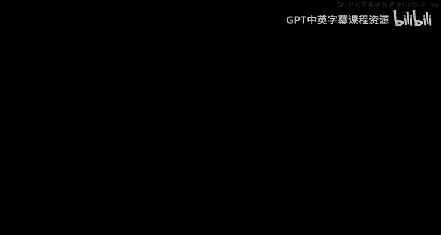
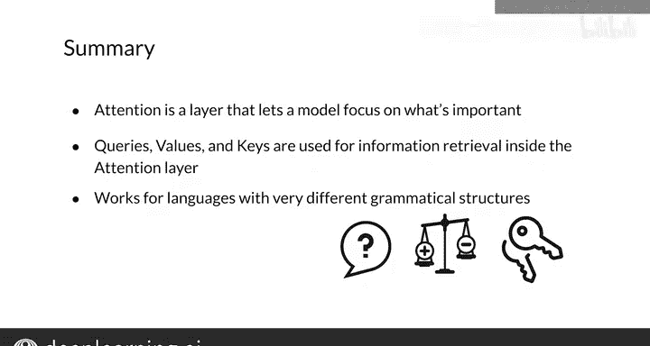

# 吴恩达《自然语言处理｜natural language processing》中英字幕 - P144：4_查询、键、值和注意力.zh_en - GPT中英字幕课程资源 - BV1Hc5ezDEWQ

Quries， keys and values are terms that you will be using for attention in this video。

 I will define them for you and show you how they could be used， let's get started。

The original attention paper was published in 2014。Since then。

 there have been multiple variations on attention with some models that don't rely on recurrent neural networks。

For example， the 2017 paper attention is all you need。

 Induce the transformer model and a form of attention based on information retrieval using queries。

 keys and values。 This is an efficient and powerful form of attention that youll be using in this week's assignment。

In this video， I'll show you how this type of attention works。

 as well as the concept of alignment between languages。Conceptually。

 you can think of keys and values as a look up table。 The query is matched to a key。

 and the value associated with that key is returned。For example。

 if we are translating between French and English， well matches with time。

 so we'd like to get the value for time。In practice。Thequeries。

 keys and values are all represented by vectors， embedding vectors， for example， Due to this。

 you don't get exact matches， but the model can learn which words are the most similar between the source and target languages。

The similarity between words is called alignment。 The key vectors are used to calculate alignment scores that are measures of how well the query keys match。

These alignment scores are then turned into weights used for a weighted sum of the value vectors。

 This weighted sum of the value vectors is returned as the attention vector。

This process can be performed using scale thus product attention。

 The queries for each step are packed together into a matrix Q。

 so attention can be computed simultaneously for each query。

 The keys and values are also packed into matrices K and V。

 These matrices are the inputs for the attention function shown as a diagram on the left and mathematically on the right。

First， the aquaries and keys， matrices are multiplied together to get a matrix of alignment course。

These are then scaled by the square roots of the key vector dimension decay。

 the scaling improveds the model performance for larger model sizes and could be seen as a regularization constants。

Next， the scaled scores are converted to weights using the softmax function。

 such that the weights for each query sum to one。 Finally。

 the weights and the value matrices are multiplied to get the attention vectors for each query。

You can think of the keys and the values as being the same。

 So when you multiply the softmax output with V。You are taking a linear combination of your initial input。

 which is then being fed to the decoder。Take a minute to make sure what I just said makes sense。

now that unlike the original form of attention， scale dot product attention consists of only two matrix multiplications and no neural networks。

 since matrix multiplication is highly optimized in modern deep learning frameworks。

 this form of attention is much faster to compute。But this also means that the alignment between the source and target languages must be learned elsewhere。

Typically， alignment is learned in the input embeddings or in other linear layers before the attention layer。

 Before moving on， I want to look a bit closer at alignment。

 The alignment weights form a matrix with queries， targets words on the rows and keys or source words on the columns。

Each entry in this matrix is the weights for the corresponding query key pair。

Word pairs that have similar meanings， T and T， for example。

 will have larger weights than theim words like T and time。Through training。

 the model learns which words have similar meanings and encodes that information。

 in query and key vectors。Learning alignment like this is beneficial for translating between languages with different grammatical structures。

Since attention looks at the entire inputs and target sentences at once and calculates alignments based on word pairs。

 weights are assigned appropriately， regardless of word order。 For example， in the sentence。

 the agreement on the European E area was signed in August 1992。 And this other sentence。

 Laco Civaazon Economic Opeian Aesinia ornutmin Nesonca Travents。

 you can see that zone and area are at different positions。 but have the same meaning。

The model has learned to align them appropriately， allowing the decoder to focus on the appropriate input words。

 despite different ordering。Congrats on absorbing all these new concepts。

 I introduce you to the purpose of an attention layer。

You saw how it is related with information retrieval。 And I showed you how well it works。

 even for languages with very different structures。 In the next video。

 I'll be talking about neural machine translation and show you what the setup looks like for the system。

 I'll show you what the dataset set looks like and the steps required for preprocesing your dataset sets。

You have now seen what keys， queries and values are these are important because if you read a research paper。

 you might come across these terms and you will understand them in the next video I will talk about the setup for machine translation。

