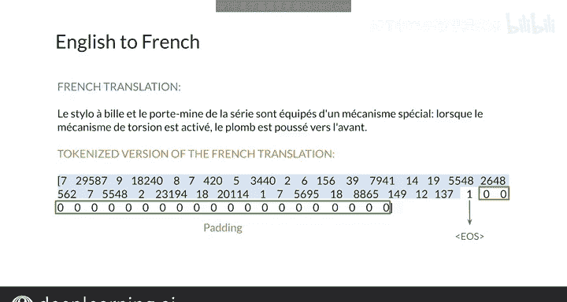

# 吴恩达《自然语言处理｜natural language processing》中英字幕 - P145：5_机器翻译的设置.zh_en - GPT中英字幕课程资源 - BV1Hc5ezDEWQ

You will now learn about how words are being represented in the neural machine translation setting。

 you will also see what the dataset set looks like and when implementing the systems I'll show you that you need to keep track of a few things。

 for example， which words correspond to what factors with that set， let's dive in。

This is an example of the type of input data that you will have for your assignments this week。

Over here， you have the sequence。 Im hungry。 and on the right。

 you have the corresponding French equivalent。Further down。

 I watched the soccer game and the corresponding French equivalents。

 You're going to have a great many of these inputs。

 You should know that the states of the art models use pre traineded vectors。But otherwise。

 the first thing you will do is to use a one0 vector to represent the words。Usually。

 youll keep track of your mappings with a were to index and index to word dictionary。

 given any input， you transform it into indices and then vice versa When you make the predictions。

 you will also normally use an end of sequence token。

 and you will pad your token vectors with zeros to match the length of the longest sequence。

Here is an example。 This is an English sentence and a tokenized version of the English sentence。

 You can see that it has an index of 4546 for the word both。After the initial tokenization。

 just add EOS token shown here is one。And path with zeros to match the length of the longest sequence。

 Now， let's go to the French translation of that sequence。

 along with the tokenized version of the French translation。

 Notice that one is the end of sentence token here， too。

It's also followed by a series of padding zeros。Given now that you know how to represent words。

 how to initialize your model， and how to structure your dataset set。

 you can go ahead and start training your model and in the next video。

 I'll show you how you can do this。