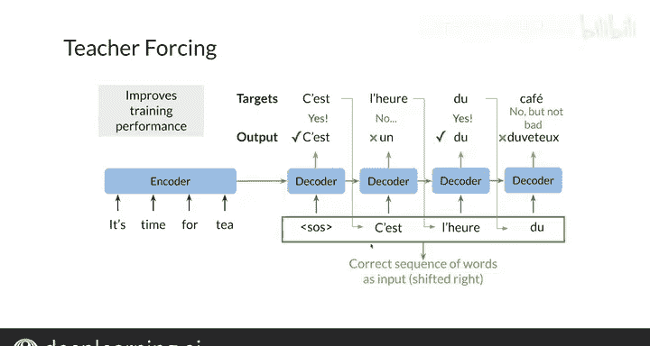

# 吴恩达《自然语言处理｜natural language processing》中英字幕 - P146：6_教师强制.zh_en - GPT中英字幕课程资源 - BV1Hc5ezDEWQ

Hello， you will now learn how to train your neural machine translation system。

 you will learn about certain concepts like teacher forcing， and you will see some of its advantages。

 so let's dive in。

In this section， you will see how to train your neural machine translation and MT4 shorts。model我的战神。

I'll introduce you to the concepts of teacher forcing。As you learned before。

 seek to seek models generate translations by feeding the outputs of the decoder back in as the next inputs this way。

 there is no set length on the output sequence。When training the model intuitively。

 you would compare the decoder output sequence with the target sequence to calculate the loss。

That is， you would calculate the cross entropy loss for each step。

 then sub the steps together for the total loss。However， in practice， this doesn't work too well。

The problem is that in the early stages of training， the model is naive。

It will make wrong predictions early in the sequence。

This problem compounds as the model keeps making wrong predictions。

 and the translated sequence gets further and further from the target sequence。

 The problem is illustrated in this slide。Where the final output word， give the。

Has a similar word to the word fluffy in English， which has a very different meaning from the word team。

To avoid this problem， you can use the ground truth words as decoder inputs instead of the decoder outputs。

So even if the model makes a wrong prediction， it pretends as if it's made the correct one and this can continue。

This method makes training much， much faster and has a special name， teacher forcing。

There are some variations on this tool。 For example。

 you can slowly start using decoder outputs over time so that late in the training。

 you are no longer feeding in the target words。 This is known as curriculum learning。

 You are now familiar with teacher forcing， and you can add this technique to your toolbox to help you with training your model and to help you get a better accuracy。

