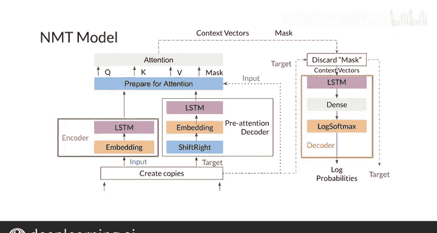

# 吴恩达《自然语言处理｜natural language processing》中英字幕 - P147：7_带注意力的神经机器翻译模型.zh_en - GPT中英字幕课程资源 - BV1Hc5ezDEWQ

Welcome。

I'll now show you how to train a neural machine translation system from scratch。

 I'll go through every step slowly so you can understand what is going on behind the scenes。

 Let's get started。In this video， I'll show you how everything you have seen this week fits together into the model architecture youll implement in this week's assignment。

 First， I'll give you a general overview before I go into the more intricate details。

You will implement a model similar to the one you have seen in previous lectures。

 you will have an encoder that gets the input sequence。

 a decoder which is supposed to do the translation and an attention mechanism。

 which would help the decoder focus on the important parts of the input sequence。

Recall that the decoder is supposed to pass hidden states through the attention mechanism to get context vectors。

The path of the hidden states from the decoder to the attention mechanism could not be easy to implement。

Instead， youll be using two decoders， a pre attentiontention decoder to provide hidden states and a post attention decoder。

 which will provide a translation。So a general overview of the modified model looks as follows。

You will have the encoder and a prettenstion decoder that's got the inputs and target sequences。

And then for the preattention decoder， the target sequence is shifted right。

 which is how you'll be implementing the teacher forcing from the encodeder and preattenstion decoder。

 you will retrieve the hidden states at each step and use them as input for the attention mechanism you will use the hidden states from the encodeder as the keys and values while those from the decoder are the queries。

As you have seen in previous lectures， the attention mechanism will use these values to compute the context vectors。

Finally， the post attention decoder will use the context vectors as inputs to provide the predicts a sequence。

Now let's take a closer look at each piece of the model。

The initial step is to make two copies of the input tokens and the target tokens because you will need them in different places of the model。

 One copy of the input tokens is fed into the encodecor。

 which is used to transform them into the key value vectors。

While a copy of the target tokens goes into the P attention decoder。

Note that the computations done in the encoder and pretension decoder could be done in parallel since they don't depend on each other。

Within the pre attentiontenstion decoder， you shift each sequence to the right and add a start of sentence token。

In the encodecoder and prettenstion the decoder， the inputs and targets go through an embeending layer before going to LSTMs。

After getting the query key and value vectors， you have to prepare them for the attention layer。

 You will use a function to help you get a padding mask to help the attention layer determine the padding tokens。

 This step is where you will use the copy of the input tokens。Now everything is ready for attention。

 You pass the query's， keys， values and the mask to the attention layer that outputs the context vector and the mask。

So before going through the decoder， you drop the mask。

You then pass the context vectors through the decoder composed of an LTM， a dense layer。

 and a log softmax。In the end， your model returns log probabilities and a copy of the target tokens that you made at the beginning。

There you have it。The model you will be building and the intuition behind all the steps。

 Take a break and just let all that sink in。

You now have an overview of how NT is implemented if you did not understand everything do not worry about it。

 we will go in more detail in this week's programming assignments in the next video I will talk about how to evaluate your system。

