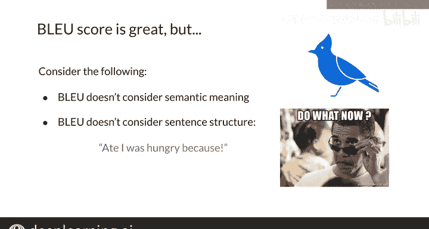

# 吴恩达《自然语言处理｜natural language processing》中英字幕 - P148：8_BLEU分数.zh_en - GPT中英字幕课程资源 - BV1Hc5ezDEWQ

After building and training your model， it is essential to assess how well it performs for machine translation。

 you have different metrics that were engineered just for this task In this lecture。

 I will show you the blue score and some of its issues for evaluating machine translation models。

The Bliss cor， a bilingual evaluation under study， is an algorithm designed to evaluate some of the most challenging problems in NLP。

 including machine translation。It evaluates the quality of machine translated text by comparing a candidate translation to one or more references。

 which are often human translations。The closer the blue score is to 1， the better your model is。

 and the closer to0， the worse it is。With that said。

 what is the blisco and why is this an important metric。To get the bs score。

 you have to compute the precision of the candidates by comparing its engrams with reference translations。

To demonstrate， I'll use unigrams as an example。Let's say that you have a candidate sequence that you got from your model composed of I I M I。

 You also have one reference translation， which contains the words Yuunice said I am hungry。

And a second reference translation that includes the words， he said， I am hungry。To get a b score。

 you count how many words from the candidates appear in any of the references and divide that count by the total number of words in the candidate translation。

 so you can view it as a precision metric。So you have to go through all the words in the candidate translation first you have the word I。

 which appears in both reference translations， so you add one to your count。Then you have again。

 the word I， what you already know appears on both references， and you add one to your accounts。

After that， you have the word M， which also appears in both references。

 so you add that word to your counts。And at the end， you have the word I again。

 which appears on both references， so you can add one to your accounts。Finally。

 you can get the blue score by dividing your account by the number of words in the candidate translation。

 which in this case is equal to 4。The whole process gives you a bs score equal to one。Weird， right。

This translation that is far from being equal to the references got a perfect core。

With this vanilla bluscore， a model that always outpos common words will do greats。

Let's try a modified version that will give you a better estimate of your model's performance。

For the modified version of the blis scoreps， after you find a word from the candidates in one or more of the references。

 you stop considering that word from the reference for the following words and the candidates。

In other words， you exhaust the words in the references after you match them what they word in the candidates。

So let's start from the beginning of the candidate translation。

You have the word I that appears in both references。

 so you add one to your count and exhaust the word I from both references。

Then you have the word I again， but you don't have that word in the references because it was taken out for the previous word in the candidates。

 so you don't add anything to your accounts。Then。You have the word M。

 which appears in both references， So you add one to your count and eliminate the word M from both references。

After that， you have the word I again， but no left occurrences in the references。

 So you don't add anything to your accounts。Finally。

You divide your count by the number of words in the translation to get blue score of 2 over 4 or 0。5。

As you can note， this version of the blue score makes more sense than the vanilla implementation。

However， like anything in life， using the blue score as an evaluation metric has some caveats。

For one， it doesn't consider the semantic meaning of the words。

It also doesn't consider the structure of the sentence。Imagine getting this translation。

A I was hungry， because。If the reference sentence is， I ate because I was hungry。

 this would get a perfect blissco。Bluscore is the most widely adopted evaluation metric for machine translation。

 but you should be aware of these drawbacks before using it。

You now know how to evaluate your machine translation model using the blue score I also showed you that this metric has some issues because it doesn't care about semantics and sentence structure in the following video youll see another metric for machine translation and that metric could be used to better estimate your model performance。

