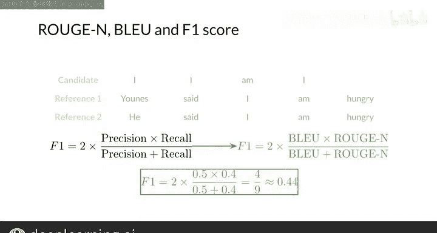

# 吴恩达《自然语言处理｜natural language processing》中英字幕 - P149：9_ROUGE-N分数.zh_en - GPT中英字幕课程资源 - BV1Hc5ezDEWQ

Previously， I introduced you to the blur score evaluation metric and its modified version。

 I used it to assess the performance of machine translation models。

 I also showed you some drawbacks that arise because that metric ignores semantic and sentence structure。

 In this video， I'll talk about the r score。 Another performance metric that tends to estimate the quality of machine translation systems。

😊。

I'll introduce you now to a family of metrics called Roj。

It stands for recall oriented under study of existing evaluation， which is a mouthful。

 but lets you know right off the bat that it's more recall oriented by default。

That means that Rouge cares about how much of the human created references appear in the candidate translation。

In contrast， blur is precision oriented， since you have to determine how many words from the candidates appear on the references。

Ruge was initially developed to evaluate the quality of the machine summarized text。

 but is also helpful in assessing the quality of machine translation。

It works by comparing the machine candidates。Against reference translations provided by humans。

There are many versions of the R score， but I'll show you the one called Roe N。

For the Rouge end score， you have to get the count of the Ngr overlaps between the candidates and the reference translations。

 which is somewhat similar to what you have to do for the bs score。

So to see the difference between the two metrics， I'll show you an example of how Rouge N works with Uniiograms。

To get the basic version of the Rouge end score based only on recall。

 so you must count word matches between the reference and the candidate and divide by the number of words in the reference if you had multiple references。

 you would need to get a Rouge end score using each reference and get the maximum。Now。

 let's go through the example that you already saw for the blues score。

Your candidate has the words I two times the word am and the word I again for a total of four words。

You also have a reference translation。 Eunice said。

 I am hungry and another slightly different reference。 He said， I am hungry。

 So each reference has five words in total。So you have to count matches between the references and the candidate translations。

 similar to what you did for the B scorere。Let's start with the first reference。

The word Eice doesn't match any of the unigrams in the candidates。

 so you don't add anything to the count。The word said， doesn't match any word in the candidates。

 either。The word I has multiple matches， but you need the first one。For this match。

 you add only one to your accounts。The word M has a match in the candidate。

 So you increment your accounts。Now， the final word of the first reference。

 Hungary doesn't match any of the words from the candidates。

So you don't add anything to your account。If you repeat this process for the second reference。

 you get count equal to2。Finally， you divide discounts by the number of words in each reference and get the maximum value。

 which for this example is equal to 0。4。This basic version of the Rouge end score is based on recall。

 while the blue score you saw in the previous lectures is precision。

But why not combine both to getting metric， like an F1 score。

Recall when intended from your introductory machine learning courses that the F1 score is given by this formula。

Two times the product of precision and recall divided by the sum of both metrics。

You get the following formula if you replace precision by the modified version of the blis score。

 and recall by the Rouge and score。For this example， you have a blue score equal to 0。5。

 which you got in previous lectures。And you have a Ro end score equivalent to 0。

4 that you calculated before。With these values， you will have an F1 score equal to 4 over 9。

 close to 0。44。You have now seen how to compute the modified blur and the simple rules and scores to evaluate your model。

You can view these metrics like precision and recall。 Therefore。

 you can use both to get an F1 score that could better assess the performance of your machine translation model。

In many applications， you will see reports in F score along with the blur and Rouge and metric。

However， you must note that all the evaluation metrics you have seen so far。

 don't consider the sentence structure and semantics only account for matching engrams between candidates and the reference translations。

You now have seen how to confuse the modified blue and the simple Rouge n score to evaluate your model。

 You can view these metrics like precision and recall。 Therefore。

 you can use both to get an F1 score that could better assess the performance of your machine translation model in many applications。

 youll see reported an F score along with the blue and the Rouge n metrics。 However。

 you must note that all the evaluation metrics you have seen so far。

 don't consider the sentence structure and semantics。

 The only account for matching andgrams between the candidates and the reference translations。

