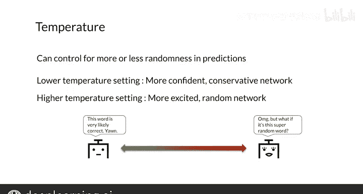

# 吴恩达《自然语言处理｜natural language processing》中英字幕 - P150：10_采样和解码.zh_en - GPT中英字幕课程资源 - BV1Hc5ezDEWQ

Hello， you will now learn about two ways that will allow you to construct the translated sentence。

 The first approach is known as greedy decoding， and the second approach is known as random sampling。

 And you will also see the pros and the cons of each method， for example。

 when choosing the word with the highest probability at every time step。

 that does not necessarily generate the best sequence。 So at that said。

 let's dive in and explore these two methods。By now。

 you will reach the final parts of this week's lectures。 That's awesome。

 I'll show you a few methods for sampling and decoding。

 as well as a discussion of an important hyperparmeter in sampling called temperature。😊，First。

 a quick reminder on how we seek to seek a model predicts words the output of the decoder is produced from a dense layer and a softmax or log softmax operation。

The outputs at each step then is a probability distribution over all the words and symbols in the target vocabulary。

 The final outputs of the model depends on how you choose the words using these probability distributions at each step。

Greedy decoding is the simplest way to decode the model's predictions as it selects the most probable word as every step。

However， this approach has limitations when you consider the highest probability for each prediction and concatenates all predicts a tokens for the output sequence。

 as the greedy decoder does， you can end up with a situation where the outputs instead of I am hungry。

 gives you I am， M， M， M and so forth。You can see how this could be a problem， but not in all cases。

 for shorter sequences， it can be fine。But if you have many other words to consider。

 then knowing what's coming up next might help you better predict the next sequence。

Another option is known as random sampling。 What random sampling does is it provides probabilities for each word and sample accordingly for the next outputs。

One of the problems with this is that it could be a little bit too random。

A solution for this is to assign more way to the words with higher probabilities and less way to the others。

 You will see a method for doing this in just a few moments。In sampling。

 temperature is a parameter you can adjust to allow for more or less randomness in your predictions。

It's measured on a scale of 0 to1， indicating low to high randomness。

Let's say you need your model to make careful。Safe decisions about what to outputs。

Then set your parameter lower and get the prediction equivalent of a very confident。

 but rather boring person seated next to you at a dinner table。

If you feel like taking more of a gamble， set your temperature a bit higher。

This has the effect of making your network more excited。And you may get some pretty fun predictions。

On the other hand， there will be probably a lot more mistakes。

You have seen in this video methods for sampling and decoding that will allow you to construct sentences using your model。

 however， these methods don't always produce the most convincing outputs Instead you will often get a very random sets of words In the next videos you will see two methods for sampling and decoding that tend to produce better results。

