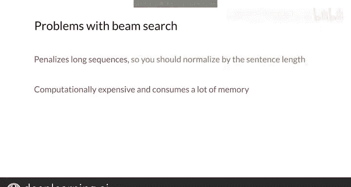

# 吴恩达《自然语言处理｜natural language processing》中英字幕 - P151：11_束搜索.zh_en - GPT中英字幕课程资源 - BV1Hc5ezDEWQ

Beam search is a technique that allows you to find the best sequences over a fixed window size known as the beam width。

Since taking the outputs with the highest probability at each time step is not ideal。

 I will show you how to use beamm search instead。So far。

 the methods I've presented only consider word probabilities one at a time。

These ways of sampling might not result in the highest probability sequences。

 and the sentences produced using these methods could not make sense。

 The overall most probable translation， given an input sentence is not necessarily the most probable word at each step。

For example， it's possible that choosing the most probable word at the start of the sequence could lead to a worse translation compared to choosing another word。

If you had infinite computational power， you could calculate the probabilities of every possible output sentence and choose the best one。

In the real world， we use beam search。This method attempts to find the most likely out sentence by choosing some number of best sequences based on conditional probabilities at each time step。

Now at each time step with beam search， you have to calculate the probability of potential sequences given the output of the previous time step。

To avoid computing the probability for every possible sequence。

 you have parameter beam called the beam width。At each step。

 you only keep the B most probable sequences and drop all others。

You generate a new word until all be most probable sentences end with the US token。

 So Bea search consumes a lot of memory。And could be computationally costly。

 depending on your choice for being。As an interesting side note。

Greedy decoding is just a particular case of beam search where you set the beam width be to be equal to one。

To illustrate this method， consider a small vocabulary consisting of the words I am hungry and an end of sentence to。

And let's say the B minus B is equal to2。As with the other methods。

 beamm search starts with a start of sentence token and gets the probabilities for the first word in the sequence here I has a probability of 0。

5。M has a probability of 0。4， and Hung has a probability of 0。1。And an EOS is at 0。

Since the beam width is soon， you keep the two highest probabilities， I and M。Then。

You calculate the conditional probability of all other words。

 given the two sequences that you have kept so far， I and M。Given the word I。

 the model returns M with a probability of 0。5。And Hungary with 0。3。Given the word M。

 the model returns the probability of word I with probability of 0。7。

And Hungary with a probability of 0。2。These are the two conditional probabilities。

 given the two previous sequences of P of word 2， given word 1。Next。

 you calculate the probability by multiplying the conditional probability for2。

 given the word I with the probability of word I。For instance， if the sequence of。

II has a probability of 0。5 times 0。1。 This is equal to 0。05。

The sequence I am has a probability of 0。5 times 0。5， which is equal to 0。25。

You have to do the same with the sequences starting with the word M。Here the sequence。

 MI has a probability of 0。4 times 0。7， which is equal to 0。28。At this point。

 there are eight possible sequences， but with the beam width be equal to 2。

 you only keep the two sequences with the highest probabilities。

So you keep the sequence I am and am I and drop all others。Then for the next step。

 you use M as the inputs were to get the conditional probabilities for the I am sequence and I for the MI sequence。

Eop repeat the process to calculate the joints probabilities and again choose the best sequence。

This process stops when the model predicts an end of sentence token for all B most probable sequences。

At the end， the sequence with the largest probability is chosen as the outputs。

To get the conditional probabilities at each step， you have to use your model for now。

 let's focus on the decoder parts of the model， ignoring the encoder and attention mechanism。

At the start of the sequence。You will use your decoder to outputs a vector of probabilities for each of the words and the vocabulary。

This is equivalent to computing the conditional probability of every word given the starts of sequence token。

 Then you select the most probable B outputs from the model and discard all other possibilities。

After that， you use your model B times to find the conditional probabilities of all the words in the vocabulary。

 given the sequences that you kept in the previous step。

Then you compute the sequence probability and keep the B most probable sequences。

And you keep doing this until the B most probable sequences gets to the end of the sequence token。

Note that at each step after the one where your sequence is only composed by the SoOS token。

 you have to run your model B times。The vanilla version of beam searcharch has some disadvantages。

 for instance， it penalizes the choice of longwar sequences because the probability of a sequence is computed as the product of multiple conditional probabilities。

However， you could normalize the probability of each sequence by its number of words to avoid this problem。

Beam search also requires you to store the B most probable sequences and computes conditional probabilities。

 given all of those sequences。Therefore， this method could be computationally expensive and consumes a lot of memory。

You have a new tool that you can add to your toolkit。

 beamm search has been widely used for quite a period of time and is still used a lot。

 In the next video， I will show you another technique that you can use known as MR or minimum based risk。

