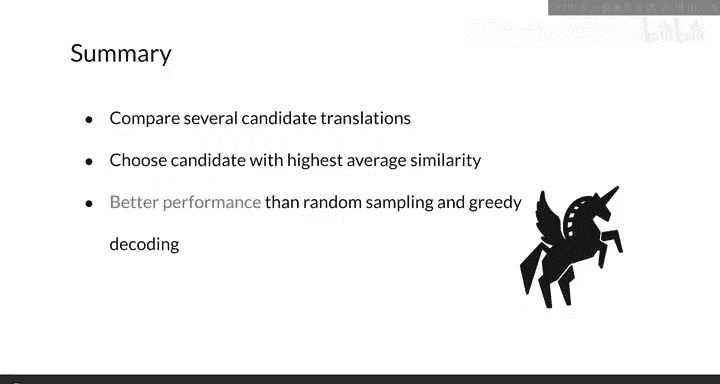

# 吴恩达《自然语言处理｜natural language processing》中英字幕 - P152：12_最小贝叶斯风险.zh_en - GPT中英字幕课程资源 - BV1Hc5ezDEWQ

This is the last technique I will show you to evaluate your NT systems it is very simple and works surprisingly well when compared to the other techniques。

 let's get started。

Earlier， you encountered random sampling to choose a probable token and the issues with that decoding method。

But if you go a little further with that， say by generating 30 samples and comparing them all against one another。

 youll see quite a bit of improvement in your decoding。

You will have to compare multiple candidate translations for the minimum base risk decoding method。

 MR for shorts。Implementing NR is pretty straightforward。 begin by generating several random samples。

Then compare each sample against each other using a similarity score or a loss function。

 Rouge would be a good choice that you may recall from a bit earlier。Finally。

 choose the sample with the highest average similarity or the lowest loss。😊。

The translation that you get using this method is the closest to all candidate translations。

 This process can be viewed， as some author suggests。

 as finding a consensus between all candidate translations。

If you decide to use Ru score as a similarity metric for comparing every pair of candidate translations。

 you would have MR summarized in the formula presented here。

Your goal is to find the candidate translation E。That maximizes the average rule score。

With every other candidate E prime。 So NPR is relatively easy to implement。

 You need to have multiple candidate translations and select a way to compare them。

 But for the sake of clarity， let's go through an implementation process in more detail。

Here are the steps for implementing NR with Rouge on a small sets of four candidate translations。

First， calculate the rule score between the first C。Subscript 1 and the second， C。

 subscribe to Canada translations。For the first and third and for the first and fourth。

Then compute the average R subscript1 using those three rules scores。

 Then European repeat this process for the other three candidates in your set to average rules scores for each one of them。

Finally， you select the candidate with the highest average rule score。 and that's it for MR。

 You'll be implementing this method in the assignment， along with a greedy decoder。In summary。

 MR takes several translation candidates and compares them against each other。

 then chooses the one with the highest average similarity。As the beam search case。

 this method can give you a more contextually accurate translation than random sampling and greedy decoding。

 Congratulations on finishing this week。 you now know how to implement a neural machine Trans system。

 and you also know how to evaluate it。 Next week， I'll talk about one of the states of the arts models known as the transformer。

 which also makes use of an encodeder decoder architecture。

