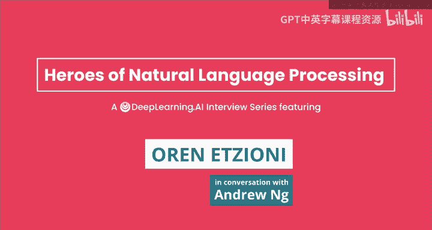
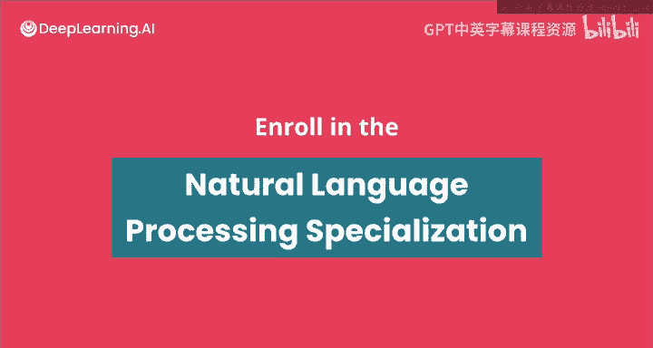

# 吴恩达《自然语言处理｜natural language processing》中英字幕 - P154：14_Andrew Ng与Oren Etzioni.zh_en - GPT中英字幕课程资源 - BV1Hc5ezDEWQ

Hi everyone， I'm delighted to have with us here today Orin Eziioni who is one of the best known figures in NLP。

 he is the CEO of the Allen Institute for Artific intelligencetelligence since his inception in 2014。

 he is also a professor at the University of Washington's Comp Science Department and the Adv of Hoor at Madronna Advure Group。

Orin has received multiple awards including Seattle's geek of the Year which I thought was cool as well as been a founder or co-founder of several companies really glad to have you with us Oren thank you Andrew it's a pleasure so I've known you for many years and even when I was a student at Comgie Melvin。

 I remember hearing about some of your work on explanation based learning from Tom Mitchell so some of you I've never really ask you before is today you're a well-known researcher but how did you get started in AI tell us about your personal story Well I really became fascinated with the field in high school when I read the book Girle Esher Bach which many of us read at some point by Douglas Hofteter more than anything with the book gave me an appreciation for is that asking what is the nature of intelligence。

 how do we build an intelligence machine has humanlike capabilities？

Really one of the most fundamental questions in all of science like what is the origin of the universe or what is the basis of matter and so I became fascinated with it at the age of 18 or so and so what happened you're 18 year old reading Gerdo Echevak。

 I remember my father trying to pushed that book on me as well when I was a teenager but I think unlike you。

 I did not read it as a teenager but then what？Well， I did two things。

 one is the summer before college I started studying LspP。

 the Lsp processing ancient programming language which of course gave some ideas into Java and Python and I found it just endlessly fun to hack Lisp code and then when I went to college I went to Harvard I was intent on studying computer science because that seemed like the path towards AI。

 I think it' inspiring to think that maybe today's a high school student somewhere or maybe the parents of a teenager reading this thinking that if their son adults is reading Gerdo Ehaba would become an interest in AI as a teenager。

 maybe they could someday have a career a bit like yours。

 it is how active follow that I think is something to think about。Well Andrew you're very generous。

 the other thing that's happened which of course is drawing a lot of people into the field in which I had no clue about is the fact that our explorations of these algorithms and these methods have led to a very powerful set of technologies which of course you've been very intimately involved in so deep learning right which is now revolutionizing the field in so many ways was not something we anticipated back then and we didn't understand that asking this fundamental intellectual question could lead to so much。

Commercial success as well Yeah I found that a lot of the great scientists were driven by fundamental questions and it sounds like yours was what is the nature of intelligence and that type of question is enough to drive someone for an entire career。

Yeah I remember also you know back in the early days you were one of the pioneers in what was called open information extraction from the web tell me more about what that was like working on information extraction back then Sure so information extraction basically means the mapping from a sentence to a more structured piece of information like we have the sentence Google acquired YouTube and we could map it to a database tufold that says acquisition Google YouTube now that when I got into the field of information extraction was very narrowly focused they would look at M&A events or they would look at terrorist events and they would try to extract the particular semantics around specific events and it occurred to me that maybe we can do it in a much more openended way one of our。

Was no sentence left behind the idea that maybe we could extract information from any sentence on the web and thereby map the huge amount of information that's available in the web corpus。

 literally billions of sentences maybe we could map it to a very powerful and comprehensive knowledge base and so we set off on doing that and the first thing we had to do was vastly generalized the techniques because the information extraction back then was still a machine learning technique。

 but it required training examples specific to a particular relation or predicate like acquisition or seminar location and there are so many in fact that's one of the things we studied there's potentially hundreds of thousands if not more different prediicates that are being expressed in a natural language like English or Chinese and so that would require millions and millions of。

Label training examples and so we attempted to solve that problem by creating a new technique which had much more of an unsupervised flavor so rather than recognizing that they were acquired it' one of the words or peicates that indicates an acquisition there are lots of ways to say ex quiet why and to learn that from data was was a huge breakthrough with thanks thanks for remembering right field the field moves forward so quickly。

 one of the things that I found particularly inspiring at the time was the fact that we realized that there were certain linguistic invariance。

 certain regularities where whatever the sentence was and whatever the topic was。

 there were certain regular ways in which people would express information activities and so on for example。

 the simplest as verbs whether it's acquired or graduated or married。

 often the verbs were a very strong。dicationOf the predian involved and the arguments of the verb。

 So， you know， Joe married Betty。 Okay， so now we know a lot about what's going on here。

 So basically， what we were able to do。 And I consider this a。

Pretty fundamental piece of observation about natural language is we were able to realize that sentences express relationships in certain stereotyped ways。

 and since we did that work in the 90s， the result has actually been replicated in lots of different languages。

 Spanish and Arabic and Korean in many languages they' found that these kind of regular ways of expressing relationships are available that if something happened the number of ways to refer to acquisition or graduationation or marriage is' quite narrow。

 so there's a very strong signal for the learning algorithm。Exactly。

And I guess both you personally and a few of NLP has come a long ways towards in and today I regularly read about exciting projects that the Allen Institute for AI is doing So one of the projects that I've heard you speak about in another context I thought was really cool was the semantic scholarolar project can you say it about that I would love to so our mission as an institute that's a nonprofit fully funded by the late Paul Allen is AI for the common good and we asked ourselves how do we use AI broadly and NLP in particular to make the world a better place and one of the things that came up on our radar was can we use it to help scientists and more generally the informed public get access to scientific papers so there's a kind of Moore's law of scientific publication right the number of papers。

Seems to be growing。Every few seems to be doubling every few years and of course growing very rapidly and even diligent folks like yourself can't have read everything that they want to read。

 in fact I think there's a kind of limit on the number of papers we're going to read in our lifetime so I thought to myself okay AI to the rescue I remember when the ICML conference or the you New Europe at that time previous in conference is small enough that I would bring home the paper proceedings and certainly every single papers is title an abstract and a good fraction of the papers and clearly we well-pa that phase of AI today so so it's great to have tools like semantic scholar exactly and semantic scholars Bo is cut through the clutter so our idea is to use AI and lots of different ways to find the papers that you want to read for example。

 we automatically generate what we call。Stream summaries or simply put TLDRs。

 So instead of having to read all those abstracts， maybe we can give you a one line summary that and if you like that。

 you might delve further into it or we use computer vision techniques to automatically extract the figures that seems may seem straightforward to a person。

 but remember these are PDF files which were set up to display information not necessarily to give you the locationation of the semantics of where figures and tables are so we automatically extract information that again will hopefully tell you at a glance。

 maybe even on a know mobile device like this one is this a paper that I want to read and so if I can save you。

The time scouring through the papers to find the ones you want to read that's a savings and even when you're reading them we're continuing to look into ways to make that process more efficient so someone watching this video is feeling the glut really the wonderful glut of deep learning or NOP papers。

Would you recommend this to very much so it's a free service it's at semanticschoollar。

org so I don't profit from it and we love people to use it we think has a lot of powerful features that would help both expert research but also people getting started to get a sense of the field to find the key authors the key papers etc ce one you think this's the story that everyone was seeing is that with the rise of COVD-19 societal tragedy many researchers is starting to publish more and more papers on this horrible virus and semantic scholar was involved in helping so tell this maybe fortunately or unfortunately rapidly growing literature so what was the story behind that so it's actually quite a dramatic stories so early in March 2020 when news was awareness was still growing about the virus the White House through a colleague reached out to us。

Because they know knew we had tools for rapidly processing collections of papers and they asked us to put together the collection of all the relevant papers。

 both published and preprints at the time and make it available to AI systems。

 make it available in a machine readable form so that NLP systems information retrieval search engines and others could make use of it。

 and we were quickly with some help the White House has helped able to form a coalition that included Chan Zuckerberg and Microsoft and colleagues from Georgetown publishers and more and to create a collection that's now more than 200。

000 papers and it's being updated daily that attempts to capture exactly as you said。

 this rapidly growing literature about the virus and then be able to answer questions about it much more rapidly than ever before so Caagle was involved creating a set of competitions that became their most。

most popular competitions and a lot of clinical questions and discoveries have been made using obviously the literature but access through our open data set which was calledCd 19 for COVID open research data set so again。

 thank you for bringing that up it's a great example of how semantic scholar and AI in general is trying to help to make the world a better place in the batchsh we were covering some of this work several times so actually。

Really excited to see your team doing this。 And really thank you for helping fight Covid 19 for all of us。

 Of course， So， Oren， you've been a successful serial entrepreneur and you are at the cutting edge of NLP technologies。

 What advice or。😊，Guidance recommendations would you give to someone that's looking to work on or to launch a startup in NLP。

Well， one thing that I think about based on my background launching AIbased companies is where is your data going to come from。

 so what I like to call the dirty little secret of big data isn't just that you need lots of data but often that you need lots of labels。

 you need some way of taking a data item， let's say credit card fraud and saying this credit card transaction is fraudulent。

 this credit card transaction is valid， and often people have great ideas for companies or for products。

 but they haven't thought through where is my data going to come from and how is it going to get labeled so I always like to ask people there's a series of questions to ask but one relatively unusual one is tell me about your data set。

 wheres your data going to come from where are your labels going to come from and that intuition came。

From probably my most successful company Faircast， which was a company that predicted airfare prices。

 their fluctuations over time， ultimately was sold to Microsoft and there what was really cool is we at the peak we had a trillion。

Label data points。 So you might ask， and this is， again， a company that。

We formed in 2003 it was acquired in 2008 so back then a trillion data point was really quite a lot so how do you get a trillion labels mechanical Turk didn't even exist back then and that's a lot of labels well it turned out because it's temporal sequential data about prices if you predict say on December 1s 2003 that the price of a particular flight will go up in a week all you have to do is wait a week and see whether your prediction came true or not so just the passage of time automatically labels your data and that observation turned out to be incredibly powerful it allowed us to label a trillion data points and with a trillion data points we were able to generate some very strong predictions it's very cool and I guess because the number of labels you have automatically generated grows quadraically in time right because at this moment you can predict a lot of future moments so shouldn。

It's a big number of but especially a entire series。

 but it makes sense you could collect this giant data sale automatically That's exactly right another thing that I really find fascinating is there's actually a connection between this and some of the success that we're seeing in NLP because even now the mechanicalrk exists the number of words or sentences and so on we can label is nowhere near enough compared to the appetite of models like our Elmo or Bt or Roberta。

 the succession of most recently G3 the succession of language models but again what they use is the inherent sequential nature of language they effectively to grossly oversimplify they're saying I'm going to predict the probability that the next word is forest or the next word is is Well how do you tell whether that prediction was correct or not？

All you have to do is look at the next word right you mask out and of course it doesn't always have to be literally the next word。

 but basically you take a sentence， you mask out some words in the sentence。

 you predict them whether these what these will be and you check your prediction so the wild thing about a natural language corpus is in a certain very similar sense it's also self-labeling so these models that we're now using with with great success and have become so enamored with have that property where the data can label itself。

Some of the most exciting material in the NLP specialization is Uniunice and Lucas talking about techniques like word embeddings or language models or transform models taking advantage of this effect。

 there's been a huge burden to the whole few of NLP and on the theme of building these giant data sets you had a trillion examples which is really huge back in the day even today。

 trillion is really large and we do see this sequence of success stories in NLP where researchers are building bigger and bigger models。

 transformable models these days or flavors of it and feeding to it bigger and bigger data sets what's your prediction on the future of this trend ever bigger and bigger and bigger and that's a store of NLP or trend towards smaller models at some point as well or plateauing or something else Well let me first start by acknowledging which I think is important how wrong I've been so I predicted that the growth and model。

Size in a number of parameters in the commensurment amount of data would already have plateaued and I've definitely been wrong about that we see that with the continued increase in performance so take predictions from anybody especially be with a grain of salt that said I do think that they will continue to grow because there is that hunger for performance and we haven't by any means exhausted the power of the machine or the size of the corra so I think they will continue to grow until we see a very significant plateau I think at the same time it's also very natural for any computer science field to first build the largest possible model to kind of brute force it and then go back and optimize it in various ways both in terms of data efficiency data selection strategies and in terms computationally so I think we'll see both。

And you know a great example of that this is an analogy but it's still I think it gives the right intuition。

 we started with chess and it was only like specialized chips and supercomputers could do it now we have stronger chess playing programs on a laptop So it's gotten cheaper and simpler。

 not just because of Moore's law also because better algorithms and at the same time we've also scaled up to larger games。

 let's say like like go I feel like today there are definitely research is aspiring research that is wondering boy if I don't have a million dollars I GPP how could I possibly do research in this view and I feel like on one hand hopefully I think there lots of opportunities to do exciting work on smaller data sets lots of groundbreaking research to be done there and also the history of computing has shown us that yesterday's supercomputer mainframe is today's smartphone or today's smartwach and so we'll see if this trend。

It to hold up， but I would love if some of these most amazing giant millions of dollars types of models that you read about in the news。

Don't know someday we'll all be their ved on all smart smart watchtches。

 but that would be an exciting future if we can get there。 Yes。

 and we've actually done some work at the Allen Institute for AI or AI too as we call ourselves on a topic we call green AI where we say。

Exactly because of the point you made Andrew that these massive models result in a large number of people being shut out of the creation of these models if we ask people to also publish results taking cost into account taking efficiency into account so if I can spend$4 million。

 $12 million and build the largest model， that's what one kind of research but what's the best model I can build for $1000 what's the best model I can build if I only have I don't know10 training examples it seems like there are a lot of questions like that where if you factor in efficiency I might say look my model isn't as good as big Brothers trillion parameter model but it only costs $1000 to train it only costs $100 dollars to train it's trainable on a laptop in fact we've been talking about something we call。

P in a box what are the best NLP capabilities you can derive from simply a laptop or simply on a phone and there are many situations where that's really the question let's just take a phone as an example I keep flashing this is as a prop for privacy reasons I may want to keep the data resident on the phone or I may have intermittent internet connectivity and so I can't just always upload things to the cloud so now I suddenly need to think about models whether they're natural language models or vision models that are optimized to run on a limited device without exhausting the battery that's a really key point and so that leads to an array of research that many more people can participate in and today many NLP teams create a model and then have to re-engineering orll compress it or something right to make it。

run on a mobile phone and people often don't think of even just a download size needed if you have a very large downloadable for mobile app users are actually less likely to be willing to depending on the country and cost of bandwidth in the country to the download and install that and of course the rise of age computing lot of exciting work on getting these things at work at age devices as well you have familiar years had a foot in both the academic world and in the industrial world as a professor also a CEO of a nonprofit and a event of hardware today。

 a lot of people are asking how do you choose between the academic and the industry pathway in AI what advice do you have for someone trying to build a career and looking at academia and in industry Well let me answer it in geeky terminology that will hopefully be very familiar to the。

Folks taking this specialization， to me， it's a question of what you're trying to optimize。

So if you're trying to optimize compensation， how much money you make or even adrenaline right what's kind of the most exciting but an exciting in the way that a car race is exciting or a poker game is exciting then the world of startups the private sector naturally beckons if on the other hand you're trying to maximize freedom the ability to ask your own questions。

 the ability to sit back and contemplate and really think really deeply uninterrupted about fundamental intellectual questions and the questions that you want to ask not somebody else。

 well then there's no substitute for academia so to me。

I'm old enough that at different points of my career， which has spent some decades。

 I've focused on different things。One of the biggest academic highlights for me was graduate school at CMU where I worked with Tom Mitchell and I could spend months just delving into one particular question right I finished my coursework I could just go deep deep as deep as I could in answering a question and in other times when you know did a startup right just that feeling of putting a team together and working so hard to succeed and that kind of rollercoer ride of this thing that we built with sweatbl and tears and we own and we're gonna make it a success that was also an incredible feeling but very different so sometimes like an academia to playing bridge and startups the commercial sector to playing poker both are fun but they sort of tickle different neurons at least in my brain from that description I gather you are both a bridge player and a poker player。

At various points in my career now I'm actually yeah， I more I play a lot of bughouse。

 the chess partner chess and yeah when I was in high school， I played chess。

 I was actually you know captain of my high school's chess club and then after Gary Kosrovrov lost to computer I gave up playing chess。

 but this sounds like fun I should check it out。Well， we should play sometime。

 One of the things I've seen you do is。Engage with regulators and help think through what are appropriate AI regulations What are your thoughts about regulating AI or to take an example close to the NLP we've seen that really unfortunately language models and other NLP systems trained on natural language trained on text on the internet learns to exhibit some of the very undesirable biases that is exhibited by text on the internet So what is the role of I think as AI technologiesnologists will do our best to diminish and squash that in our systems or what do you think is the role of regulators in this frankly。

 really ny NLP problem where we have wonderfully performance systems but very problematic。

Aspects of bias because of the data they learn from。

 how do you think regulators should think about that？Wow。

 I do think that's the toughest question you've asked me。 Andrew， I would be very careful。😊。

So so so what should the role of regulation be for natural language processing I would be very careful to avoid legislating our values into the technology and I would really allow a thousand flowers to bloom and what I would look at a lot more closely is specific applications so NLP is a broad technology and that technology as you pointed out is prone to bias but it's how this bias manifests in particular applications that's what needs to be regulated let me give a concrete example if we build。

A resume scanning application and that exhibits bias in favor of men right over women Obviously that's highly problematic。

 we don't want to have that bias it's illegal。 So in that context we should block that we should audit those sorts of applications and disallow bias to appear there but what I would really not want to do is regulate basic research into NLP based on these ideas。

 so I think that's really the most important point， regulate the applications， not the research。

Yeah and I would love for regulators and technologists to together try to figure out what is the fair standard to hold these systems to and then rigorously audit the systems such as a resume screener to a well articulateulated standard and then hold the AI teams accountable from reaching that standard and if we do that hopefully we can also avoid Gochas where an AI team goes along and then many years later you know' there's a surprising maybe even fair but surprising criteria that if only we had all realized we should judge the AI system on this criteria we could have avoided the problem in the first place so it is tricky I'm glad that。

Communities working on this Yeah， I want to just highlight at least one more point there and again。

 there's so much to say on this topic， but I think the word audit that you mentioned there is really a key one because for example in the European Union they've started thinking about the right to an explanation so they say hey if I have a model then the model has to be able to tell me why it came up with its conclusion and the problem with that is you and I know very well that deep learning models that are based on very large number of variables a lot of parameters。

 a lot of data may really struggle to provide an explanation that anyone can understand so if that regulation is created what we will end up with is explanations that are either incomprehensible and thus useless or inaccurate right they're clear but they're actually not correct。

 they're not high fidelity explanations and then they're not useless。They're misleading。

 which is perhaps even worse another option which is encapsulating what you said is to say no I'm not going to insist on explanations。

 but I'm going to insist on the right to audit so if you create a model a regulatory agency or a third party like the ACLU or like an academic should have access to it to audit its behavior and to check whether it's exhibiting bias and now we can rely on the marketplace of ideas and the interaction between different bodies with different incentives like journalist nonprofits and so on to check on each other and I think that sort of situation is a much more robust and interesting one the vision of transparency and auditing I think hopefully will shift society to more fairness so just one final thing what else on which is youve mentor a lot of students a lot of engineers earlier in the career。

 youve helped a lot of people。I'm really good at NLP over your career。

What advice do you have to someone watching this video today that wants to break into NLP or grow the career in NLP？

Well， I would say at the early stages make sure you've got the fundamentals right so we're talking about statistics。

 computer science understanding of machine learning I think that's essential because again the flavor of the month which the flavor of the year as transformers as you said that changes very rapidly so you want to make sure you've got the fundamentals right then the second step is I do think that we've seen online courses to be extremely successful。

 extremely cost efficientic and widely accessible so that's the next place I would go to and of course our conversation is part of an NLP specialization I haven't studied it in depth but I'm sure knowing you Andrew I'm sure it is very high quality Thank you and after that after someone's done you studied online what's after that。

There is no substitute for doing it yourself， so you only understand something at a certain level if you've done it at the course level。

 you've got to take a real problem， take a data set and do it yourself So find out how it works or doesn't work and you could be surprise you could find that the problem that you're excited about is easier than you expected and you can do really well or you'll find maybe I didn't understand that concept so well or maybe this problem is harder than it seems。

 and that might lead you to a new invention or a new idea so there's also no substitute for practice That。

 thank you and I hope that maybe many of our learners I hope will follow your advice and end up someday becoming great NLP such as a scientists or engineers and build amazing systems。

So that was inspiring， so thank you thank you very much， Warrenen。

 it was really great having you and thank you again for joining this interview series。😊，Well。

 it's a real pleasure， Andin and thank you for all that you're doing to be a champion of the field in general and to bring this information and these ideas to so many more people right we need that if we're going to make the kind of progress that we should be making to use AI to make the world a better place so yeah thank you Aen。

For more interviews with NLP Though leaders， check out the Deeplearning。

AI YouTube channel or enroll in the NLP specialization on Coursera。

