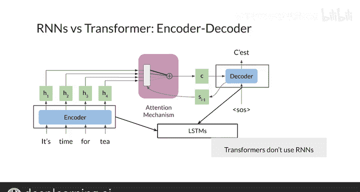

# 吴恩达《自然语言处理｜natural language processing》中英字幕 - P156：16_Transformer与RNN的比较.zh_en - GPT中英字幕课程资源 - BV1Hc5ezDEWQ

Welcome， this week， I'll teach you about the transformer model。

 It's a purely attention based model that was developed as Google to remedy some problems with RnN。

 First， let me tell you what these problems are so you understand why the transformer model is needed。

 Let's dive in。 First， I will talk about some problems related to current neural networks using some familiar architectures。

 After that， I'll show you why pure attention models help us solve those issues。😊。

In neural machine translation， you use a neural architecture to translate from one language to another in this example。

 from English to French。Using an RNN， you have to take sequential steps to encode your inputs。

 You start from the beginning of your inputs， making computations at every step until you reach the end。

At that point， you decode the information following a similar sequential procedure。

As you can see here， you have to go through every word in your inputs。

 starting for with the first word， followed by the second word。

 one after another in a sequential matter in order to start the translation that is done in a sequential way。

 too。 For that reason， there is not much room for parallel computations here。

The more words you have in the input sentence， the more time it will take to process that sentence。

 a more general sequence to sequence architecture。In this case。

 to propagate information from your first word to the last output。

 you have to go through capital T sequential steps where capital T is an integer that stands for the number of time steps that your model will go through to process the input of one example sentence。

If， for instance， you are inputting a sentence that consists of five words。

 then the model will take five time steps to encode that sentence。 And in this example。

 T equals to 5。And as you may recall from earlier in this specialization， with large sequences。

 the information tends to get lost within the network。

And vanish ingredients problems arise related to the length of your input sequences。

LSTMs and GRUs help a little with these problems， but even those architectures stop working well when they try to process very long sequences due to the information bottleneck。

As you saw in the last week of dis course。So to recap。

 we said we have a loss of information and then we have the vanished ingredients problem。Now。

 in the previous week。Including attention in your model is a way to tackle these problems。

You already saw and implemented a sequence to sequence architecture with attention similar to the one depicted here。

Recall that you relied on LSTMs for your encoder and decoder。

 but you could also have used DR use or just vanilla RNNs。In contrast。

 transformers rely only on attention mechanisms and don't require the use of recurrent networks。

In a transformer， attention is all you need。Well， some linear and nonlinear transformations are usually included。

 but you get the idea。 Now you understand why R andNs can be slow and can have big problems with contexts。

These are the cases where transformers can help。 Next。

 I'll show you a concrete overview of the transformers。 Let's go to the next video。

