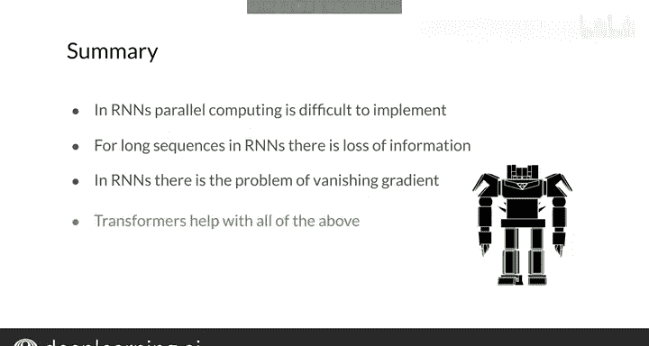

# 吴恩达《自然语言处理｜natural language processing》中英字幕 - P157：17_Transformer概述.zh_en - GPT中英字幕课程资源 - BV1Hc5ezDEWQ

There has been lots of hype transformers in this video。

 I'll give you an overview of the Transformers model The Transformer model was introduced in 2017 by researchers at Google。

 including Lucas Kaiser， who helped us develop this course。Since then。

 the transformer architecture has become the standard for large language models。

 including B T5 and GPPT3， which you'll learn about later。

It sounds an overstatement to say that transformers revolutionize the field of natural language processing。

I suggest that you read the first transformer paper。 Attention is all you need。

I's the basis for all the models presented in the rest of this course。

 You'll see how each part of the transformer model works in detail。 But first。

 I want to give you a brief overview of this architecture。 Now。

 don't worry if some of its components aren't clear。 I'll go more in depth on the following lectures。

 The transformer model uses scale do product attention。

 which you saw in the first week of this course。The first form of attention is very efficient in terms of computation and memory due to its consisting of just matrix multiplication operations。

This mechanism is the core of the model， and it allows the transformer to grow larger and more complex while being faster and using less memory than other comparable model architectures。

In the transformer model， you will use the multi head attention layer。 This layer runs in parallel。

And it has a number of scale thus product attention mechanisms and multiple linear transformations of the input。

 queryries keys and values。 In this layer， the linear transformations are learnable parameterss。

The transformer encoder starts with a multi head attention module thus perform self attention on the input sequence。

That is each word in the input attends to every other word in the input。

 This is followed by a residual connection and normalization。

 a fit forward layer and another residual connection and normalization。

This entire block is one encoder layer and is repeated in number of times。

Thanks to self attention layer， the encoder will give you a contextual representation of each one of your inputs。

The decoder is constructed similarly to the encodeder with multi headed attention modules。

 residual connections， and normalization。The first attention module is masked such that each position attends only two previous positions。

 its blocks leftward flowing information。The second attention module takes the encodeder output and allows the decoder to attend to all items。

This whole decoder layer is also repeated some number of times， one after another。

Transformers also incorporates a positional encoding stage。

 which encodes each input's position in the sequence。

This is necessary because transformers don't use recurrent neural networks。

 but the word order is relevant for any language。Positional encoding could be learned or fixed。

 just as word word embeddings。 For instance， let's suppose you want to translate from the French phrase over here。

 you have your sweetconton。And then you want to capture the sequential information。

The transformers uses a positional encoding to retain the position of the input sequence。

 The positional encoding has values that are added to the embeddings so that for every input word。

 you have information about its ordant position。In this case。

 a positional encoding vector for each word z， Sui and conton。Putting these parts together。

 here's the full model architecture。 briefly on the left， the input sentence is first embedded。

 and the position encodings are applied。This goes to the encoder。

 which consists of multiple layers of multi head attention modules。

On the right is the decoder which takes the output sentence， shifts it over one step to the right。

 and the outputs from the encodeder。The decoder output is turned into output probabilities using a linear layer with a softmax activation。

This architecture is easy to parallellyze compared to RNN models and as such。

 can be trained much more efficiently on multiple GPUs。

It can also scale up to learn multiple tasks on larger and larger data sets。

I went through this quickly， but don't worry， I'll go in depth on each part in later videos。

In summary， RNNs have some problems that come from their sequential structure with RNNs。

 It is hard to fully exploit the advantages of parallel computing。 and for long sequences。

 important information must get lost within the network and vanishing gradient problems arise。

But fortunately， recent research has found ways to solve for the shortcomings of iron by using transformers。

Transformers are a great alternative to R N Ns thats help overcome these problems in N LP。

 And in many fields， thats process sequential data。

 You now can see why everyone is talking about transformers。 They are indeed very useful。

 In the next video。 I'll talk about some of the applications of transformers。😊。

