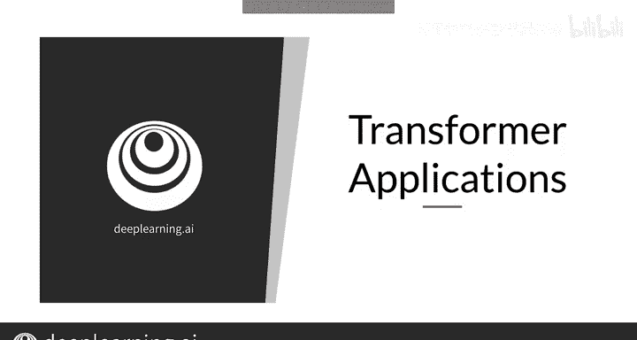
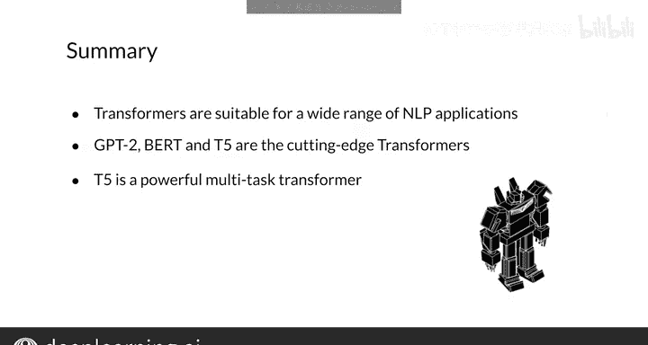

# 吴恩达《自然语言处理｜natural language processing》中英字幕 - P158：18_Transformer应用.zh_en - GPT中英字幕课程资源 - BV1Hc5ezDEWQ

Transformer is one of the most versatile deep learning models。

 It is successfully applied to a number of tasks， both in NLP and beyond Let me show you a few examples。

In this video， you will see a brief overview of the diverse transformer applications in NLP。 Also。

 youll learn about some powerful transformers。

First， I'll mention the most popular applications of transformers in NLP。

Then you'll learn what are the states of the art transformer models。

 including the so called T to text Trans Transer T5 in shorthand。Finally。

 you'll see how useful and versatile5 is。Since transformers can be generally applied to any sequential task。

 just like RNNs， it has been widely used throughout NLP。

One very interesting and popular application is automatic text summarization。

They are also used for auto completion， named entity recognition， automatic question answering。

 machine translation， another application is chatbots and many other NLP tasks like sentiment analysis and market intelligence。

 among others。Many variants of transformers are used in NLP， and as usual。

 researchers give their models their very own names。For example。GP2。

 which stands for generative pretraining for Transformer。

 is a transformer created by open AI with pretraining。

 It is so good at generating text that news magazines。

 the economist had the reporter asked the G2 model questions as if they were interviewing a person。

 and they published the interview at the end in 2019。Bert。

 which stands for bidirectional encoder representations from Transformers。

 and which was greeted by the Google AI language team。

 is another famous transformer used for learning text representations。T5。

 which stands for text to text Trans Transformer and was also created by Google is a multitask transformer that can do question answering among a lot of different tasks。

Let's dive a little bit deeper into the T5 model。A single T5 model can learn to do multiple different tasks。

 This is pretty significant advancement。For example。

 let's say you want to perform tasks such as translation， classification and question answering。

Normally， you would design and train one model to perform translation and then design and train a second model to perform classification。

 and then design and train a third model to perform question answering。But with transformers。

 you can train a single model that is able to perform all of these tasks， for instance。

 to tell the T5 model that you wanted to perform a certain task。

 you'll give the model an input string of text that includes both the task that you want it to do。

 as well as the data that you wanted to perform that task on。For example。

 if you want to translate the particular English sentence I am happy from English to French。

 you would use the input string， translates English into French。 Go on。 I am happy。

 and the model would be able to output the sentence。 This Ricanto， which is the translation。

 if I am happy in French。 This is an example of classification over here。

Where input sentences are classified into two classes acceptable when they make sense and unacceptable。

In this example， the input string starts with coa sentence。

 which the model understands is asking it to classify the sentence that follows this command as acceptable or unacceptable。

For instance， the sentence he bought fruits and is incomplete and then is classified as unacceptable。

 Meanwhile， if we give the T5 model this input call a sentence， he bought fruits and vegetables。

 The model classifies。 he bought fruits and vegetables as an acceptable sentence。

If we give the T5 model the input starting with the word question over here， followed by a colon。

 the model then knows that this is a question answering example。In this example。

 the question is which volcano in Tanzania is the highest mountain in Africa。

 and your T5 will output the answer to that question， which is Mount Kilimanjaro。

And remember that all of these tasks are done by the same model with no modification other than the input sentences。

 How cool is that。Even more， the T5 also performs tasks of regression and summarization。

Recall that a regression model is one that outputs a continuous numeric value。

Here you can see an example of regression， which outputs the similarity between two sentences。

The start of the input string， S TSB will indicate to the model that it should perform a similarity measurement between two sentences。

The two sentences are denoted by the words， sentence 1 and sentence 2。

The range of possible outputs for this model is any numerical value ranging from 0 to5。

 where0 indicates that the sentences are not similar at all。

 and5 indicates that the sentences are very similar。Let's consider this example。

When comparing the sentence1， cats and dogs are mammals。With sentence2。

 these are four known forces in nature， gravity， electromagnetic， weak and strong。

The resulting similarity level is0， indicating that the sentences are not similar。Now。

 let's consider this other example。 sentence1， cats and dogs are mammals in sentence 2。

 cats and dogs and cows are domesticated。In this case， the similarity level may be 2。6。

If you use a range between 0 and 5。Finally， here you can see an example of summarization。

It is a long story about all the events and details of an onslaught of severe weather in Mississippi。

Which is summarized just as six people hospitalized after a storm in Attla County。

This is a demo using T5 for trivia questions so that you can compete against a transformer。

What makes this demo interesting is that T 5 was trained in a closed book setting without access to any external knowledge。

So these are examples where I was playing against the trivia。Alright。

 so in this video you saw what are the transformers' applications in NLP。

 which range from translations to summarization。 Some of the state of the R transformformers include GT2 B and T5。

 and I also showed you how versatile powerful T5 is。

 as it can perform multiple tasks using text representations。

 Now you know why we need transformers and where it can be applied。

Isn't it astounding This one model can handle such a variety of tasks。

 I hope you are now eager to learn how transformers works。 And that's what I will show you next。

 Let's go to the next video。😊。