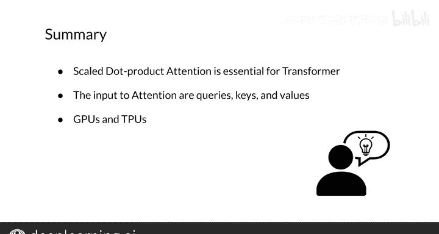

# 吴恩达《自然语言处理｜natural language processing》中英字幕 - P159：19_缩放点积注意力.zh_en - GPT中英字幕课程资源 - BV1Hc5ezDEWQ

The main operation in Transer is the scaled do product attention。

 You've already seen attention in the first week of this course In this video。

 I'll remind you how it works。 First， I'll remind you of the formula used for scale do product attention。

Then you will see some details about the math and the dimensions of the query's keys and values。

Recall that in scaledo product' attention， you have queries， keys and values。

The attention layer outputs contact vectors for each query。

 and the contact vectors are weighted sums of the values where the similarity between the queries and keys determines the weights assigned to each value。

The soft max ensures that the weights add up to one。

And the division by the square roots of the dimension of the key factors is used to improve performance。

The scale thus product attention mechanism is very efficient。

 since it relies only on matrix multiplications and its optmax。 Additionally。

 you could implement this attention mechanism to run on GPpUus or TpUus to speed up training。

To get the query key in value matrices， you must first transform the words in your sequences to word embeddings。

 Let's take the sentence。 just we E as the source for the queries。

Youll need to get the embedding vector for the word。Then for the word Sw。 And finally。

 for the word Eah。The query matrix will contain all of these embedding vectors as rows。

Note that the matrix size is given by the size of the word embeddings and the length of the sequence to get the key matrix。

 Let's use a source of the sentence。 I am happy。You'll get the embedding for each word in the sentence and stack them together to form the key matrix。

You will generally use the same vectors used for the key matrix for the value matrix。

 but you could also transform them first。Notes， however。

 that the number of vectors used to form the key in value matrix must be the same。

Now you can revisit the scaled attention formula that I showed you before to get a sense of the dimensions of the matrices involved at every time step。

First， you compute the matrix products between the query and the transpose of the key matrix。

You scale it by the inverse of the square of the dimension of the key vectors。

 d subK and calculate the Soax。This competition will give you a matrix with the weights for each keeper query。

Therefore， the weight matrix will have a total number of elements equal to the number of queries。

 same the number of keys。And that's matrix。The third element in the second row would correspond to the weights assigned to the third key for the second query。

After the computation of the weights matrix， you can multiply it with the value matrix to get a matrix that has rows and the context vector corresponding to each query。

And the number of columns on this matrix is equal to the size of the value vectors。

 which is often the same as the embedding size。Scaed thus product attention is the heart and soul of transformers。

 In general terms， this mechanism takes queries， keys and values as matrices of embeddings。

That is composed of just two matrix multiplications and a soft max function。Therefore。

 you could consider using GP Pus and GP Pus to speed up the training of models that rely on this mechanism。

 Now， you understand that product attention very well。 In the transformer decoder。

 we need an extended version called the self mask attention。

 I'll teach you about it in the next video。

