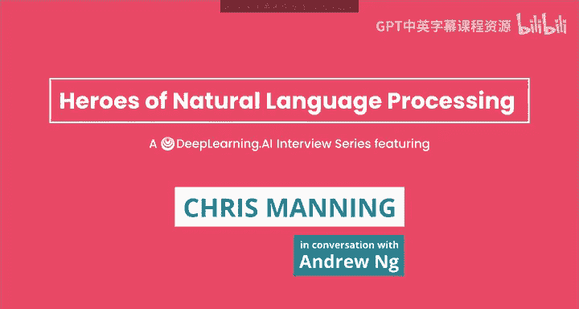
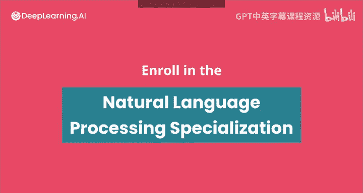

# 吴恩达《自然语言处理｜natural language processing》中英字幕 - P15：14_Andrew Ng与Chris Manning.zh_en - GPT中英字幕课程资源 - BV1Hc5ezDEWQ

Welcome to this interview series to kick it off， I'm delighted to half of us today， Chris Manning。

Tus， I believe the most highly cited NOP researcher in the world。

 he is a professor of computer science and linguistics at Stanford University。

 he's also the director of the Stanford AI Lab， which is role that I had previously held as well。

Chrisris is well known globally as a leader in applying deep learning to natural language processing and has done well known research on tree recursive neural networks。

 sentiment analysis， neural network dependency po， the glove algorithm， and a lot more。

He's taught at Connie Mellon， the University of Sydney and at Stanley University， welcome Chris。

Thank you， Andrews。 Great to have a chance to chat。

 Even though you and I Chris have had the opportunity to work together on many occasions。

 one thing I've actually never asked you before is how did you get started working in AI。

 I know that one of the unusual aspects of your background is that you major in linguistics。

 And then wound up being a computer science professor doing an LP， But tell tell us about your apprc。

 getting started in AI。😊，Sure so my background in some sense isn't as an AI person that's not really where I began so as an undergrad I have a major in computer science and math but I also got very interested in linguistics and did a major and honors and linguistics so coming off of that to a fair extent my startingoff point was a much more cognitive science viewpoint of human language seemed fascinating these teeny little human beings somehow managed to learn it at a time where you know in general their cognitive abilities don't seem that great and how could human language learning take place and so in linguistics by far dominant belief in sort of the second half of the 20th century was the thinking of known。

😊，Chmsky that known Chomsky was just the eminent person in linguistics in the same way that I guess for the first half of the 20th century。

 maybe RA Fiishcher was the dominant person in statistics and Chomsky has had this very strong position that humans。

😊，Cannot possibly just be learning languages from data alone and that there must be innate machinery in people's brains that allow them to learn languages that's a very that's a big topic even you know back then it seemed to me kind of just unbelievable given this。

 you know， evolutionary extremely recent development of human language So I was interested in the idea of how could you go about learning languages And that led me to start to look at machine learning。

 you know， starting off first at the end of my undergrad。

 which was the late 1980s and you know these days machine learning is such a big and dominant field you know。

 it's so big and dominant that the terms artificial intelligence and machine learning a kind of twotds。

 the same thing because the vast majority of。😊，What you see in AI is machine learning but at that time it just wasn't like that at all right that machine learning was this sort of very scruffy on the side offshoot of AI that almost no one worked in so you know there was sort of the series of two or three books by Heime edited by Heime Carbonll and Tom Mitchell from CMU who had started sort of put together some papers on the machine learning and the early decision tree algorithms。

 this fly still in Australia so the early decision tree algorithms in AI。

 the ID3 algorithm that you know had seen decision tree learning that you know machine learning barely existed but I was sort of interested in these ideas of how you could go about getting computers to learn and that was sort of the entree that led me down the。

😊，Thats turned me to an AI researcher and it was a big deal， right。

 it was maybe not intuitive at the time that you should use data to learn from language rather than code out by hand a。

 you know CFG grammar or something to truly understand the language。

 which is what people were trying to do back then。Right， yeah。

 so the dominant way in which people did natural language processing was。By humans， I mean。

 of course that wasn't only a fact about NLP， that kind of corresponded to the dominant thinking and AI at that time as well。

 this was the era of knowledgebased systems where what was seen as what we needed was to get subject matter experts for which knowledge engineers would encode their knowledge in knowledge representation systems and that all of this he engineering would lead us to intelligence。

😊，So even back then， you're an early believer in machine learning for NLP。

Absolutely right at the moment transformer based architectures have really been become the dominant thing in neural networks and we're sort of going out of order here。

 so maybe we should get back to them later， but I mean the interesting thing about transformer architectures is that they're built around an idea of attention and you can think of attention as。

😊，Giving you sort of a soft tree structure where you can sort of point it from one word to another and that allows you to build a tree structure so we've done some really interesting work especially my PhD student John Hewit looking at what do transformal models learn when trained on billions of words of a human language and you can actually show that these models learn all kinds of things about the structure of a language you know one of the things they learn is that they learn some of these co-reference facts so that they'll learn that she refers back to Susan and that it is referring to the bottle and sentences。

 but they also actually do learn this hierarchical contextfree grammar structure of languages just from a pile of sequence。

😊，words in the text alone， which is actually a really neat in as because language can be reasonably described as this nested context tree grammar like treelight structure。

 you know， a neural network or officially large neural network or transform network discovers aspects of that just from the data yeah。

And in fact， in the lead up to the modern views on transformers。

 your group at Stanford did some of the very influential early work。

 so I know that for a long time in the pre deep learning days you did a lot of work on statistical machine translation and then as deep learning started to make inroads into NLP。

 you and your PhD students Tng Long actually published one of the earliest papers on neuro machineachine translation and helped lay the foundation bi linear attention matrix but helped lay some of the foundations of the modern transformer model tell us a bit about that。

Sure， yeah， so really before starting working in neural networks again。

 I actually did a teeny bit of neural network work back in the 90s and the days when Dave Har was at Stanford that you know really I barely got into that and so in the 200s decades only everything that I was doing was using probabilistic modeling techniques。

 putting probabilities over symbolic structures to describe human languages which was by far the dominant approach in that decade and one part of that work that I'd worked on for about a decade was building machine translation models the dominant models were referred to as statistical phrase based machine translation those days and a lot of。

😊，A lot of techniques were worked out pretty well in that time。

 so there's a fairly well worked out architecture where you have these factorized machine translation models where a part of it was that you had phrase tables which gave you probabilities of translating a phrase in one language to a phrase in another language so they did the local parts of translation and then you were combining it with what's called in natural language processing a language model so language model is kind of a term of art that's very dominant in natural language processing so a language model means something that gives you probability distributions over sequences of words in a language and that's just been a really dominant powerful idea in NLP because it lets you just tell whenever you want to sort of have words next to words what other words are likely or unlikely so this。

😊，Ba idea of a language model has used context sensitive spelling correction so when you have something like you know Google correcting your spelling and context beautifully there's a language model speech recognition systems used language models and these machine translation systems also used language models so we had architectures and they worked reasonably well so when Google first came out with machine learning based learn from data machine translation systems。

 they were using these statistical phrasebased machine translation systems you know if I back up just for a teeny little bit of story you know when Google first launched machine translation they licensed very traditional old rule-based machine translation system and that sort of was a system that originally developed by this company cistrans。

😊，whose roots go back really to the 1950s from the earliest explorations of machine translation。

 but they had that for a couple of years and then have seen of all the advances sort of being made in probabilistic models for machine translation they effect over to that and then things got much better and you know and I remember Fran Os was the am I saying is there Fran and remember Franz Os was really a real thought leader in helping Google scale to training the traditional models on tons more data and just dramatically improve the performance of Google Trans Yeah so absolutely so at that point yeah Franocc was one of the one of maybe even the leading person doing statistical phrase-based MT models and he went to Google and yeah led a team that then Google had the sort of leading large scale implementation of statistical。

😊，phrasebased MT models and you know they actually work pretty reasonably they already achieved the goal that you could just sort of feed any web page and dozens of languages in and get something that was two thirdhirds comprehensible you could work out basically what it was saying about what topic and sort of that was reasonable but you know that was sort of great for 2007 to 2010 but sort of 2010 to 2014 which was sort of the same period where Andrew and me were doing those tree recursive neural networks we were just talking about in that period statistical phrasebased machine translations sort of stalled there weren't really very good ideas for making further progress and a little bit of progress was being made by just throwing more data in。

😊，More data helps that's still true modern machine learning but the models didn't have enough capacity for it to help a lot an idea that people were working on a huge amount including me in those years was saying well surely the solution is to make more use of grammatical structure of human languages and our machine translation systems so really the dominant research area was trying to do syntax based machine translation systems but that。

😊，That seemed a good idea， but you know that barely， barely ever worked right。

 that basically the result was that for some language pairs。😊。

That it didn't work at all just wasn't better than the statistical phrasebased machine translation systems。

 whereas for some other language pairs that had sort of more different grammatical structures actually English Chinese machine translation was a good example it definitely did help a bit you could show some real gains but for the solution ironly it turned on to we to pay less attention to the syntax and more attention to the data correct yeah so that work kind of got blown out of the water when people started exploring using neural methods for machine translation and this was really。

😊，I was going to say was the first big success of neural methods in NLP。

 you know whether that's true or not depends on whether you count speech as part of NLP or not because really speech recognition was the huge first huge success of neural network methods applied to human language problems but for textbased work really the first thing that was just a sort of knock you out was building neural machine translation systems and it was a very successful domain because it's a domain where there's sort of lots of data available of here's a lot of text in a pair of languages that you could start to train big neural network models and it was first done by Ellia Sutzgaver and a couple of colleagues at Google and for having modeling a sequence of anything like a sequence of words or a sequence of DNA。

😊，That the dominant model is recurrent neural networks。

 which are just models that work on simply sequences and sort of remember。😊。

What they've seen before in a limited way it's kind of like it's the the continuous neural version of a hidden Markov model and so essentially what they showed is if you made no use of the structure of human languages at all。

 So this is kind of undermining all that work on syntax based models was that if you just build very large recurrent neural networks that were then deep right until that point。

 most of the neural network modeling in。😊，NLP was that you know if we had two layers we called it deep and if we had three layers or four layers we were really pushing it where they were immediately sort of pushing it out to eight layer deep recurrent neural networks and this is where you start getting into systems issues of needing to sort of run it on a machine with eight GPPUs to get which is a trend that's continued and we can maybe talk more about so they showed that a much larger neural network just training big sequence models and two sequence models。

 one is an encoder that encodes the source language then another runner a generator that generates a sequence of words in the target language could already give you a pretty good machine translation system not quite as good as the state of the art at that point。

 but you know it was close enough to the state of the art to seem tantalizing since all they were doing was plugging two neural networks together。

😊，The kind of thing that you know if you're not counting the library code for having recurrent neuralNe units。

 some in particular LSTM's long short termm memory units was sort of very influential and allowing this work to work。

 you sort of only need your 500 lines of Python code around the neural network library and you could have an almost state of the art machine translation system that seemed just super intriguing but theyre also seen something crude and missing there and so then very quickly after that Kahuun Cho who was working with the offshore Benio and Montreal。

😊，He。Well， actually not only Can Cho also Dima Budenau。

 I should mention as the first author on the paper who was then a younger student in Montreal。

 so it was really actually I think Dima who developed the idea of you could build an attention based model and the idea of an attention based model at any point in the sequence。

 you could calculate out a connection to other words in。😊。

Perhaps the same perhaps a different sequence and then using that attention you could kind of calculate a new vector to influence what happens next so in particular in this machine translation context you'll have started your translation and your translation is starting to say the pilot and then you calculate attention back into the source sentence in the other language and work out and essentially what words in the source you want to be translating next based on what you've translated so far and so rather than having to remember the entire of the source sentence in your current neural network state you could do what the human translator actually does and dynamically look back at the source sentence and work out what to translate next and so this idea of attention has just been transformative it's also being used and increasingly being used also in vision systems systems for knowledge graphs and other areas。

😊，Of work on your networks。So they did that and how did and then shortly after the Cho and Dima paper。

 you Zang wrote a paper on bilinear attention， how did that come about right so in earlier work sort of really starting with another student Danie Chan？

That we looked at this idea of neural tensor networks where what we wanted to do was sort of be able to combine together vectors and have them influence each other produce another vector and we've done that by sort of putting tensor which is the multi-dimensional generalization of matrices in between them so you know that idea was sort of going on other pieces of work in my group at the time but you know here we just wanted to get an attention score and so in Demer and Cho's work what they had done and said okay we want an attention score between these two vectors let's feed them through a little neural net a little multilayer ofceptron and c an attention score whereas it seemed to me that well wait no。

😊，I could just do this simple thing of biline attention where here are these two vectors。

 if I put a matrix between them and I multiply vector times matrix by vector。

 I just get a number out and so that is biline attention or now sometimes referred to as multiplicative attention。

😊，And it's a simpler and more directly interpretable idea of attention because in some sense。

 the simplest idea of attention is to say， well， you have two vectors just dot product them together。

 you get a score for similarity but that's too rigid because you sort of want to say well maybe I only want to pay attention to parts of the vector and maybe I want to know if that the top part of one vector is similar to the bottom part of the other vector and so by sticking a matrix into the middle。

 you can then sort of modulate the similarity calculation there's a natural measure of similarity and very easily learnable manual neural networks and in some sense it's a general there's sort of how ideas developed and spread is always sort of complex there are a lot of ideas in the air at any one time but in some sense what's become dominant in the modern。

😊，With transformer based models essentially does build off that notion but adding in an extra idea on top of it is a similar idea where instead of having a giant matrix in the middle which requires a lot of parameters if you have a low rank approximation to that matrix in the middle to what you were using then that gets very close to the modern transformer model right exactly so in our initial work we just had a full rank matrix in the middle but the floor of that is you have a full rank matrix with a lot of parameters and the obvious way to。

😊，Have less parameters is to say， well no， I can have two I can regard that matrix as being the product of two low rank matrices and then once you have that idea rather than sort of multiplying them together。

 you can say well I can sort of apply those two low rank matrices to the vectors on each side which is more efficient computationally as something to do and that's exactly what modern transformer models do that you take your two vectors you multiply each by a low rank matrix and then you take the dot product between those which is exactly equivalent to saying I form the matrix by multiplying two low rank matrices and then I do my vector matrix vector product but done more efficiently In fact。

 you know not to jump around too much I feel like this is not the first time your career that you really have。

😊，the field by making observations about matrix multiplications。

 if I look at the work that your team did on glove， the word embeddings。

 I feel like the heart of that idea was also simplifying what was a relatively complex you know set of neural network like stuff into just a set of matrix multis do you know to talk about that I still find glove to this day a very elegant paper because it really simplifyimified what was previously a very complicated you know set of ideas for learning word embeddings into into into simpler you know take the inner product between the word embeddings kind of kind of formulation Thank you Yeah。

 I do think the glove paper in some senses。One of its main contributions was you know。

 giving better understanding， I mean it's not that it worked better than the other methods have been recently being developed。

 but it was interesting let's try and think about what's going on here and how these methods relate to other things that have been explored and so。

😊，Yeah， so our general topic here is word vectors coming up with a vector real vector representation that gives you the meaning of words in which now in your NLP deep learning course is essentially often the first idea you really see because it's a very useful notion and a fairly simple one and this has been done quite successfully by a couple of pieces of work in。

😊，Sort of in the few years around sort of 2010 to 2013 but have been done in sort of very mechanistic neuralnet ways of here's the architecture and the algorithm run this and run it in those days often for weeks because we didn't yet have very fast parallel computers and at the end will pop great word vectors and we were interested so this was work with postdoc Jeffrey Pennningington。

 we were interested sort of actually trying to understand better what was happening in terms of the math of these models and so you know once something that we were intrigued by was I mean actually there was an older tradition。

 the LSA or latent semantic analysis tradition of having vector representations of word，😊。

meaning which exploited classical linear algebra， so the latent semantic analysis models in linear algebra terms were neither more or less than the singular value decomposition or using the singular value decomposition on word word count cocurrence count matrices and then reducing rank via getting rid of small singular values that's fascinating。

😊，And one trend that overlays all of this work that you've observed and participated in for the last many。

 many years is the scaling of NLP models。 It seems like the state of NLP models are getting larger and larger you know like GP3。

 but really。Many models in the sequence。For how long do you think this will continue and do you think someday if ever well go back to building smaller models In 2018。

 Bert came out and it showed that you could do fantastically well on a bunch of tasks。

 including question answering natural language inference， text classification。

 name entity recognition， parsing， making use of this pretrained large language model where you were training a large transformer just on a few billion words of text to predict gapped words and sentences。

 but that just doing that simple tasks gave you these really good language representations which then could just be sort of used in a very simple manner with something like a softax classifier to provide great solutions for downstream NLP tasks。

😊，that was an amazing success right and the idea of representation learning that many of us had been sort of talking about for a decade we sort of saying that you know in neural networks。

 it's about representation learning， learning these useful intermediate representations and this was really showing that this was really working for building representations of language that could then be very easily applied to higher natural language understanding downstream tasks。

😊，But Bert already used a huge amount of data and compute so it was trained on billions of words of language and it was trained on you know large numbers of computers for quite a long time but since Bt there's been a lot of further progress but it's essentially just come from scaling up the compute more and more and more I mean。

 as always I'm leaving a few things out， there've also been a couple of new ideas there's been ideas like doing relative attention which hasn't has improved things。

 but through a first approximation what's really been driving the gains is just by throwing more and more computer at the problem running even bigger models on even more data yeah so Andrew often use you often use the slogan AI as the new electricity in。

😊，Some of the talks I've been given recently discussing this trend of bigger and bigger models。

 I've been turning it around and saying that electricity is the new AI。😊。

Because if you look at what's been happening people are now training models that are not just 10 times or 100 times bigger than the BRT model their training models that are 1000010000 times bigger than the BRT model and the computational and energy demands to train those models is going up accordingly so you know that's certainly push progress I think that trend can't possibly continue much further I mean you know part of it is just we're running out of text and we're running out of computers to train ever bigger models on although going from BRT to G3 if I remember there was massive scaling of computers and you modest scaling of data so maybe we have enough text data we just need know another0 or thousand00 or 1000 times massive computers。

😊，I don't so you're right that the track the scaling of compute was vastly bigger than the scaling of data。

 but nevertheless the amount of data that's now being used is actually you know quite substantial I mean there's certainly more data but you know they actually are using a sort of a substantial quantity of quality data but yeah I by the point that to the extent that clever systems people can give us three orders of magnitude more power from our GPUs even without more text data of these models are going to be better and probably will be made better in the coming years but you know I don't ultimately believe that's the path to artificial intelligence or the interesting path at this point for further improving natural language processing I mean there's no doubt that so let me ask maybe a slightly controversy。

😊，question you know， sometime several weeks ago， one of our mutual friends made a comment， you know。

 about this direction that said oh， maybe the scale is a pop to what AGI right youre that conversation where one of our mutual friends made that comment what are your thoughts on that？

嗯。So。Oh。I think there's a place that that idea is coming from。

 So the really cool thing about the GP3 model that was recently released by Open AI was。😊。

The discovery that then really motivated their subsequent work that with these really humongous language models that。

They can actually achieve a generality where they can be used for all kinds of tasks without actually having to train them to do any task so Rob you know conventionally if we wanted to do different task with a neural network wed just take data for that task and trainer model for that task with these large pretrain language models like BRT we sort of got to a halfway house where we had a baseline very good language representations have been pretrained but still we then just fine tune it for every different task so we fine tuned as a question answering model and when we'd start again and fine tune it for something else like summarization or something like that。

😊，And what they discovered with GPT3 is that actually you didn't need to do that anymore。

 that instead you could just hint to the model what you'd like it to do by giving it a couple of examples。

 so you would say okay I'm interested in you know translation so if，😊。

Here's a sentence what I'd like you to produce is this sentence which is a translation of it into Spanish and if you gave it a couple of examples of what you wanted it to do the model would get the idea and then you could give it more sentences and it'll translate it but it didn't only do translation。

 you could give it some questions and tell it you wanted answers and it' would give answers to the questions and the sort of mindbing thing about GPT3 is to a first approximation you can give it all kinds of tasks。

 even you know sort of weird ones that you wouldn't expect it to really know why it knows it and it'll just do them right so sometimes the kind of things that linguists are interested in as sort of weird sentence manipulations。

 you know if I give you a sentence can you turn it into a question sentence or can you turn it into a relative。

😊，That modifies the person and you know any of those things you can just give it as little task to GT3 and it will do it so that's a sense in which it actually offered a vision of general intelligence rather than what's been the mainstay of AI over the last decade which was this very narrow AIs where you just trained system for one particular thing you know here's a movie recommender。

 here's an object recognizer and images， here's natural language question answerer and so it's intriguing because of its general intelligence。

😊，But I don't actually believe it represents。Something that's。

A path to the goals of artificial general intelligence。

 which is to kind of flexible cognitive agent like human beings。

 because it is just this humongous pretrain model trained on an amount of data that is just massively more than a little human beings sees before they're competent。

😊，That human language and it's not you know to have something that's like a human being you have to have something that can flexibly learn different tasks as it's exposed to them the big GPT3 model it's no longer learning at all you know it's been exposed to so much data training time that it can do all sorts of different tasks by sort of effectively pattern matching to something it saw somewhere along the line you know that's actually an area that there's also starting to be a lot of work on right at the moment in deep learning as the idea of meta learning that' how do you build systems that are good at learning how to learn new tasks and I think that's actually closer to the kind of intelligence we have to be seeking if we're aiming at having artificial general intelligence and there's in your career。

😊，You've mentored tons of very successful you know undergrad students， master's students。

 PhD students and today there are many people applying to be a student in your lab so I'm curious in your view what what makes a good researcher you know in your lab as Stanford what characteristics do you like to see in people applying to be a member of your lab so there are definitely people that come from different backgrounds。

You know I certainly do actually like some of my students to know something about and really be interested in human languages and their structure。

 so you know I certainly like to have some people that have backgrounds in human languages and linguistics。

 but that's certainly not all of them I've had other people who are AI machine learning。😊。

Um or other quantitative students who have no background at all， apart from like all human beings。

 they're native speakers of some language or another。😊，I think， you know。

 the dominant thing is that you have to have。Creativity。😊。

And a scientific thinking right I mean there are lots of people around who can read papers and do whatever's in them the the secret of being successful is that you can think a bit differently and say wait a minute these people are doing things like this in fact almost everyone's doing things like this but maybe there's another way it could be approached that is better and really I think that sort of core sort of scientific training of trying to sort of。

😊，Aim to break things in the sense of。😊，Find why these ideas aren't actually a great way to do things and to think of different approaches which might work better。

😊，And how does a student become creative？That's a good question。😊，Yeah。I believe。

I believe that you can make progress on this。 And I think。

It's a matter of taking a mindset of being critical when you read things and starting to explore around and do different things so rather than sort of just reading papers and thinking oh this is a good way to do things I think you really want to be concentrating on being awake as you read and trying to think well what are they assuming why are they doing it this way rather than some other way and well a lot of times youre experiments will fail but you know I think when they fail you're already learning more then if you're simply implementing the algorithm in the paper because you sort of don't really learn very much by doing that and you know occasionally you might see something that half works and then that might give you an idea of well maybe there's something here and if I sort of modify it or pushed it and have sort of a second vector off。

😊，What people do now， then it might work interestingly better and I think you kind of。😊。

The practice of sort of exploring out and thinking in those directions is the way that you sort of build these skills of coming up with something new。

😊， and I find a lot of the most creative people are reading t widely。

And wind up making strange connections that someone else would't have made between linguistics and computer science。

 or between some other weird thing and deep learning so。

Yeah yeah I think that's also a really good strategy so thanks this has been great and before we wrap up I think a lot of the learners watching this video are looking to build a career in AI looking to build a career in NLP do you have any final words of advice to someone watching this。

 looking to advance their career in AI？😊，Sure， so I mean。

 it's a great time for you to do this right that there's just huge opportunities all over industry and also in academia for people with skills in AI machine learning natural language processing you'll be greatly in demand so this is a great thing to do。

 but I think nevertheless you want to think thoughtfully about how to develop your career and this is maybe connected with what Andrew you were just saying about reading widely because the reality is that the world and the skills that are useful develop quickly right so that we've talked about earlier in this hour that you know really when I started off you know I was being taught about rule-based NLP and then there started to be machine learning models and probabilistic。

😊，There are other things that went by in the meantime like support vector machines and large margin models and then there was the return of neural networks to dominance but neural networks were idea that been around since the 1950s so that at the moment deep learning and neural networks seems so dominant it seems like nothing else can possibly be relevant to know the only thing I should learn is how to be state of the art in building neural network models but you know that's not how the world has been in the past you know around 2008 that's what we thought of probabilistic AI models they were obviously right and dominant and they were the thing to know but you know really progress is made by sort of taking old ideas and rediscovering them and putting them together with some stuff that's been learned in the meantime and sort of further raising the bar on where we can get to。

It's just sure to be the case that lots of different ideas are going to be useful in various ways in the future and so to be successful long term it both helps to have a richness and background。

 it definitely helps to have some breadth of areas of computer science there is a math statistic。

 linguistics， different ideas but you also have to accept that this is an area where you have to adapt and move on to new ideas。

 I mean you know I think one of the ways in which I've been very successful is not by you know inventing a whole new field singlehandedly。

 but being able to see where' promising ideas， we're emerging and moving whilst starting to think about those and moving to do work in them fairly quickly and so that kind of adapt keeping your antennas up for interesting ideas that are starting to appear and being。

😊，adaappttable and willing to sort of explore and make use of new ideas that that's the way that you keep your thinking vibrant yeah and I think AI machine learning and Op self as I think all of us just have to you know keep learning absolutely thanks this has been great and it's really seem to hear the story of how you wander doing all this work over these many years and I find it inspiring to think that maybe someone watching this that will you know follow some of your footsteps and themselves maybe end up a professor somewhere or doing great research much as much as you have so thank you Thank you Andrew it's been fun chatting a final fact I can tell people listening is you know for a whole bunch of years Andrew and me were actually officemates we had the office next door to each other on the corridor and so once upon a time I had an opportunity。

😊，Often to see Andrew in the corridor and pass a few thoughts I don't get those chances as often anymore so it's fun getting a chance to chat thanks those are good days I remember we share the wall so I hit my wall in my office zero' on the on the other side those three times。

😊，Thanks， Chris。😊，Okay， see you。😊，For more interviews with NLP Though leaders。

 check out the deeplearning。AI YouTube channel or enroll in the NLP specialization on Coursera。

