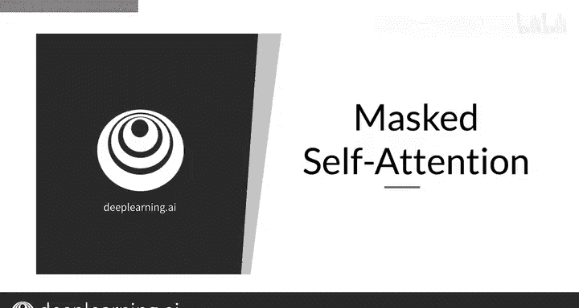
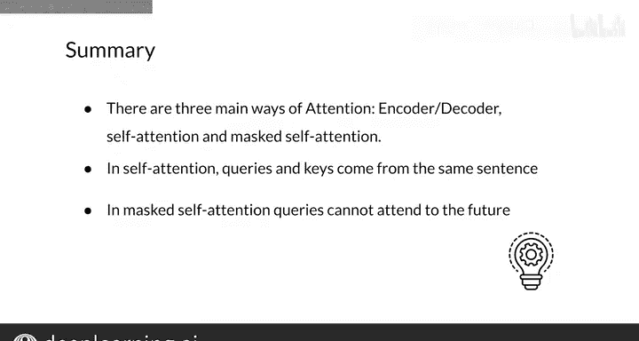

# 吴恩达《自然语言处理｜natural language processing》中英字幕 - P160：20_掩码自注意力.zh_en - GPT中英字幕课程资源 - BV1Hc5ezDEWQ

In this video， I'll review the different types of attention mechanisms in the transformer model。

 and you will see how to compute mask self attention。 First。

 you will see what the three main ways of attention in a transformer model are。

Afterwards， I'll show you a brief overview of mask self attention。

One of the attention mechanisms in a transformer model is the familiar encodeder decoder attention。

In that mechanism， the words in one sentence attend to all other words in another one。

 That is the queries come from one sentence while the keys and values come from another。

You've already used this kind of attention in the translation task from last week。

Where the words from sentences in French attended two words from sentences in English。

In self attention。The query's keys and values come from the same sentence。

 So every word attends to every other word in the sequence。

This type of attention lets you get contextual representations of your words。In other terms。

 self attention gives you a representation of the meaning of each word within the sentence。Finally。

 in masked self attention， queries's keys and values also come from the same sentence。

But each query cannot attend two keys on future positions。

This attention mechanism is present in the decoder from the transformer model and ensure that predictions at each position depend only on the known outputs。

Mathematically， self attention works precisely as the encoder decoder attention。

 The only difference is the nature of the inputs for each mechanism。

 So let's focus on masked self attention。Recall that the scaled dust product attention requires the calculation of the Soax of the scaled product between the queries and the transpose of the key matrix。

And then for mask self attention， you add a mask matrix within the softmax。

The mask has a0 on all of its positions， except for the elements above the diagonal。

 which are set to minus infinity， or in practice， a huge negative number。After taking the softax。

 this addition ensures that the elements in the weights matrix are 0 for all the keys in the subsequent positions to the query。

In the end， as with the other types of attention， you multiply the weight matrix by the value matrix to get the context vector for each query。

 and that's it， you only need to add a matrix within the softmax to ensure that the queries don't attend to future positions。

In this video， I showed you the three main ways of attention， encodeder decoder attention。

 self attention， and masked self attention。In mass self attention。

 queries and keys are contained in the same sentence， but queries cannot attend to future positions。

You have seen many types of attention so far In the next video。

 I'll show you the multi headed attention。 It is a very powerful form of attention that allows for parallel computing。

