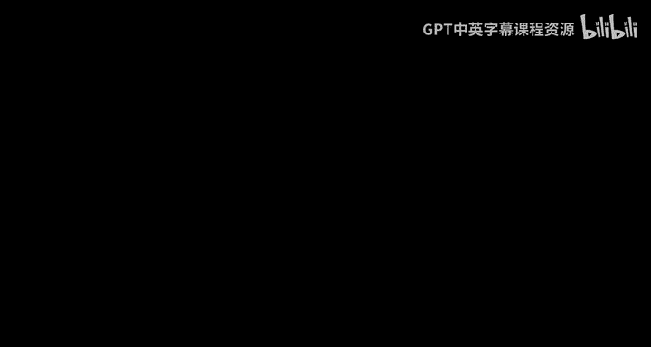
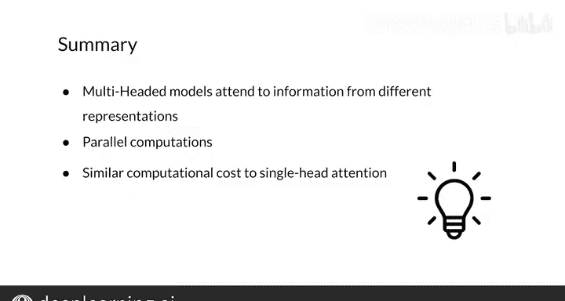

# 吴恩达《自然语言处理｜natural language processing》中英字幕 - P161：21_多头注意力.zh_en - GPT中英字幕课程资源 - BV1Hc5ezDEWQ

You have learned all the basics of attention by now， in fact。

 you could already build a transformer from it， but if you wanted to work really well。

 run fast and gets very good results， you'll need one more thing， the multihead attention。

 let me show you what it is。First， I'll share with you some intuition on multi head attention。

 Afterwards， I'll show you the math behind it。Recall that you need word embeddings for the query key and value matrices and scale those product' attention。

In multihead attention， you apply in parallel the attention mechanism to multiple sets of these matrices that you can get by transforming the original embeddings。

In multi head attention， the number of times that you apply the attention mechanism is the number of heads in the model。

 For instance， you all need two sets of queries， keys and values， and a model with two heads。

 The first head would use a set of presentations。And the second head would use a different set in the transformer model。

 you get different representations by linearly transforming the original embeddings by using a set of matrices。

 W superscript Q K V for each head in the model。Using different sets of representations。

 allow your model to learn multiple relationships between the words from the query and key matrices。

With that in mind， let me show you how multi head attention works。

The input to multihead de is the value， key and query matrices。First。

 you transform each of these matrices into multiple vector spaces， as you saw previously。

 the number of transformations for each matrix is equal to the number of heads in the model。

Then you will apply the scale dot product attention mechanism to every set of value。

 key and query transformations。Where again， the number of sets is equal to the number of heads in the model。

After that， you can catnate the results from each head in the model into a single matrix。Finally。

 you transform the resulting matrix to get the output's context vectors。

Note that every linear transformation in multi head attention contains a set of learnable parameterss。

So let's go through every step in more detail。Say that you have two heads in your model。

 the inputs to the multihead extension layer are the query keys and values matrices。

The number of columns in those matrices is equal to D submodel， which is the embedding size。

 and the number of rows is given by the number of words the sequence is use to construct each matrix。

And the number of rows is given by the number of words the sequence is used to construct each matrix。

The first step is to transform the query keys and values using a set of matrices。

 W superscripts QK and V or head of the model。This step will give you the different sets of representations that you use for the parallel attention mechanisms。

The number of rows and the transformation matrices is equal to the submodel。The number of columns。

 Ds sub K for the queries and keys transformation matrices。

 and the number of columns D sub V for W superscript V are hyperparmeters that you can choose。

In the original transformer model， the author advises setting D subub K and D subub V equals to the dimension of the embeddings divided by the number of heads in the model。

This choice of sizes would ensure that the computational cost of multi head attention doesn't exceed by much the one for a single head attention。

After getting the transformed values for the query key and value matrices per head。

 you can apply in parallel the attention mechanism。As a result。

 you get a matrix per head with the column dimensions equal to D subvin。

 and the number of rows in those matrices is the same as the number of rows in the query matrix。

Then you can cainate horizontally the matrices outputted by each attention head in the model。

So you will get a matrix that has D sub v times the number of heads。Colums。

Then you apply a linear transformation， W superscript O to the concateated matrix。

This linear transformation has columns equal to D submod。

 and if you choose D sub V to be equal to the embedding size divided by the number of heads。

 the number of rows in this matrix would also be D submod。Just as with single head attention。

 you will get a matrix with the context vectors of size D sub model for each of your original queries。

 That's it。For multihead attentionten， you just need to apply the attention mechanism to multiple sets of representations for the queries。

 keys and values。Then you can catnate the results from each attention computation to get a matrix that you linearly transform to get the contact vectors for each original query。

In this video， you learned how multihead attention works。

 and you saw some of the dimensions of the parameter matrices involved in its calculations。

You can implement multiha attention to make computations in parallel。

And with the proper choice of sizes for the transformation matrices。

 the total computational time is similar to the one of single head attention In the last three videos。

 you learned about attention。 You know the basic thats product attention。

 the causal one and the multiheaded one。 You're now ready to build your own transformer decoder That's what we' will do in the next video。

