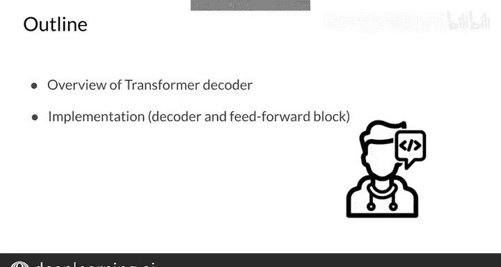
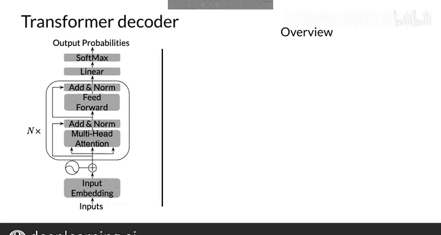
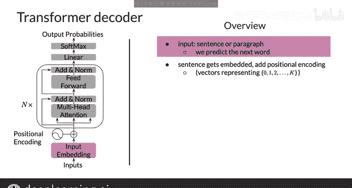
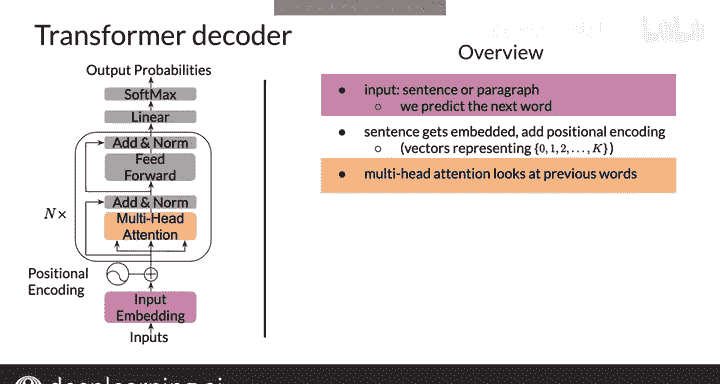
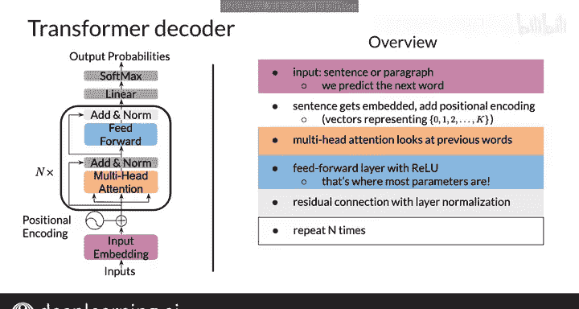
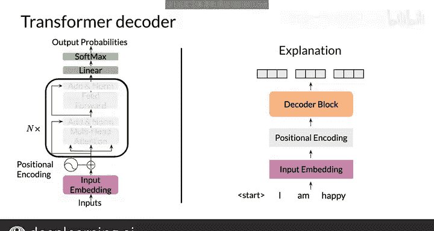
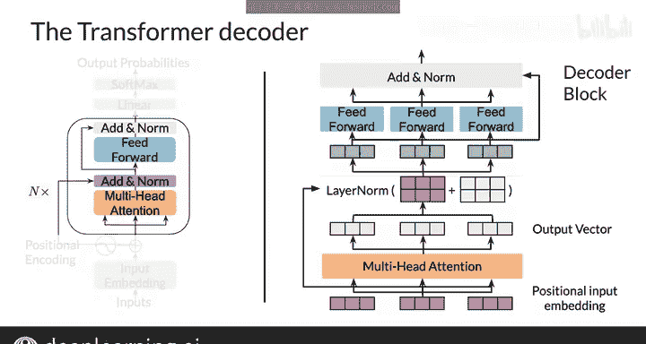
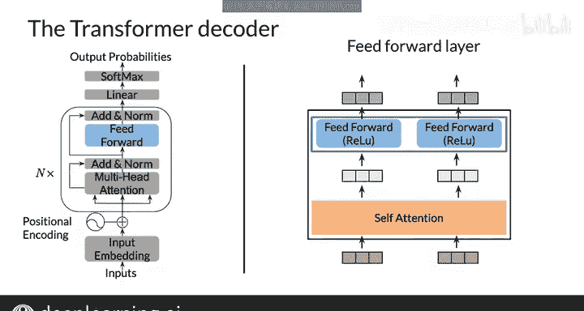
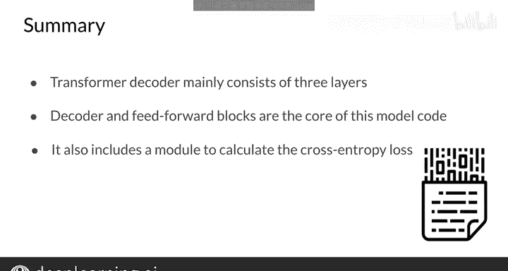

# 吴恩达《自然语言处理｜natural language processing》中英字幕 - P162：22_Transformer解码器.zh_en - GPT中英字幕课程资源 - BV1Hc5ezDEWQ

In this video， you'll build your own transformer decoder model， which is also known as G T 2。

 Once you know attention， it's a fairly simple model， as you will see。 So let's dive in。

In this video， you will see the basic structure of a transformer decoder。

 I'll show you the definition of a transformer and how to implement the decoder and the feed forward blocks。

 So on the left， you can see a picture of the transformer decoder as input。

 it gets a tokenized sentence， a vector of integers as usual。

The sentence gets embedded with word embeddings， which you know， quite 12 by now。

 Then you add to these embeddings the information about positions。

This information is nothing else than learned vectors representing 1，2，3。

 and so on up to some maximumim length that we will put into the model。

 So the embedding of the first word will get added with a vector presenting one。

 the embedding of the second word with a vector representinging2 and so on。

Now， this constitutes the input for the first multi headed attention layer。

 After the attention layer， you have a feet forward layer。

Which operates on each position independently。After each attention and fit forward layer。

 you put a residual or skip connection， so just add the input of that layer to its output and then perform layer normalization。

The attention and feet forward layers are repeated n times。

 The original model started with n equals 6， but now transformers go up to 100 or even more。

And then you have a final dense layer for output and a opt max layer， and that's it。Now。

 don't worry if you didn't sketch it all at once， we'll go through the structure again and with code to explain all the details。

Here you'll see the core of the transformer model。 It has three layers at the beginning。

Then the shift right just introduces the start token。

 which your model will use to predict the next word。You have the embedding。

 which trains a word to vector embedding。And positional encoding。

 which trains the vectors for one2 and so on， as explained before。

 if the input to the model was a tensor of shape， batch by length， then after the embedding layer。

 it will be tensor of shape， batch by length by D model where D model is the size of these embeddings。

 and they usually go to 5，12，1024。 and nowadays up to 10 k or more。After these early layers。

 you'll get n decoder blocks。And then a fully connected layer that outputs sensorsors of shape。

 batch by length， by vocab size。And they log softftms for cross entry pillars。

Now let's see how the decoder block is built。It starts with a set of vectors as an input sequence。

 which are added to the corresponding positional coding vectors。

Producing the so called positional input embedding。After embedding。

 the input sequence passes through a multiheaded attention model。

And while this model processes each word， each position in the input sequence。

 the attention itself searches other positions in the sequence to help identify relationships。

Each of the words in the sequence is weighted。 Then in each layer of attention。

 there is a residual connection around it， followed by a layer normalization step to speed up the training and significantly reduce the overall processing time。

 Then each word is passed through a feet forward layer。 That is。

 embeddings are fed into a neural network。And then you have a dropout at the end as a form of regularization。

Next， a layer normalization step is repeated capital n times。 Finally。

 the E layer output is obtained。

After the attention mechanism and the normalization step。

Some nonlinear transformations are introduced by including fully connected feet forward layers。

With simple but not only new re activation functions for each input。

 and you have shared parameters for efficiency。The feet forward neural network output vectors will essentially replace the hidden states of the original RNN decoder。

So let us recap what you have seen in this video， you saw the building blocks used to implement a transformer decoder。

And you saw that it has three layers。 It also has a module to calculate a lock softmax。

Which makes use of the cross entropy laws。And you also saw the decoder and the fit forward blocks。

You have now built your own first transformer model。 Congratulations。

 Wouldn't it be nice to see its in action。😊。