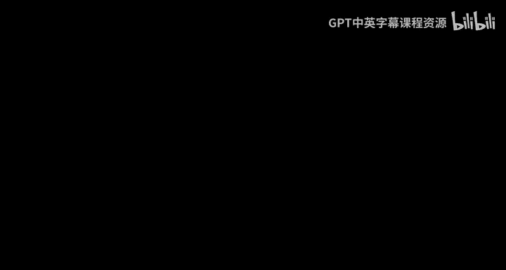
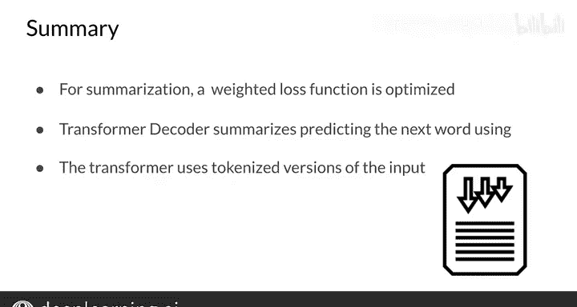

# 吴恩达《自然语言处理｜natural language processing》中英字幕 - P163：23_Transformer摘要生成器.zh_en - GPT中英字幕课程资源 - BV1Hc5ezDEWQ

I'll show you how to make a sumr。 Let's dive in。 First。

 I'll show you a brief overview of the transformer model code。

 Then you'll see some technical details about the data processing for summarization。

 At the end of this video， you will see how to make inferences with a language model。First。

 take a look at the problem you will solve in this week's assignments。As input。

 you get whole news articles as output， your model is expected to produce the summary of the articles。

 that is few sentences that mention the most important ideas。To do this。

 youll use the transformer model that I showed you in previous videos。

But one thing may immediately stand out to you。Transformer only takes text as inputs and predicts an export。

For summarization， it turns out you just need to concatenate the input。 In this case。

 the article and put the summary after it。 Let me show you how。

Here is an example of how to create input features for training the transformer from an article and its summary。

 The input for the model is a long text that starts with a news article。Then comes the E O tag。

The summary and then another Eos tag。As usual， the input is tokenized as a sequence of integers。Here。

0， denote padding and one E O。And all other numbers for the tokens， for different words。

When you run the transformer on this input， it will predict the next word by looking at all the previous ones。

 but you do not want to have a huge loss in the model just because its not able to predict the correct ones。

And that's why you have to use a weighted loss。Instead of averaging the loss for every word in the whole sequence。

 you weight the loss for the words within the article with zeros and the ones within the summary with ones。

So the model only focuses on the summary。However， when there is little data for the summaries。

 it actually helps to waste the article loss with non0 numbers， say 0。2 or 0。5 or even one。That way。

 the model is able to learn word relationships that are common in the news。

 You will not have to do it for this week's assignment。

 but it's good that you have this in mind for your own applications。😊。

Another way to look at what I discussed in the previous slide is by looking at the cost function。

Which sums the losses over the words J within the summary for every example I in the batch。

 So the cost function is a cross entropy function that ignores the words from the article to be summarized。

Now that you know how to construct the inputs and the model， you can train your transformformer sumr。

 recall again that transformers predict the next word and your input is in news article。

At test or inference time， you will input the article with the EOS token to the model and ask for the next word。

It is the first word of the summary。Then you will ask for the next word and the next and so on until you get the Eos token。

 When you run your transformer model， it generates a probability distribution over all possible words。

You will sample from this distribution， so each time you run this process。

 you will get a different summary。I think you will have fun experimenting with this in the coding exercise。

So in this video， you saw how to implement a transformer decoder for summarization as a key point。

 the model aims to optimize a weighted cross entropy function that focuses on the summary。

 The summarization task is basically text generation with the whole article as input。

This week， you have learned how to build your own transformer。

 and you have used it to create a summarr。 I hope you enjoyed the journey。

 Transformer is a really powerful model that is not hard to understand。 Next week。

 I'll show you how to get even better results。 You'll use a more powerful version of transformer with pretraining。

 Don't miss it。😊。