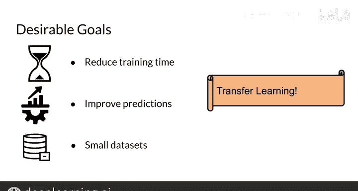

# 吴恩达《自然语言处理｜natural language processing》中英字幕 - P166：26_第3周概述.zh_en - GPT中英字幕课程资源 - BV1Hc5ezDEWQ

Good to see you again。 And this week， you will learn about transfer learning。

 which is a new concept in this course。 Transfer learning allows you to get better results and speeds of training。

😊。

You'll also be looking at question answering， so let's dive in。So in week3 of course 4。

 you're going to cover many different applications of NLP and one thing you're going to look at is question answering so given a question and some context。

 can you tell us what the answer is going to be inside that context Another thing you're going to cover is transfer learning for example。

 knowing some information by training something in a specific task how can you make use of that information and apply it to a different task you're going to look at BRT which is known as the bidirectional encoder or representation which makes use of transformers。

And you'll see how you can use bidirectality to improve performance。

 And then you're going to look at the T5 model。 And basically what this model does。

 you can see here it has several possible inputs， So it could be a question。 you get an answer。

 It could be a review and you'll get the rating over here and it's all being fed into one model。

So let's look at question answering and over here you have contextbased question answering。

 meaning you take in a question and a context and it tells you where the answer is inside that context over here so this is the highlighted stuff which is the answer and then you have closed book question answering which only takes the question and it returns the answer without having access to a context so it comes up with its own answer。

So previously we've seen how innovations in model architecture improve performance and we've also seen how data preparation could help。

 but over here you're going to see that innovations in the way the training is being done。

 also improves performance in which case you'll see how transfer learning will improve performance。

So this is the classical training that you're used to seeing。

 you have a course review it goes through a model and let's say you predict the rating and then you just predict the rating the same way as you've always been doing。

 So nothing changed here。 This is just an overview of the classical training that you're used to。

Now in transfer learning， let's look at this example， let's say that you have movie reviews。

And then you feed them into your model and you predict a rating and over here you have the pretrained task which is on movie reviews Now when training you're going to take the existing model or movie reviews and then you're going to find units or train it again on course reviews and you'll predict the rating for that review so as you can see over here instead of initializing the weights from scratch。

 you start with the weight that you got from the movie reviews and you use them as a starter point when training for the course reviews and at the end you do some inference over here and you do the inference the same way you're used to doing。

 you just take the course review， you feed this into your model and you get your prediction。

So you can also use transfer learning on different tasks。

 this is another example where you feed in the ratings and some review and this gives you sentiment classification and then you can train it on a downstream task like question answering where you take the initial weights over here and you train it on question answering so when is pi day and the model answer is March 14th。

And then you can ask the model the same question， when's my birthday over here。

 and it does not know the answer， but this is just another example of how you can use transfer learning on different tasks。

So now we're going to look at Bt， which makes use of bidirectional context。

 so in this case you have learning from deep learning AI is like watching the sunset with my best friend and over here the context is everything that comes before and then let's say you're trying to predict the next word deep learning AI Now when doing bidirectional representations you'll be looking at the context from this side and from this side to predict the middle word。

And this is one of the main takeaways for bidirectality。

So now let's look at single task versus multitask over here you have a single model which sticks in a review。

And then predicts a rating。And over here you have another model which takess in a question and predicts an answer。

 So this is a single task each like one model per task。Now。

What you can do here with T5 is it is the same model that's being used to take the review。

 predict the rating， and then take the question and predict the answer。

So instead of having two independent models， you end up having one model。

So let's look at T 5 and over here， the main takeaway is that the more data you have， generally。

 the better performance there is。 So， for example， the English Wikipedia data set is around 13 GB compared to the。

C4 causalal cleaned crawled corpus is about 800 gigabytes， which is what T5 was trained on。

 and this is just to give you like how much larger the C4 dataset is when compared to the English Wikipedia。

So what are the desirable goals for transfer learning first of all you want to reduce training time because you already have a pretrained model so hopefully once you use transfer learning you'll get faster convergence it will also improve predictions because youll learn a few things from different tasks that might be helpful and useful for your current predictions on the task you're training on and finally you might require or need less data because your model has already learned a lot from other tasks。

So if you have a smaller data set， then transfer learning might help you。

You now know what you're about to learn。 I am very excited to show you all these new concepts in the next video。

 we will start by exploring transfer learning。😊。