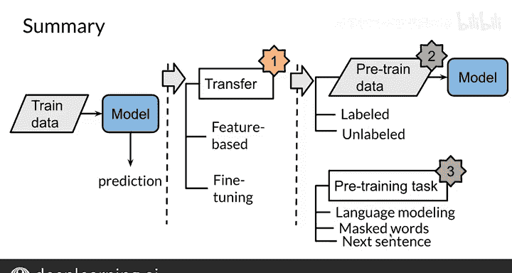

# 吴恩达《自然语言处理｜natural language processing》中英字幕 - P167：27_NLP中的迁移学习.zh_en - GPT中英字幕课程资源 - BV1Hc5ezDEWQ

This week， I'll be talking about transfer learning with the full transformer。

 I'll also talk a little bit about Bt， which is the bidirectional encoder representation for transformers。

 Then I'll talk about a special model known as the T 5 model。 What you'll learn about。 Now。

 all of these concepts make use of transfer learning。 So what is transfer learning。 Let me show you。

😊。

You'll now take a look at the transfer learning options that you will have while performing your NLP tasks。

So this is a quick recap where you have your train data goes into a model then you have a prediction。

So transfer learning will come in two basic forms The first one is using featurebased learning and the other one is using fine tuning and by feature based I mean things like word vectors being learned and fine tuning is you take an existing model existing weight and then you tweak them a little bit to make sure that they work on the specific tasks you're working on so there is pre-trained data which makes use of labeled and unlabeled data。

 let's say your training your model on sentiments for product reviews and then you can use those same weights to train your model on course reviews。

And then the other thing is pretraining task， which usually makes use of language modeling。

 for example， you mask a word and you try to predict what that word is or you try to predict what the next sentence would be。

So let's look at general purpose learning and this is something that you're already familiar with。

 so over here you have I am because I am learning and you're trying to predict the central word。

 so the central word is happy over here。And you used a model known as the continuous bag of Word model。

 or at least you got the following embeddings。So now you can use these embeddings as the input features in translation tasks to translate from English to German。

So let's look at a more concrete example of feature based versus fine tuning。

So over here you have word embeddings， you put it in your model， you get a prediction。

 and then over here you get some type of new features or new word embeddings。

And then you feed them into a completely different model， and this gives you your prediction。Now。

 on the fine tuning side， you have your embeddings， you feed it into your model。

 you get a prediction。And then you fine tune on this model。So on a downstream task。

 and then you have some new input。On your new weight that you find tuned。

 so you feed it in and you get a prediction。So let's look at fine tuning。

 this is a way to add fine tuning to your model， so let's say you have movies and you're predicting one star。

 two stars or three stars。So you pretrained and let's say now you have course reviews。

 so one way you can do this is you fix all of these weights that you already have and then you add a new feed forward network while keeping everything else frozen here and then you just tune on this new network that you just added data effects performance a lot so in this case you have data being fed into your model and you get some neutral outcome。

But as you have more data and you build a larger model over here， then you get a much better outcome。

 so the more data you have， the better it is， and the more data you have。

 the bigger the models you can build will be able to capture the task you're trying to predict on。

So let's look at labeled versus unlabeled data now this is just a graphic example that tells you that usually you'll have way more unlabeled text data than labelbeled text data and heres an example so in pretraining you have no labels you feed this into your model。

And then in downstream task， you could have something like。

What day is by day if feed is into your model and you get the March 14。 So and remember。

 these are the word vectors we're talking about。 So which tasks work with unlabeled data。

 This is a self supervised tasks。 So you have the unlabeled data， and then you create input features。

 You create target store labels。 And this is how it works。

 So you have unlabeled data learning from deep learning AI is like watching the sunset with my best friend。

You create the inputs and then blank， so the sunset with my best blank so you're trying to predict friend。

 so you feed this into your model， you get your prediction， So the target is friend。

 your prediction goes in， you have the loss here and then you use this loss to update your model and this is basic language modeling that you've already seen before。

So let's look as fine tuning a model in the downstream task， so you have your model here。

 you did some pretraining on it either by masking words or predicting the next sentence。

 and then you use this model to train it on downstream task so you can use this model。

 fine tune it on translation or summarization or question answering。

So is a summary of what you've seen so far， usually you have some trained data， you have a model。

 you make a prediction。We use transfer learning to get feature based examples or fine tuning。

 so feature based like word vectors or word embeddings and fine tuning is something that you can do on downstream tasks and then we can also use labeled data and unlabeled data to help us so you can train something on a different task on a different data set and that will also help a little bit。

And then you can use pre training tasks like language modeling or masked words or consensusus prediction。

You have now seen some advantages of transfer learning。

