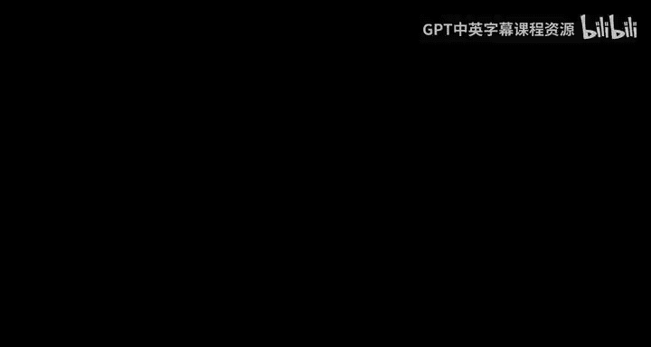
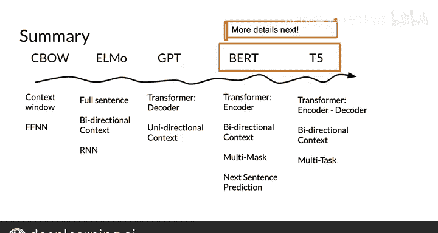

# 吴恩达《自然语言处理｜natural language processing》中英字幕 - P168：28_ELMO、GPT、BERT、T5.zh_en - GPT中英字幕课程资源 - BV1Hc5ezDEWQ

I'll show you a chronological order of when the models were discovered。

 We will also see the advantages and the disadvantages of each model。 Let's start。

 So this is a quick outline。 where you can see we start here with continuous bag of words model。

 Then we got Elmo。 Then we got GT。 Then we got B。 And finally。

 we ended up having T5 and so more like over here。 you're going to end up having many。

 many more models coming up hopefully soon。 So this is not a complete history of all relevant models and research findings。

 but it's useful to see what problems arise with each model。 and what problems each model solves。😊。

So let's look at context over here。 Let's say we have the word right。And ideally。

 we want to see what this word means so we can look at the context before it。

And then we can also look at the context after it， and that's how we've been able to train word embeddings so far。

So the continuous bag of words over here， you have the word right。

 And previously what you've been doing， you would take a fixed window， say  two。

 before and2 after or3 or for whatever a C is for the window size。

 And then you will take the corresponding words。 feed them into a neural network and predict the central word in this case。

 which is right。 Now， the issue over here is that。What if we wanted to look at not only the fixed window。

 but all the words before and all the words after， and how can we do that？So if we want more context。

 let's say we want， they were on on the over here， this is like the first left part of the sentence and then all the right parts of the sentence。

So instead of having the fixed window， we want to add like the street or history， for example。

So to use all of the context words， what researchers have done。

 they explored the following using RNN so they would use an RNN from the right and from the left。

And then they would have a bidirectional LSDM， which is a version of our current neural network。

So you feed both of them in， and then you can predict the central word right。

 so that gives you the word embedding for the word right。Now open AIGPT what it did。

 so we had transformer so the encoder decoder architecture that you're familiar with。

 and then we ended up having this GPT which makes use of a decoder of stacks only so in this case we only have one decoder but you can have several decoders in the picture Elmo made use of RnNs or LSTMs and we would use these models to predict the central word so why not use a bidirectional model So in this case this is the transformer and you can see that in the transformer over here Each word can peak at itself。

So。If we were to use it for on the right， you can only look at itself。

 but the issue is that you cannot speak forward。And remember。

 you've seen this in causal attention where you don't look forward。

 you only look at the previous ones。So birds came and helped us solve this problem。

So this is a recap， transformformers encoder decoder， GPT makes use of decoders。

 and BRT makes use of encoders。So over here you have the legislature believe that they were on the blank side of history so they changed the law。

 and over here we can make use of bidirectional encodeder representation from transformers and this will help us solve this issue。

So this is an example of a transformer plus bi directionional context。

 so you feed this into your model， and then you get right and of and because of this。

 you're able to look at the sentence from the beginning and from the end and make use of the context to predict the corresponding words。

So if we were to look at words to sentences， I meaning instead of trying to predict just the word。

 we'll try to predict what the next sentence is， so given the sentence over here。

 the legislators believed that they were on the right side of history。

 is this the next sentence or is this the next sentence？So you have a sentence a。

And then you try to predict the next sentence B， so in this case it's obviously so they change the law。

So bird pretraining tasks make use of multimask language modeling。

So the same thing that you've seen before and it makes use of an next sentence prediction。

 so it takes two sentences and it predicts whether it's a yes。

 meaning sentence 2 follow sentence1 or sentence B follow sentence A or not。

So let's look at encodeder versus encodeder decoder。

So over here you have the transformer which had the encoder and the decoder stack。

 and then you had GPT， which just had decoder stack， and then burn just the encoder stack。

So T5 tested the performance when using the encodeder decoder as in the original transformer model。

 and the researchers found that the model performed better when it contained both the encoder and the decoder stacks。

So let's look at the multi task training strategy over here。

 so you have studying what deep learning dot AI was。

It's being fed into the model and it gives you a five star rating and hopefully it's a five star rating。

And then you have a question and then you get the answer。 But the question here is。

 how do you make sure that the model knows which task it's performing in because you can feed in a review over here。

And how do you know that it's not gonna to return an answer instead。

 how do you know it's going to return a rating or if you read in a question。

 how do you know it's nots going return some you know numerical output or some text version of a numerical output So let's see how to do this over here is an example where let's say you're trying to classify whether it is five stars or four stars or three stars。

 So you put you append the string classify for example。

 and then it classifies it and you get five stars let's say you want to summarize So you you add the string summarize colon on it goes into the model。

 its automatically identifies that you're trying to summarize and it says that it was all right。

 You have a question you append the question string。

It knows that it's a question and it returns the answer。 Now。

 this might not be the exact tag that you'll find in the paper。

 but it gives you the overall sense of the idea。So in summary you've seen the continuous bag of wordss model。

 which makes use of a fixed context window， you've seen ElLmo。

 which makes use of a bidirectional LSTM， you've seen GPT which is just a decoder stack and you can see kind of unidirectional in context。

 then you've seen BRT， which makes use of bidirectional encodeder representation from the transformer and it also makes use of multimask language modeling and next sentence prediction。

 and then you've seen the T5 which makes use of the encodeder decoder stack and also makes use of maskask and multitask training。

You have now seen an overview of the models， you have seen how the text to text model has a prefix with the same model you can solve several tasks in the next video。

 we will be looking at the BRT model in more detail。

 also known as the bidirectional encoder representation for Transformers。

