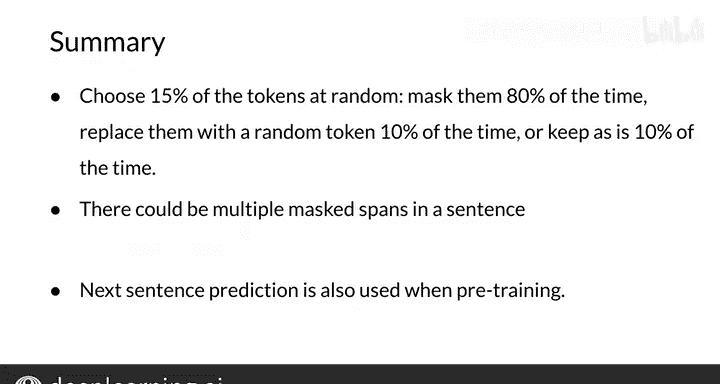

# 吴恩达《自然语言处理｜natural language processing》中英字幕 - P169：29_Transformer的双向编码器表示（BERT）.zh_en - GPT中英字幕课程资源 - BV1Hc5ezDEWQ

I'll now teach you about bidirectional encoder representations for transformers or in shorts。

 just Bt Bt is a model that makes use of the transformer。

 but it looks at the input from two directions。 Let's dive in and see how this works。

Today you're going to learn about the B architecture。

 and then you're going to understand how bird pre traininging works and see what the inputs are and the outputs are。

So what is birds？Bert is the bidirectional encoder representation from transformers。

 and it makes use of transfer learning and pretraining。

So how does this work usually starts with some inputs embedding。

 so E1 e2 all the way to some random number EN。And then you go through some transformer blocks。

 as you can see here， so each blue circle is a transformer block， goes up further， further。

 and then you get your T1， t2， TN。So basically there are two steps in Bs framework。

 pretraining and fine tuning， and during pretraining the model is trained on unlabeled dataum over different pretraining tasks as you've already seen before。

And for fine tuning， the B model is first initialized with the pretrained parameters。

 and all of the parameters are fine tuned， using label data from the downstream tasks。 For example。

 in the figure over here， you get the corresponding embeddings。

 your run is through a few transformer blocks and then you make the prediction。

So we'll discuss some notation over here， so first of all。

 Bt is a multi layerer bidirectional transformer。It makes use of positional embeddings。

And the famous model is B pace， which has 12 layers or 12 transformer blocks。

 12 attention heads and 1 hundred10 million parameters。

 and these new models that are coming out now like GT3 and so forth， they have way。

 way more parameters and way， way more blocks and layers。So let's talk about pretraining。

 so before feeding the word sequences to the birth model， we mask 15% of the words。

And then the training data generator chooses 15% of these positions at random for prediction。

And then if the eye token is chosen， we replace the eye token with one。

 the mask token 80% of the time。And then two， a random token 10% of the time， and then three。

 the unchanged I tokenken 10% of the time。So in this case。

 then TI what you've seen in the previous slide will be used to predict the original token with crossenttropis。

 so in this case this is known as the masked language model and over here we have after a school Lucas does his blank in the library so maybe work may be homework one of these words that your birth model is going to try to predict and to do so usually what you do you just add a dense layer after the TI token and use it to classify after the encoder output so you just multiply the output vectors by the embedding matrix and then to transform them into vocabulary dimension and you add a softmax at the end。

So this is another sentence after Lucas， after school Lucas does his homework in the library。

And then after school blank， his homework in the blank。

 so you have to predict Lucas does and then library also。

So in summary you choose 15% of the tokens at random， you mask them 80% of the time。

 replace them with a random token 10% of the time， or keypa is 10% of the time and then notes that there could be multiple mask spans in a sentence so you could mask several words in the same sentence and in birth also in next sentence prediction is also used when pretraining so given two sentences if it's true it means the two sentences follow one another otherwise they're different。

 they don't lie in the same sequence in the text。

You have now developed an intuition for this model。

 You have seen that Bt makes use of the next senseensus prediction and masked language modeling。

 This allows the model to have a general sense of the language In the next video。

 I'm going to formalize this and show you the loss function for Bt。 Please go on to the next video。😊。

