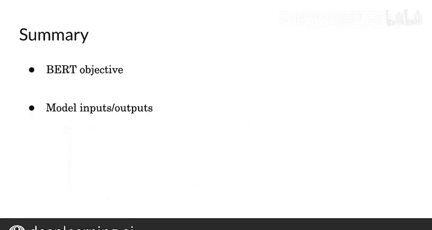

# 吴恩达《自然语言处理｜natural language processing》中英字幕 - P170：30_BERT目标.zh_en - GPT中英字幕课程资源 - BV1Hc5ezDEWQ

I will be talking about the bird's objective。 Youll see what you are trying to minimize。Specifically。

 I'll show you how you can combine word embeddings。

 sentence embeddings and positional embeddings as inputs。 Let's take a look at how you can do this。

So you're going to learn how BRT inputs are fed into the model and the different types of inputs and their structures。

 then you're going to visualize the outputs and finally you're going to learn about the BRT objective。

So formalizing the input， this is the BRT input representation。

 so you start with positional embedding， so they allow you to indicate the position in the sentence of the word。

 so where each word is in the corresponding sentence， so you have this。

Then you have the segment embeddings， and they allow you to indicate whether it' is sentence A or sentence B。

 because remember inbert you also use next sentence prediction。

And then you have the token embeddings or the input embeddings。And you also have a CLS token。

 which is used to indicate the beginning of the sentence and a sep token。

Whi is used to indicate the end of the sentence， and then what you do just take the sum of the token embeddings。

 the segmentation embeddings， and the position embeddings， and then you get your new input。

So over here you can see you have mask sentence A， you have mask sentence B， they go into tokens。

 and then you have the CLS token， which is a special classification symbol added in front of every input。

 then you have the S token， which is the special separator token。

You convert them into the embeddings so then you get your transformer blocks。

And then you can see at the end， you get your T1 to TN， your T1 prime to Tn prime。

 so these are each T embedding will be used to predict the mask toward via simple softmax。

And you have this C also embedding， which can be used for next census prediction。

So let's look at the bird's objective now， so for the multimask language model use a cross entropy loss to predict the word that's being masked or the words that are being masked。

 and then you add this to a binary loss for the next sentence prediction so given the two sentences do they follow one another or not。

 So in summary you've seen the bird's objective and you've seen the model inputs and outputs。

In the next video， I will show you how you can find tune in this pre tradeed model， specifically。

 I'll show you how you can use it to your own tasks for your own projects。

 Please go on to the next video。