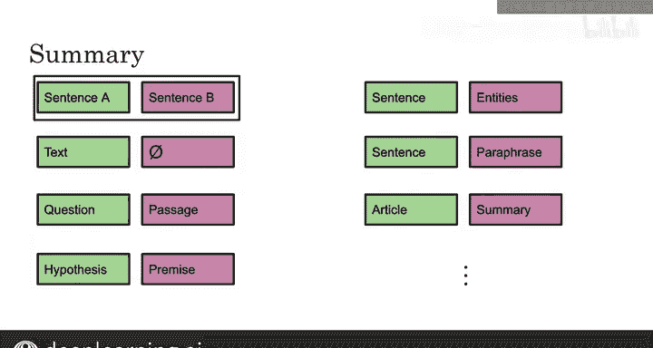

# 吴恩达《自然语言处理｜natural language processing》中英字幕 - P171：31_微调BERT.zh_en - GPT中英字幕课程资源 - BV1Hc5ezDEWQ

Using BRT can get you state of the art results on many tasks or problems in this video。

 I'm going to show you how you can find you in this model so that you can get it to work on your own dataset sets Let's take a look at how you can do this。

So right now you're going to see how you find tune birds。

So during pretraining remember you had sentence A in sentence B。

 and then you used next sentence prediction and used mask tokens to predict the mask tokens that you mask from each sentence。

 so that's in pretraining Now if you want to go on to M&LI or like hypothesis premise scenario。

 then instead of having sentence A in sentence B， you're going to feed in the hypothesis over here and the premise over here。

For N ER， you're going to feed in the sentence A over here and then the corresponding tags over here。

For question answering， youll have S， for example， you'll have your question over here and then your answer over here。

So。Visually， what does this look like， So remember this image from the bird's paper。

So this is what ends up happening over here you have the question over here you'll have the paragraph and this will give you like your answer。

 the start in the end of the answer， then for N E R， again。

 you will have the sentence and the corresponding named entities for M andLI you will have the hypothesis and then the premise and so forth。

So in summary， given the place of sentence A and sentence B。

 you can fill it with a text in part4 sentence A and then say like an nu symbol to say that you're trying to classify the text。

 whether it's for sentiment analysis， like happy or sad， so that's one way to do it。

 question passage for question answering， you could have hypothesis premise for M andI。

 you could have sentence with the named entities for NER。

 you can have sentence and a paraphrase of the sentence， you could have an article in a summary。

 and so forth。So this is just the inputs into your birds model。

Now that you know how to fine tune your model on classification tasks， question answering。

 summarization and many more things， we'll take it to the next level and introduce you to a new model known as the T5 please go on to the next video to learn about the T5 model。

