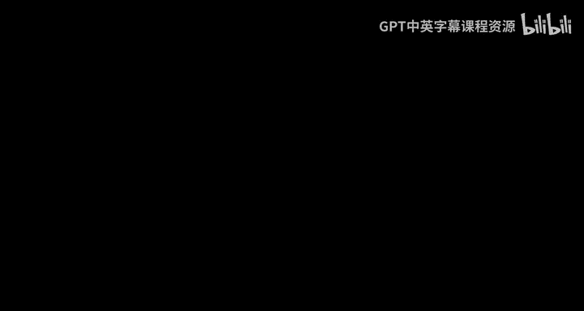
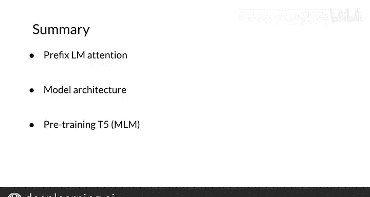

# 吴恩达《自然语言处理｜natural language processing》中英字幕 - P172：32_Transformer T5.zh_en - GPT中英字幕课程资源 - BV1Hc5ezDEWQ

The T5 model could be used on several NLP tasks， and it also uses similar training strategy to BRT Contely。

 it makes use of transfer learning and mask language modeling the T5 model also uses transformers when training so let's take a look at how you can use this model in your own applications。

So you're going to understand how T5 works， then you're going to recognize the different types of attention used and see an overview of the model architecture。

 so T5 transformers known as the text to text transformer， and you can use it in classification。

 you can use it for question answering to answer a question， you can use it for machine translation。

 you can use it for summarization and you can use it for sentiment。

And there are other applications that you can use T5 for， but we'll focus on these for now。

 So the model architecture and the way the pretrain is done， first of all。

 is you have an original text， something like this where you have。

 Thank you for inviting me to your party last week。So you mask the certain words。

 so for inviting a mean last， and then you replace it with these tokens like brackets X， brackets Y。

 so brackets X corresponding for inviting and brackets Y corresponding to lasts。

And your targets are going to be bracket X for inviting brackets Y last。 And you know。

 these tokens or these brackets， like they keep going in increment order。 So then it's bracket Z。

 and maybe brackets A， brackets， B， and so forth。 So each bracket corresponds to a certain target。

The model architecture and different transformer architecture variant that we're going to consider for the attention part here。

 so we start with the basic encodeder decoder representation so you can see over here you have fully visible attention and the encoder and then causal attention in the decoder and then you have the general encodeder decoder representation just as notation so light gray lines correspond to causal masking and dark gray lines correspond to the fully visible masking。

So on the left as I said again， it's the standard encoder decoder architecture in the middle over here。

 What we have， we have the language model which consists of a single transformer layer stack and it's being fed the concatenation of the inputs and the target so it uses causal masking throughout as you can see because they're all gray lines and you have x1 going inside over here get its x2 x2 goes into the model x3 and so forth。

Now over here to the right， we have prefix language model which corresponds to allowing fully visible masking over the input。

 as you can see here in the dark arrows and then causal masking in the rest。

So as you can see over here， it's being。It's doing causal masking。

So the model architecture uses encoder decoder stack， it has 12 transformer blocks each。

So you can think of it as a dozen eggs， and in 220 million parameters。

 so in summary youve seen prefix language model attention， youve seen the model architecture for T5。

 and you've seen how the pretraining is done similar to Bt but we just use mask language modeling here。

You now have an overview of the transformer model。You know how to train it and you've seen that you can use it on multiple tasks In the next video。

 I'll be talking about a few training strategies for this model， See you there。

