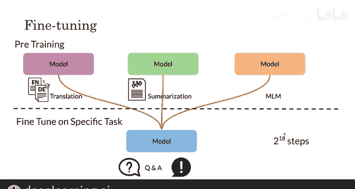

# 吴恩达《自然语言处理｜natural language processing》中英字幕 - P173：33_多任务训练策略.zh_en - GPT中英字幕课程资源 - BV1Hc5ezDEWQ

Welcome， you will now see how you can train one model to get you very good results on several NLP tasks when training such a model。

 we usually append a tag to notify whether we're training on either machine translation。

 question answering， summarization， sentiment or some other type of task Let's see how you can use this in your own applications。

 So the multitask training strategy works as follows So if you want to translate from English to German。

 you append the prefix， translate English to German。And this gives you the corresponding translation。

For coa sentence， like the course is jumping well。And it is。

 it's not acceptable because it's grammatically incorrect。

If you have two sentences and you want to identify their similarity。You put in the STSB sentence1。

 and then sentence2 inside over here， sentence1， sentence 2。

 and then you get the correspondingence score， if you want to summarize。

 you add the summarize prefix to the article or the text you want to summarize。

 and it gives you the summary。So this is how it works， input and output format。

 so for machine translation， you just do translate like blank to blank and you add the sentence。

To predict entailmentss contradiction or whether it's neutral。

 you would feed in something as follows so mLI premise， I hate pigeons and the hypothesis。

 my feelings towards pigeons are filled with animosity and the target is entailment so basically over here this is going to try to learn the overall structure of entailment and by feeding in the entire thing the model would have full visibility over the entire input and then it would be tasked with marking a classification by outputting the word entailment。

 so it is easy for the model to learn to predict one of the correct class labels given the task prefix mLI in this case if you know the main difference between prefix LM and the B architecture is that the classifier is integrated to the output layer of the transformer decoder and the prefix LM。

And over here you have the Wininorad scheme out is another way to predict whether a pronoun。

 for example， over here， the city councilmen refused the demonstrators as a permit because they feared violence。

So you're going to feed this into your model， and then it will be tasked to predict they。

As the city councilman。So for multitask training strategy。

 this is a table found in the original paper and we'll talk about what the glue benchmark is and these other benchmarks you can check them out。

 but for the purpose of this week we'll be focusing on the glue benchmarkch which would be the next video and we'll talk about adapter layers and gradual on freezing。

 but these are the scores reported。And you can see that the T5 paper actually reaches states of the art in many tasks。

So how much data from each task to train on so for the data training strategies there is examples proportional mixing and in this case what you end up doing you take an equal proportion。

 say like 10% from each data that you have and if the first data set for example blue。

 you take 10% of this then youll get 10% over here。

 10% of this is larger and 10% is just random number I picked。

But you get the point for the other type of data training strategy equal mixing。

 so regardless of the size of each data， you take an equal sample and then there is something in the middle called temperature scale mixing where you try to play with the parameters to get something in between now we'll talk about gradual unfreezing versus adapter layers So in gradual unfreezing what ends up happening you unfreeezze one layer at a time So you say this is your neural network un freezingreezing the last one you find tune using that you keep the others fixed then un freezingreezing this one and then you unfreeze this one so you keep unfezing each layer and for the adapter layers you basically add a neural network to each feet forward in each block of the transformer and then these new feet forward networks they're designed so that the output dimension matches the input and this allows them to be inserted without。

Having any structural change when fine tuning， only these new adapter layers and the layer normalization parameterss are being updated。

So we'll talk a bit more about fine tuning。The approach that's usually being used here has the goal of training a single model that can simultaneously perform many tasks at once。

 for example the model most of its parameters are shared across all of the tasks and we might train a single model on many tasks but when reporting performance we can select a different checkpoints for each task so over here the task could be like translation summarization or mask language modeling and they do the training in two to the power of 18 steps。

You learn about multiple training strategies used for your transformer model now that you know how to train this model。

 you need the way to evaluate it Contely， you will be evaluating it using the glue benchmarkchmark。

 which stands for general Language Understanding evaluationval benchmarkchmark。 See you there。

