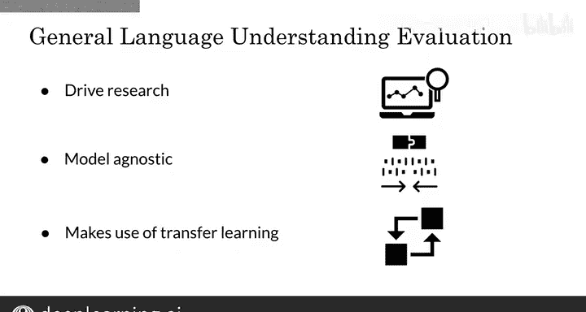

# 吴恩达《自然语言处理｜natural language processing》中英字幕 - P174：34_GLUE基准.zh_en - GPT中英字幕课程资源 - BV1Hc5ezDEWQ

I will show you one of the most commonly used benchmarks in natural language processing specifically you'll learn about the glue benchmark this is used to train。

 evaluate， analyze NLP tasks let's take a look at this in some more detail。

So the Glo benchmarkchmark stands for general language understanding evaluation and it is basically a collection that is used to train。

 evaluate， analyze natural language understanding systems。

 it has a lot of datas and each dataset has several genres and theyre of different sizes and different difficulties。

 some of them are for example used for co reference resolution。

 others are just used for simple sentiment analysis。

 others are used for question answering and so forth。

And it is used with a leaderboard so people can use the dataset sets and see how well their models perform compared to others。

So the tasks evaluated on could be， for example， sentence grammatical or not。For example。

 if a sentence makes sense or it does not， it could be used on sentiment。

It could be used to paraphrase some text。 It could be used on similarity， on question duplicates。

Whether a question is answerable or not， whether it's a contradiction， whether it's entailment。

 and also for the Wininograd schema， which is basically trying to identify whether a pro noun refers to a certain noun or to another noun。

So it's used to drive research， as I said that researchers usually use the glue as a benchmark。

 it is also a model agnostic， so it doesn't matter which model you use just evaluate on glue and see how well your model performs。

 and finally it allows you to make use of transfer learning because you have access to several dataset sets and you can learn certain things from different datasets that will help you evaluate on a completely new dataset sets within glue you now know not only how to implement states of the arts models but you also know how to evaluate them。

In the next video， I'll be talking about question answering。

 and I will show you how you can use these models to build a sophisticated Q A system。

 I'll see you there。😊。