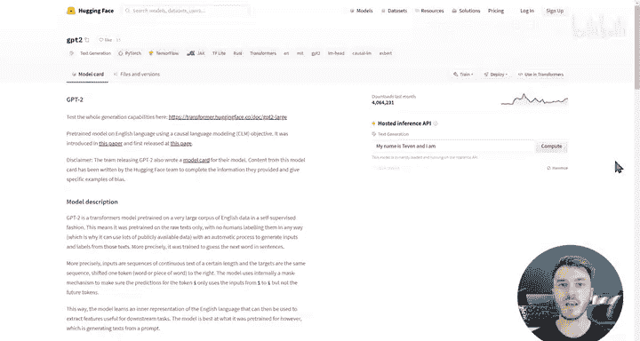
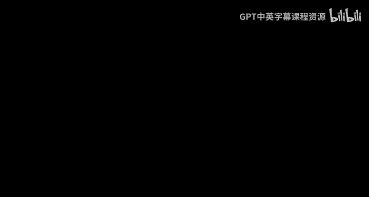

# 吴恩达《自然语言处理｜natural language processing》中英字幕 - P175：35_Hugging Face介绍.zh_en - GPT中英字幕课程资源 - BV1Hc5ezDEWQ

Hi， I'm Lyander from the Open sourceur team at Huging Face。At Higggen F。

 we specialize in democratizing machine learning。 We want to make machine learning as accessible as possible。

 and we firmly believe the only way to do so is through open source and open science。😊。

We develop and create tools and centers of the machine learning community。

Tools like the Transformers Library， which supports dozens of transformer architectures that can be easily used in any natural language processing。

 computer vision or speech project。😊，Tools like the dataset sets library to easily download and pre processces more than 1 thousand0 different data sets。

And tools like accelerate tokens and others to simplify machine learning from data handling to modeling。

 training and post processing。These tools make up the Huging F ecosystem。

 an ecosystem connected by the Huging F hubub， a platform to collaborate on machine learning models and data sets。

Before you get started with this lab by deploying。taI， let me introduce you to the hub。

 which you will leverage in the next videos。The Model hub is host to more than 15000 community contributed models。

And it offers a way to select a model according to a task， a library trained on a specific data set。

 on a specific language with a given license。Models can be from the Huging F Transformers Library。

 but they're not limited to it。Any library can easily add hub support。

 and some like Space C or at LNNLP， among others， already do。 Furthermore。

 we offer tools to push your own model and weights with no requirement on the library。😊。

Models can be further described by their model cards。

 and other members of the community may play with the model using the hosted En API。

The data set hub is similar to the model hub， hosting thousands of data sets here too。

 mostly community contributed。These data sets can then be selected by task， language。

 number of examples and licenses。These data sets offer a comprehensive dataset card。

 explaining how the data was designed， where the data came from。

 and considerations when using the data， both in terms of social impact and biases。Additionally。

 it offers a quick link to models fine tuned or trained on these dataset sets。

We are very excited to partner with deep learning Datya on this course， focused on transformers。

In the upcoming labs， you'll get a chance to practice using some of the hugging F tools like transformers。

 data sets， and the Huging F hub to find you in a pretrain model。

Have fun and looking forward to seeing your fine tune models。

