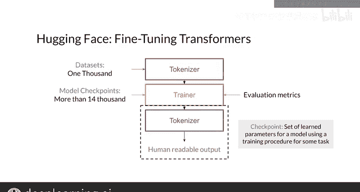

# 吴恩达《自然语言处理｜natural language processing》中英字幕 - P176：36_Hugging Face I.zh_en - GPT中英字幕课程资源 - BV1Hc5ezDEWQ

In this video， I'll introduce you to Huging Face I'll show you what is can provide you and how you can use it for your projects Hugging F is very well documented and they even have a course on their website that I recommend you check out if you want to dig deeper into their ecosystem。

HggingFace offers a wide range of solutions for organizations。

 builds community and has tools for collaborative research， however。

 I'll be focusing on their Transformers's Python library。

 which is a great tool for using transformer models in your projects。

You can use Hogging F transformformers's library alongside Pytorrch， Tensor，flow or Flax。

 so you can leverage everything that Hogging F has to offer without the need to change your favorite framework。

There is also a growing support for Flax， which is a neural network library and ecosystem based on Js。

 You can use Hogging face Transformers' library for basically two things。

You can use it applying states of the art transformer models for a variety of NLP tasks。

 and two fine tuning pretrained models using your dataset sets or the ones provided by Hoging face。

The Transformer's library has the pipeline object that encapsulates everything you need to run a model on your examples with pipelines。

 you can easily use states of the art transformer models right out of the box for different NLP tasks。

 I'll go through pipelines in more detail in later video。

 but let's go through a very general overview of what they do。

Pipelines take care of preprocessing your inputs， running the model and postprocess the outputs for you。

 so you have to provide the appropriate inputs for your task to get a human readable results Moreoverover。

 if you don't know what model to use for your task you don't have to worry every pipeline has a default model For instance。

 with a pipeline for question answering task you can use a transformer to answer different questions provided a context you only need to specify the pipelines task and provide a context with the questions you want to ask the pipeline takes care of everything else and gives you human readable answers so you can use transformer models for virtually any NLP task with huggingface pipelines and if you want to find tune and a pre-trained model the Transer's library provides you different tools to do so and without any complications。

 of course。Hgging Face has a growing library with more than 15。

000 pre traineded model checkpoints that you can use to fine tune the most popular transformer architectures。

A checkpoint for any given model is just the set of parameters learned for a specific model that was trained with a particular data set for some task。

 like question answering， you can find Q&A model from a starting checkpoints using one of the thousand dataset sets available as hugging face or with your own data。

The Transformer's library offers tokenizers associated with every checkpoint to preproces the data。

 de tokenizers do the heavy lifting for you by translating your text so readable inputs for the model you want to find tune。

If you use byytororch， you can use the trainer included in the transformformer's library or create a custom one to train the model fors in Surflow。

 it is recommended to use traditional careis methods like fits。

Hugging phase also provides metrics like Goom that seamlessly integrates into the training process to evaluate your model。

And when you have a fine tuned model， you can run it to get an output that tokenizers can help you transform into human readable text。

 So hugging face and the Transformer's library，Give you everything you need to find you in a transformer。

 However， you can customize any of the steps。

