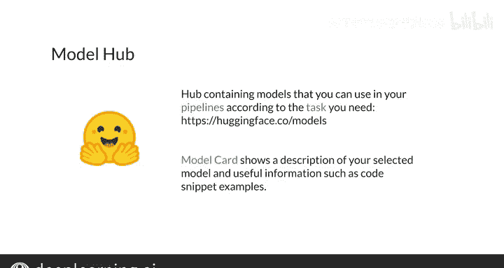

# 吴恩达《自然语言处理｜natural language processing》中英字幕 - P177：37_Hugging Face II.zh_en - GPT中英字幕课程资源 - BV1Hc5ezDEWQ

Let's do a quick recap。The Transformers's library has a pipeline object that you can use to apply states of the art transformer models for different NLP tasks。

Piplines take care of preproces your inputs， running the model and post processing the outputs for you so it is human readable。

 for instance， with a pipeline for the question answering task。

 you can use a transformer to answer different questions provided in context。

To use a transformer model， you only need to indicate the task that you need your pipeline to work on。

 In other words， pipelines are objects that you build for specific andl tasks。

To initialize a pipeline， you only need to pass the task， but if you need。

 you can also indicate the model checkpoints you want to use。To use an initialized pipeline。

 you only need to provide the appropriate inputs that your task requires Huging face supports the most popular NLP tasks。

 but Huging F does not focus only on NLP， it also supports other tasks such as image classification。

 object detection for computer vision， automatic speech recognition and others。For instance。

 you could use the familiar Senment analysis task if your goal is to classify a sequence as positive or negative。

The inputs of this pipeline is a sentence， and the output is the category to which the sentence belongs。

You can also create a pipeline for question answering if you want a model that answers questions。

 extracting information from a context you provide。

The input here is the context and the sets of questions。

 and the model outputs the corresponding answers if it finds any。

Another task that you might find helpful is fillMask。

 which you can use when you need your model to fill blank spaces in a text。

This pipeline needs the sentence you want to fill and the exact position you need your model to fill it。

 It outputs a series of possible ways to complete the sentence。

 and there are many more tasks that you can find directly on the Hoging face website。

As I already told you， you can pick the specific model checkpoint that you want to use with your pipeline。

 Huging face provides a huge number of checkpoints。

 and some of them are fine tuned using massive data sets to give exceptional results on specific tasks。

However， it's best to keep in mind that not every checkpoint is suitable for every task。

 so you should check the description of the pretrained models to select the appropriate checkpoint or stick with the default used by the pipeline。

Finally， you could be asking， where can I find the proper model for my task and use the checkpoints？

For that， Hoging face has a model hub available at Hogingface。com。

 there you will find several pretrained models。You will be able to filter by your desired task or even by the dataset or framework you need to use once you select the model that fits better to your needs。

 you will see the model card interface the model card shows you information about your selected model such as description of the same and some code snippets。

 such as a description of the same model and some code snippets with examples on how to use the selected model。

