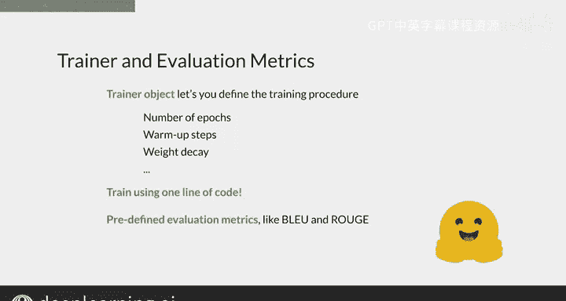

# 吴恩达《自然语言处理｜natural language processing》中英字幕 - P178：38_Hugging Face III.zh_en - GPT中英字幕课程资源 - BV1Hc5ezDEWQ

Huuggging face provides you everything that you need to finet tune a transformer model。

They provide more than  a000 data sets for specific tasks that you can quickly load using the datasets library。

They also provide you with tokens that help you preprocess your data before the training and post process the outputs after running the model。

And they have more than 15，000 model checkpoints that you can load from the Transformer's library。

Additionally， the trainer object lets you train your model without worrying about coding the training procedure。

And as if it wasn't enough， it also has predefined metrics that you can use to evaluate your model's performance。

 which can integrate into the trainer object。Huggging F has more than 15。

000 model checkpoints that you can use as starting points for your fine tuning process。

Recall that a model checkpoints is the set of weights learned for a model during a training procedure using a determined dataset。

For instance， you could use a model checkpoint for the distilled version of the bird transformer obtained by training on a question answering dataset set。

 which you can find as distill dash based dash case， distilled dash squad and hugging face。

Or you could use the base version of the B model trained on a cased English corpus。

What you can find as Bs dashb dash case， so you can explore the Huging F model library to look for a checkpoint that you can use for your specific use case。

Once you have selected the checkpoint you want to use。

 you can upload this architecture and wait using a single line of code using functions from the Transformer's library。

You'll see how to do that in the next ungraded lab， so don't worry about the code just yet。

Now to find you in a transformer model for a specific task or perform well in a particular domain。

 you need lots of data。You could get and process your data sets by。

Scraing the web or even collecting datas are from an app you made。

 But Huging face has a library with task specific dataset sets that is worth exploring before you go through much trouble。

You can search this dataset library on their web by filtering for task category， language and size。

 and to load any dataset set that you choose， you only need a function from datasetss library。

So if you decide to use a dataset set from Hogging phase。

 you only need a line of code to load your data on。And if you already have your dataset sets。

 the loading process is just as easy。Using the Hunging F datasets library is a smart choice because it is optimized to work with massive datasets。

 and it has methods that will help you preprocess the data。

 even if you decide to work with your own data。Once you figure out what dataset set to use to fine tune your model。

 you need to preprocess the data to feed it to the model for training。

The way to pre processcess the data varies depending on the task and the model you want to fine tune。

But hugging face provides tokenizer objects。 That is the process。

 You only need to specify the model checkpoint you are using。

 and the tokenizer does almost all the heavy lifting。

A tokenizer receives your text data and returns the tokens that your model can read。For instance。

 you can pass a distal bird organizer the text with the question what well known superheroes were introduced between 1939 and 1941 by detectiveective comics？

And it would return the numeric token that the distill bird model can use for training and inference。

You might need to take some additional steps for the preprocessing of your data after getting the tokens that vary depending on the model you want to fine tune。

 the data set you are using， and the task you're training the model for。

To ensure that you are doing everything you need to do during the preprocessing step。

 you need to read the description of your model checkpoint and the data sets you are using。

 which are also provided by Hoging face。Now to perform the fine tuning of your model。

 you need to run a training procedure。And as you might already have guessed。

 hugging F will make this step easier for you too。The Hogging F Transformers library has the trainer object that gets the model that you want to fine tune as input with some other arguments that you can tweak as needed。

s as the number of form up and epochs or the strength of the weight decay to perform the training procedure。

 you need to call the training method from the trainer objects， which has just one line of code。

Additionally， you can define a function to use some predefined metrics provided by hugging F。

 such as the bliss score， or even you can define your own metrics if you wish， with hugging F。

 computing the metrics you want with a trainer object is done by justcal an evaluation method on the training。

 validation or test data。

