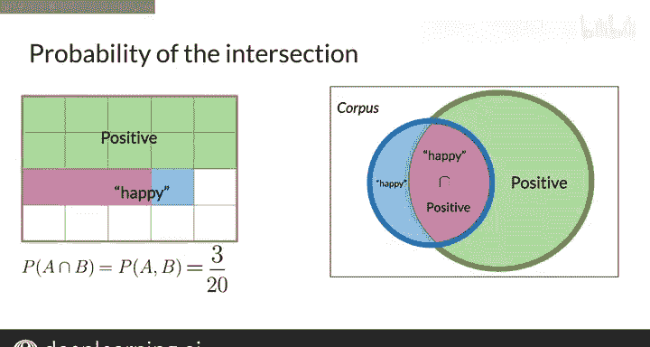

# 吴恩达《自然语言处理｜natural language processing》中英字幕 - P17：16_概率与贝叶斯规则.zh_en - GPT中英字幕课程资源 - BV1Hc5ezDEWQ

This video will give you an overview of Bay rule and go over some probability Don't worry if your math is a little bit rusty。

 we'll go through this together step by step。Probability is fundamental to many applications in NLP。

 and you will see how you can use it to help classify whether a tweet is positive or negative。

 so let's get started。To start， we are going to first review what probabilities and conditional probabilities are。

 how they operate and how they can be expressed mathematically。

Then I'll go over how to derive Bay rule from the definition of conditional probabilities。

 Bes rule is applied in many different fields， ranging from medicine to education and is used extensively in NLP。

 Once you understand the theory behind Bayes rule， you can use it to perform sentiment analysis on tweets。

 which will be this week's assignment， Then in the next course。

 you will implement autocorrect using its basic formulation as well。

Imagine you have an extensive corpus of tweets that can be categorized as either positive or negative sentiment。

 but not both。 within that corpus， the word happy is sometimes being labeled positive and sometimes negative。

 Let's explore why the situation is occurring。One way to think about probabilities is by counting how frequently events occur。

 Suppose you define event A as a tweet being labeled positive。

 Then the probability of event a shown as P of a here is calculated as the ratio between the count of positive tweets in the corpus divided by the total number of tweets in the corpus。

In this example， that number comes out to 13 over 20 or 0。65。

You could also express that value as a percentage， 65% positive。

It's worth noting that the complementary probability here。

 which is the probability of the tweet expressing a negative sentiment。

Is just equal to one minus the probability of a positive sentiment。 Note that for this to be true。

 all tweets must be categorized as either positive or negative， but not both。

 Lets define event B in a similar way by counting tweets containing the word happy。In this case。

 the total number of tweets containing the word happy shown here as unhappy is4。

Here's another way of looking at it。Take a look at the section of the diagram where tweets are labeled positive and also contain the word happy。

In the context of this diagram， the probability that a tweet is labeled positive and also contains the word happy is just the ratio of the area of the intersection divided by the area of the entire corpus。

In other words。If there were 20 tweets in the corpus and three of them are labeled positive and also contain the word happy。

 then the associated probability is 3 divided by 20 or 0。15。

You now know how to calculate the probability of an intersection for you know how to calculate the probability of a word namely happy with the probability of being positive in the next video we will talk about naive B。

