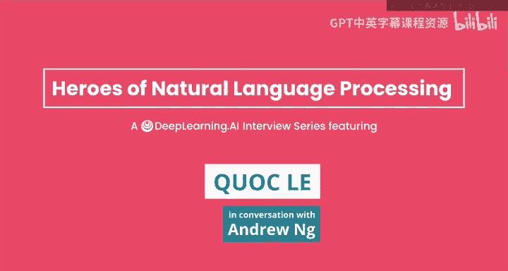
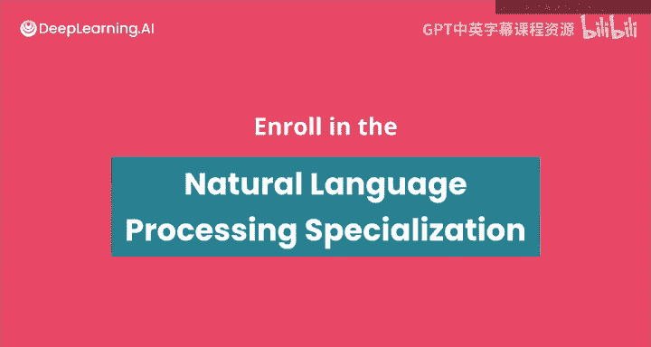

# 吴恩达《自然语言处理｜natural language processing》中英字幕 - P180：40_Andrew Ng与Quoc Le.zh_en - GPT中英字幕课程资源 - BV1Hc5ezDEWQ

Hey everyone welcomee back to this interview series I'm delighted to have of us Kokler who is a researcher at Google Brain I had the pleasure of working with him at Stanford University many years ago and Cork and I which cha just now fun fact Cork was the very first intern I had recruited into Google Bra when I was leaving it back in the early days J Chen Youngang was the second intern I ever recruited into Google Brain and I think Jeff Hinton was the third intern I ever recruited so I think Cor was in good company since then Corck has done some of the most influential work in NLP and I'm delighted to have here today to tell us about some of his experiences thanks to joining us Cor。

Yeah thank you， Andrew for having me in the interview series and it's a pleasure to be here talking to you。

So today Clark you are known widely as one of the most influential NLP and deep learning researchers and your journey has been a complicated one。

 I think you had started off going to school in Vietnam and then went to Australia and in Germany and then now the United States so tell us more about your journey getting into AI。

Yeah， so when I was。Like Im a high school student， I was。

fasciascinated by AI and I ended up reading a lot of books and even programme some simple AI programs。

And then I got a scholarship from Australia。For my undergrad in the Australian Australian National University and in my second year of my undergrad。

 I got a little bit bored and I said， you know maybe I should do something research in AI because it seems like the faculty there。

 they have some very amazing faculty， So I contacted。Alex Moeller， who。

actually took me as an intern for summer， and I work on kernel methods with him。 And that's the。

 I think that's even though I did some AI， you know， projects in before that。

 that's the first time that actually。Learned about machine learning。

And I became super fascinated about machine learning and I realized the potential of blue machine learning learning for AI wait backing up a bit I don't think I knew the story what was the AI project you're coding up in high school that got your scholarship to Australia that I didn't get a scholarship to Australia because of the AI program but I programmed myself to learn more about AI and so on I was building like a chatbot you know like a rubay system to actually talk to myself and you know tried to randomize the answer and so on。

 tried to see how I can fool my friends because I read about the Toururing test and so on and I was fascinated about it but I didn't win the scholarship because of that program it was too simple for it。

 but know because when I programme it I know how hard it is。

To write a computer program to do to actually be intelligent。

So I and I think it's really cool that you thought about that way because I think if there's someone listening to this interview series now that is coding up。

 you know， some slightly broken chatbot that kind of works doesn't work and finds it hard。

 right they may be taking their first steps to an illtous career in AI much like you were onces coding out like a you know so so chatbot。

I find inspiring that we all start from your programs that don't quite work as well as we wish。

 but that can be a wonderful start Yes yeah actually much later， like many years many years later。

 I actually had a conversation with you and turns out you also did something like this as well in the past。

 but I was fascinated， I was always fascinated about， you know， if you ever viewed an AI program。😊。

Can I talk to it right Like can I can I like talk to the program and hear about what it thinks。

 but anyway， the in going back to the journey， I did my summer project with with。

Alex Mola on kernel methods， machine learning and I realized the potential of using machine learning to be AI and then after that I graduated from you know I kept on ruin research with him for a while and then after I graduated he has a friend in Germany and I went to Germany。

 you know Bernard Shankcock hosted me in Germany and when I was in Germany。

 I was also ruin machine learning research and near the machine learning research。

 there's like a neuroscience Center。That it was trying to think about。

 trying to understand the brain and so on。 So I became very fascinated about that as well。

 And then I listened to one of your talks at New that year that you were talking about using machine learning for AI。

And I by the way， at that point in time， most people think about machine learning as up recognition。

 just doing machine learning for machine learning， like trying to classify things。

 but when I' heard about machine learning to do AI。

 it really resonated with me so I applied to the Stanford PhD program to do the PhD and then you know I ended up going to Stanford and then doing the PhD program。

 PhD degree with you。So that's around 2009。7， and then around 2010，2011。

 you you told me that you were found and you were found in and creating a project at Google to scale up。

N learning research and deep learning you know like1 hundred or thousand times bigger when I heard about it。

 I say， oh that's must be the future because in the neuralness I what I did。

 the only thing that make a big difference is giving it more data and more compute So it really resonated with me I'm glad you thought the future。

 a lot of my friends at the time is a terrible idea to do this crazy Google breathing。

 you thought it was reasonable。 but actually I I I think you and I we had the privilege as Stanford of seeing some of the early results that Adam Co was generating and Adam Co had show raising small scale resources and scaling up the neural networks really。

 I think it made I totally agree that figure that Adam Co did。 I think I mean。

 that's basically changing a lot of the things that I did。

 but I think probably a lot of the things in the field did too but really influenced me into。

You know， I joined the project， of course， I then I went to Google brand and I think you and I was an intern。

 like you said， I was the first intern of the project。And I that's around 2011。Around 2000。

 I think I remember that around April 2011， and then I stay since with the project and you know。

 brain has grown grown from you know。do four five people that you诶嗯。

Had at the beginning and now to you know much larger teams and now I do research。

 still continue to do research in deep learning and AI and yeah。Yeah。

 Google Bra was incredibly lucky to have you join and I think one of the first home runs was that。

 you know， Google CAt project， which you were the lead engineer or the lead author on， you know that。

Yeah yeah yeah yeah I remember that so back when we were at Stanford I was you know playing around with this method called autoencoder。

 basically given the input image in and trying to reconstruct the image and then if you apply some kind of sparsity。

 you start having some at the low level of the neural network。

 you start seeing some kind of like ash filters。And Ash filter is very useful for computer vision。

 and then there's this influential result by Mahola P。

 which is my and I think in the project he will hit it with you。

 is that if if you do this in a deeper neural network， you start having。More sophisticated features。

And for me at that point in time， you know， learning future representation is very。

 very very interesting。 And our thought ethic exercise， this is our is not me。

 but our thought exercise， but you know， you got a lot of credit in this。 So I have to say it。

 but our thoughts exercise were actually， can you make this， you know。

100 or thousand times bigger and learn even more。Sophisticated features we don't know what they're going to end up doing like these networks right and then we set out doing this project we scale it up from a single machine to 16000 machines I remember that and we traded on YouTube because I feel like my question was you know what is the biggest image data set that we had access in the world at that moment and it turns out that YouTube images。

So we trained the neural network for like a week or so， the spae auto encodecor and。

You know with a lot of poking we found hidden some neuron in the network that is very sensitive to faces and cats the typical things that the people expect on the internet and yeah and one of the most intriing result was that is actually faced surprisingly the network found cats on the internet I still remember I think we're both in the office that the team was so much smaller and you grabbed me say  hey Andrew come to my confusion and take a look and I walked through and said。

 and that was the cat thing that you had discovered from unsupervised learning I yeah I think one piece of early deep learning history is I think almost all of us maybe overestimated the shortterm impact of unsupervised learning and didn't realize that supervised learning。

be where a lot of the action， you know， at least in the early days would be。

 although I find it interesting that one place where unsupervised learning has really taken off and is showing wonderful commercial results is an NLP。

Yeah yeah yeah。Yeah， and if I still remember when you know。

 there was one day in the office we wearing Google Ra where you walked over T Michelle there and you said hey Andrew come with the computer and take a look and walked over and there you know you gotten this cat to appear on your monitor from on an unsurvised learning and I think that iconic slightly blurry Google Cat wound up being one of the iconic imagess of unsupervised learning for that time So think team couldn't have done that without you。

嗯，O。Shortly after one of the other huge hits that you worked on was the sequence of sequence model。

 and I think that that was another piece of work that changed the trajectory of NLP tell us a bit more about that。

The first version of sequence to sequence is actually a lot of people did not know。

 but there is an idea called word to word。Is transld from one language to another。So。

 and the reason why we did this is a fallen。 So back in around 2012，2013。

 suddenly there is a wave of new world vector methods and pione by a guy called Thomas Mioff and it was developing World2va right and it trained。

ItTs you know world vectors fairly quickly and it shows this amazing ability of， you know。

 if you take you know clean minus screen， then the vector is similar to man minus women for example right and basically solving in analogy so the next question we ask is that can we is there any similar structure between the two languages so for example。

 can you train world vectors from in in Spanish and then also train world vectors in English and can you try to align them。

A little bit， for example， can you learn that， you know。

 certain words in one language align with another word and we do this thing and it turns out it works。

 So you can only have， let's say， five words or you know。

100 words in popular words in English and you know the corresponding in translation in Spanish and then you learn the rotation matrix。

And then you can actually map。 Now， you can start translating words from one language to the other without knowing too much about the language。

 So that， you know， this word to word translation， gave me a feeling that， oh。

 maybe we should not do this word to word。 Maybe we should do sentence to the sentence。And。

 and then we say， okay， so what do we do sentences sentence。

 And it turns out that just it wasn't easy to conceptually at the beginning for us， so。

We were thinking always all the ways， for example， let's try to read in the input sequence。

 the input sentence and then try to predict， you know what's the first word looks like and then trying to predict what's the second word looked like without knowing the first word。

 for example， is like predicting the。First war， second war， third war， et cetera。

 without knowing their relation。And then I said that， oh， maybe that's a little bit limited because。

If you predict a second word， you should know the first word because if。

And if you predict the third word， you should know the second word， et cetera， right。

 so it has to be some some sort of。Depenency。So we thought about it in English sentence。

 it doesn't really make sense to independently predict the first and the second and the third and the fourth words you should predict the first word and then based on that figureiguring out what was the second word and then based on that only after that figure the third word and the sentences you output just make a lot more sense when you do it one word at a time rather than try to spew out all 10 words at the same time that may not end up relating to each other Yes yes that's a good way to explain it now it turns't tell that so you know like from the point that we realized this idea to actually making it work it took like a year and it was actually very difficult and bottle tone about this whole thing is actually training the sequence model to do this and back at the time when I training this I train with a conventional recur neural network but at that point in。

う呃。Together with me， Ilia Suzovva and Olio Vier， they also have very similar ideas of doing this。

So and audio Vi now and Eli Su， they had。They know how to trend this model。

 how to get this model to work with LSPM。So we met and then we decided that let's try with the AISDM。

 it turns out it gave us really good improvements， but when the first translation。

 if it still looked awful and it can output certain words that look like the input but mostly wrong。

So the question is， can should we continue and I was into trying all sorts of ideas and so on。

 but credit to Elilia that he said maybe we should train this model or better。

We should really train this model better and train a bigger model。

 train bigger model and train it longer， train it better。

And credit to him that actually actually that approach actually turns out to be successful and then he。

We drain it we lower the complexity slowly， slowly over time， and then we start when after， you know。

 you know， a couple of months， we really， we start seeing。🎼Better and better translation， you know。

 now is it only one two words but like five was something more correct and we realize we realize that we were on to something so so it sounds like if we got the history right you tried to have RNNs then got better results of LTMs and then the last mile was just scaling more data bigger network。

 bigger LTM network and that wound up being the last several steps to get to that you know semi breakthrough that we so and mirror。

Yeah。I will say that like last seems to trivial from the perspective of a researcher。 but like。

 I think it make a huge difference for the project because， you know， had I try， you know。

 fancy ideas and， you know， even also like crazy ideas。 I think I would not get a thing to work。

 And we would delay the project for much longer。 and， it's a lot of lesson。

Even though the last mile seems to be trivial from the research point of view。

 it made a huge difference for the project and had invest had we invested in fancy ideas and not didn't try scale and didn't try to train the model longer or better。

You know， if we invest more on ideas， we never got the model to work and it would not it would delay the project for much longer yeah yeah it doesn't seem trivial to me at all and I find that when I'm building systems whenm you know in basic research mode sometimes I hold the data fix and change the algorithm but when I'm in production just build a commercial system that works no sometimes I hold the algorithm fix you pick an architecture that I think is good enough and instead spend all my time changing the data so its very very different ways of operating。

Yes， yes， yes yes。So the work that you did with earlier and audioo on sequence sequence models。

 similar of these were really huge impact on a whole field of deep learning。

And then almost coming full circle， you built chatbots in high school and building on the ideas of sequence sequence。

 you also built this much more advanced chatbot than your high school version I imagine called Meaner and I remember reading that paper and thinking。

 wow， some of these outputs actually look you know pretty cool you talk bit about the meaner chatbot project。

Sure， sure。 one of my dreams in my high school is that to build a chatwalk can tell you a joke。

You know， it can it can tell me like a new original joke。And you know。

 one of the things when we're writing the badge every Tuesday because we sound on Wednesday is my editor and she and I often end up sitting around brainstorming for five minutes to see what's the joke we want to tell one other So you a chatboard also make a joke telling you make my life easier So' sure same with me know sometimes I want to give a talk and I always be in the talk with some joke and I find it sometimes it's hard to make the joke as well but yeah。

 but like when I was in high school， I was thinking you know。

 can we come up with a why to create like an original joke and it turns out if you think about who that exercise is actually difficult more difficult than then you can we can program。

So afterward I worked on the sequence to sequence project。

 I realized that if you can get in sequence as input and then produce sequences output。

 maybe one of the biggest application is to train a model can talk to you。Now I actually。

 this idea actually actually executed better， I actually who thought about this idea at Google first it's not me its actually Oo Vier。

So he actually trained a chatbot that actually worked really well and we realized that maybe we should collaborate and then build like a chatbot cool chatbot and we did it in around 2016 or something like that and it's like a paper on archive and we show that there's huge some potential of this yeah remember you do a lot of work right within Google to get permissions to use the IT support to support exactly data in into the chatbot。

Yeah， yeah。 So back at the time we were like， we were researchers。

 we we asked ourselves where's the data set。 So one thing when we did was like going after that。

 you know， technical support internally at Google and get a data set from them and then train a model And then it we ask a question like。

 can you debug this I lost my password what should I do。

 And then it start answering some some kind of question， you know。

 although it still feels a little bit off， But you start seeing it'。There there's something there。

 right， there's something there that really promising it。

And then I spent I just have this very clear recollection， you me， I think Adam Cos。

 a bunch of us were having dinner in a restaurant in Palo Alto and you had just gotten permission to use the data and you were very excited over dinner that day yeah yeah I collection of that dinner Yes yes。

 that was when we had a sushi in the follow Alto restaurant。😊。

Yeah I remember we will talk about that and how excited you were that you know someone work on because you also work on the but and then I and I think I told you about my high school chatt the it's actually more of a prank I I wrote a prank chatbot where I will type and no matter what I type the chatbot will print out what is your name so I would type QOC space LE and as I type that the chatbot will print out WHAT space is your name and the type when I hit enter then it will print out what I actually type so to the user they think I typed what is your name and then it printsler so to my friends I was pranking it looked magical because I could ask you the question theyll know the answer but what was actually happening is I was typing the answer。

It's just displaying a precan question so that's impressive yeah just a high school let's you mean it was much more much one tell that story I spent one year like trying to improve the bot myself and I didn't get very far and turns out the its very hard to how to improve after you actually after so if you create multiter conversation and after one or two turns it becomes very difficult for example it can answer you the first term but the second turn it start to forget information it doesn't give you good answer and so on so it's pretty much broken but then by the end of 2016 and 2017 I met this guy at Google he's a engineer。

Google， his name is Daniel and。Came and told me and said， I want to。

 I also had a dream to be a chatbot。 So let's work together to be a chatbot。 And。

 and when he came in back at that moment， something magical happened。

 which is basically people have has developed this transformer architecture。And we say， okay。

 maybe the transformer is more promising because it can understand long range dependency better right so it can see multiple term better than the ASPM。

And so we started working on using the transformer as to deal with this multiter conversation。 And。

 you know， we train bigger model again， right longer and using more resources at Google and slowly。

 we start to see some improvement。 and one more one magical moment that in my opinion。

 is that I look through the law。 So we allow some people to chat to it at Google。

 and there was one magical moment is that we look through the log。 and then I saw。

Some joke the bart made。And it's actually in the paper about， the joke was about， you know。

 if cows go to Harvard， then horses should go to Harvard。

It's a fun is a that joke right a that joke and then but it's actually a multiterm conversation it's trying to lead the audience into it so I saw it and I thought oh so I tried to look into the training data to see whether it's actually does it have anything like Hayward or you know cow go to sorry horses go to Hayward or not and we couldn't find it so so it's truly is's actually trying to it understand the concept of jokes。

It understand the concept of pun。And it actually created a new joke。

 And I think that's that's a very magical moment， in my opinion and。Prety excited about it， I think。

Yeah， I remember reading that joke when I read the Min paper， hey， how do you know if it was？

True understanding the concept of jokes and puns and Harvard versus ha versus， you know。

 you if you enough monkeys and a typewriter right or enough randomness means eventually that'll be a funny joke。

Yeah， so we look into the training data very carefully and see look for the word Ha right and see whether that word mentioned anywhere it mentioned once in the entire training corus。

 but is's not next to like a joke its mentioned in a different context Our conclusion is it' actually trying to actually understand this concept of a joke because the training in the other side has a lot of jokes。

Tin data set has a lot of jokes as well， puns， there's a lot of puns。

 but the that particular example is actually novel we could not find anywhere in the the training data。

So you've been at the forefront of you know nLP research for many years and we continue to see breakthroughs in LLP on a regular basis now i'm curious look into the future what are you most excited about in terms of。

Things yet to come in and helphe。Oh， yeah。 I think I think I'm most in NLP。

 I'm most mostly excited about genetic models。 I think currently a lot of NLP and is basically doing。

You know traditional NP， where you can classify the sentiments of the sentence。

 or you can do name and the recognition on the sentence。

 But I'm more excited about the capability of generation like。

 can you generate a new book that you know， consumed by humans and， you know。

 teach people a new concept。Can we， can we get to that point or or maybe it can it help like a director to a screenplay writer to come up with a better movie plot。

Right there's so much potential in using these technology for generation in my opinion。

 now huge since the right breakthroughs of transformer model and the several flavors of transformers。

 one huge vector of progress for the generative models has been scale right scale data and especially compute other than scale。

 whether the what do you think are the important vectors of progress forgenrative models。Okay。

 I think。I think I think true understanding， I think right now we look into like for example。

 tax generates， there' still things are a little bit of it made of stuff。

Right like there's some facts that it made up so the question is can we get the art to really have common sense understanding and generating more factory correct output I think that would be a big thing I think that would be a big vector of progress。

Yeah I want to take a little bit further into that because I think a lot of researchers including me you know。

 sometimes have talked about computers understanding images or understanding language and common sense is a concept that philosophers have debated for I think over 2000 years now So when you talk about NLP understanding or common sense are these scientific concepts that are measurable or are these philosophical concepts that you kind of feel like it understands it。

 but how do you approach these questions understanding common sense I think it's measurable so in some sense you can ask for example。

 you can for example you can create for example， GDP or any language model you can give a prompt about let's say you know talking about the GDP in the and like let's talk about GDP in the world and can you look at the GDP and you compare with Wikipedia and can you say they imagine。

And that's measurable or you can start talking about movies in 2020 right and can it understand that these are the movies I think it's measurable do you have a favorite set of benchmarks like there's like a common sense QA is one data set。

 do you have a favorite benchmark for measuring understanding or common sense I thought common sense is a bold name to say this is our measure of common sense is a bold name for data maybe we can instead of like talking about common sense。

 we can just talk about maybe factuality a little bit just factual knowledge just generate some statements that are actually factually correct for example。

 you know how always is Barack Obama and so on it can generate correctly and from that perspective。

 I think it's easy to create another set for that， we haven't had that data set yet， but I think。

It will be created， I think that people are in other AI they created like common sense。

That sets to measure the performance of genetic models， right， So I don I'm not expert in this field。

 but I think my feeling is that when I read a lot of these outputs。

 I still see things that are actuallyfactor not correct。 and I think see things a little bit off。

And I think like addressing that issue can be quite important， yeah。Okay， so like Tess said。

 one measuring factual correctness would be a good way to help the view forward。😊。

in your time at Google you've mentored a lot of younger engineers and even at your time at Stanford。

 you mentored a lot of younger students， so today there are a lot of people wanting to break into AI or that want to advance or to grow their career in AI。

 what advice do you have to someone wanting to build their career in AI？Yeah， okay， so first of all。

 I have to say that I don't have true meta advice。 I don' I don't like the concept of me advice for a lot of people because I think。

 you know， food for me is poisoned for other people。 we are living in different world now。 but I say。

 you know， looking through my journey， I say that I started out from something very。

 very different right I came from different culture， different background。

 So maybe one piece of advice is that， you know， like career as a whole is taking a long time to make really significant progress。

 I never can imagine that I make a big progress。 I make a good contribution for translation。

 for example。 So So my my thinking is that。maybe you can start quite low， but maybe， you know。

 with hard work and dedication you， you know， over time， you can， you know。

 do good work and make impact for the field。 And so be patient， really， right so for me。

 that just journey has taken me。1515 years also already from the point that I started and then until that。

 you know I become a more senior researcher and at Google。

 so be patient and because it takes time to do impactful work， that's number one。

And numberumb two is I think naiveivity can be good a lot of people think that they have to read a lot and understand everything I think naivete sometimes can be in your favor。

 for example， in around 2014 when I was doing this sequence to sequence 2013 I tried to reimple phrase based a neuro machine translation and I was just a bad programmer I didn't know anything about phrase based neuro machine translation I was bad I was I spent two months implementing it I couldn't do it。

And because of that， because of that frustration， I。

I say okay maybe I should do something here I should do end to end learning instead。

 but imagine if I was a good programmer and I knew a lot about phrase based machine translation。

 I would program it successfully and then I would not develop a sequence to sequence and I would not participate on a different project like that so maybe na if is on sunseta can be good。

Yeah。I think I think what you said about patience is great advice and sometimes it does take some time years to become really good at AI and it can be a long journey but extremely rewarding journey So I'm curious what advice do you have for someone that is learning about AI learning about machine learning during the career and you know in the course of that process。

 how can someone know if they're making progress and how can someone。

Know they're doing the right things to be advancing the right speed。

Right like we need to identify data set， identify a task where you can see progress more quickly and maybe sometimes you you don't get success on that then try to understand why and try to talk to you know more maybe contact more senior researchers and try to figure out on all the senior engineers and try to figure out。

What went wrong， I mean， if I were to start AI today as in career in AI as a researcher let's say then I would probably maybe the start the starting point would be I would try to。

 you know， replicate some AI my favorite AI research papers right then try trying to， you know。

 look for read the paper， trying to understand it， reproduce the result。

 compare against their Github and trying to you know to get into the habit that I can implement quickly and you know。

 my code can reproduce the result quickly and。And then you know。

 if I make progress in that easy phase， then I can start thinking about how could I contribute。

 how could I get better at developing my own ideas so that would I do do and then I would start in other words I would start with something easier first。

Trying some try to get something that easier。 Like it's like。It's like learn to swim。

 You don't want to go to the ocean to learn to swim， You want to learn to swim。

In a pull first and then you know， do something quite easy that you get happy doing it and then move slowly。

 move yourself towards more and more difficult tasks。And to the， for example， creating your new idea。

 writing your own paper， that's difficult。 But I think reproducing line existing paper。

And getting a result on analysts or Cfa， that seems。Easy enough to do。

 So maybe start with that first。 start， start with something simple， yeah。Good advice， kind of like。

 you know， we use curriculum learning in training neural networks as well。Thanks， Carl。

 this has been great。 Before we wrap up， do you have any final words or any final thoughts for the for the viewers watching this。

 Oh， I can say some of my final words。 I say， you know， I， I。😊。

I accepted the interview because I want to see Andrew。 and I want to thank， you know。

 Andrew was a spectacular educator。I have to say。 So I remember in 2017， I came to， you know。

 I was already a researcher I wrote papers and so on。 I came to Stanford。 I started my PhD。

 I came to a lecture hole by you， The CS S 2，29 lecture。

 And I literally had goosebumps because your lecture was so good。

 it was so it was like another level and。I learned I learned a lot。

 I think I learned a lot from from your class and you know， from your original thinking as well。

 thank you for your contribution in educating in the community about deep learning。

 I think that that's going to be very， very impactful for the field as well because we need more you know more people to move the field forward as well。

Now yeah， thanks， Hu， what wasn't expecting to say that is very， very， very。

 very kind of you means a lot。Yeah thank you and I think thanks thanks for being with me on this interview series it's wonderful to see all the tremendous contributions you're making to NLP learning whos a great cha as always。

😊，Yeah， thank you。For more interviews with NLP Though leaders， check out the Deeplearning。

AI YouTube channel or enroll in the NLP specialization on Coursera。

