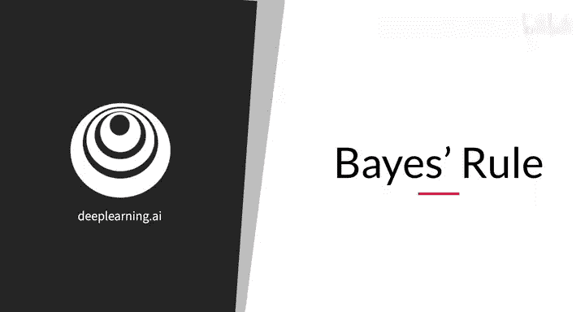
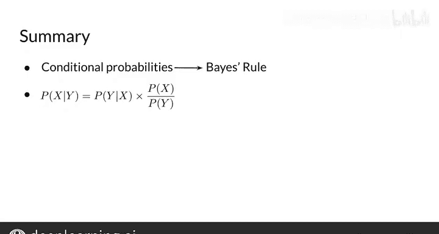

# 吴恩达《自然语言处理｜natural language processing》中英字幕 - P18：17_贝叶斯规则.zh_en - GPT中英字幕课程资源 - BV1Hc5ezDEWQ

Welcome， we will be looking at conditional probabilities to help us understand Bay' rule。

 In other words， if I tell you you can guess what the weather is like。

 given that we are in California and it is winter， then you will have a much better guess than if I just ask you to guess what the weather is like。

In order to derive base rule， let's first take a look at the conditional probabilities。

Now， think about what happens if instead of the entire corpus。

 you only consider tweets that contain the word happy。This is the same as saying。

 given that a tweet contains the word happy with that。

 he would be considering only the tweets inside the blue circle where many of the positive tweets are now excluded。

😊，In this case， the probability that a tweet is positive， given that it contains the word happy。

 simply becomes the number of tweets that are positive and also contain the word happy。

 And we divide that by the number that contain the word happy。😊，As you can see by this calculation。

 your tweet has a 75% likelihood of being positive if it contains the word happy。

You could make the same case for positive tweets。 The purple area denotes the probability that a positive tweet contains the word happy。

😊，In this case， the probability is 3 over 13， which is 0。231。

With all of this discussion of the probability of meeting certain conditions。

 we are talking about conditional probabilities。 Conal probabilities could be interpreted as the probability of an outcome B。

 knowing that event A already happened。Or given that I am looking at an element from sets A。

 the probability that it also belongs to sets B。Here's another way of looking at this with the Venn diagram you saw before。

So using the previous example。The probability of a tweet being positive。

 given that it has the word happy， is equal to the probability of the intersection between the tweets that are positive and the tweets that have the word happy divided by the probability of a tweet given from the corpus。

 having the word happy。Let's take a closer look at the equation from the previous slide。

You could write a similar equation by simply swapping the position of the two conditions。 Now。

 you have the conditional probability of a tweet containing the word happy。

 given that it is a positive tweet。 armed with both of these equations。

 you are now ready to derive Bayes rule to combine these equations。

 Know that the intersection represents the same quantity。 No matter which way it's written。

 knowing that you can remove it from the equation。 with a little algebraic manipulation。

 you are able to arrive at this equation。 This is now an expression of basees rule in the context of the previous sentiment analysis problem。

😊，More generally， Bayes rule states that the probability of x given y is equal to the probability of y given x times the ratio of the probability of x over the probability of y。

And that's it。 You just arrived at the basic formulation of Bays rule， nicely done。So to wrap up。

 you just derived Bays rule from expressions of conditional probability。

Throughout the rest of this course， you'll be using Bayase Rule for various applications in NLP。

The main takeaway for now is that。Base rule is based on the mathematical formulation of conditional probabilities。

 and that with basees rule， you can calculate the probability of x given y if you already know the probability of y given x and the ratio of the probabilities of x and y。

So that's great work。 I'll see you later。

Congratulations you now have a good understanding of Base rule in the next video you'll see how you can start applying Base rule to a model known as naive Base。

 this will allow you to start building your sentiment analysis classifier using just probabilities。

