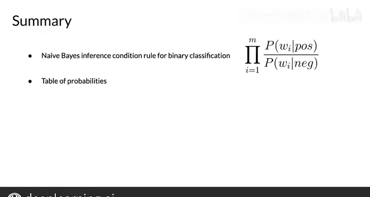

# 吴恩达《自然语言处理｜natural language processing》中英字幕 - P19：18_朴素贝叶斯介绍.zh_en - GPT中英字幕课程资源 - BV1Hc5ezDEWQ

Welcome last week you learned how to classify tweets using logistic regression this week we will solve the same problem using a method called the naive B it's a very good quick and dirty baseline for many text classification tasks and the concept you learned will be used later throughout the specialization。

Naive Base is an example of supervised machine learning and shares many similarities with the logistic regression method you used in the previous assignments。

 It's called naive because this method makes the assumption that the features you are using for classification are all independent。

 which in reality is rarely the case。 As you will see， however。

 it still works nicely as a simple method for sentiment analysis。 So as before。

 you will begin with two corporal。One for the positive tweets and one for the negative tweets。

 You need to extract the vocabulary or all the different words that appear in your corpus。

 along with their count。You get the word counts for each occurrence of a word in the positive corpus。

Then do the same for the negative corpus， just like you did before。

Then you're going to get a total count of all the words in your positive corpus and do the same again for your negative corpus。

 That is， you're just summing over the rows of this table。 So for positive tweets。

 there is a total of 13 words， and for negative tweets， a total of 12 words。😊。

This is the first new step for naive base， and it's very important because it allows you to compute the conditional probabilities of each word given the class。

 as you're about to see。Now divide the frequency of each word in a class by its corresponding sum of words in the class。

So for the word I， the conditional probability for the positive class would be 3 over 13。

And you store that value in a new table with a corresponding value， 0。24。

Now for the word I in the negative glass， you guess3 over 12。

So you store that in your new table with the corresponding value 0。25。

Now apply the same procedure for each word in your vocabulary to complete the table of conditional probabilities。

One key property of this table is that if you sum over all the probabilities for each class。

 you'll get one。😊，Let's investigate the stable further to see what these numbers mean。First。

Note how many words have a nearly identical conditional probability。Like I am learning and N LP。

 the interesting thing here is words that are equally probable don't add anything to the sentiment。

In contrast to these neutral words， look at some of these other words like happy， sad and not。

 They have a significant difference between probabilities。

 These are your power words tending to express one sentiment or the other。

 These words carry a lot of weight in determining your to sentiment。Now let's take a look at because。

As you can see， it only appears in the positive corpus。

 so its conditional probability for the negative class is 0。When this happens。

 you have no way of comparing between the two corporal。

Which will become a problem for your calculations。To avoid this。

 you will smooth your probability function。Say you get a new tweet from one of your friends。

And the tweet says， I'm happy today。 I'm learning。And you want to use the table of probabilities to predict the sentiments of the whole tweet。

This expression is called the Naive Bay's inference condition Rule for binary classification。

This expression says that you are going to take the product across all of the words in your tweet of the probability for each word in the positive class divided by the probability in the negative class。

Let's calculate this product for this suite。For each word， select its probabilities from the table。

So for I， you get a positive probability of 0。2 and a negative probability of 0。2。

 so the ratio that goes into the product is just 02 over 02。For m， you also gets 0。2 over 0。2。

For happy， you get 0。14 over 0。10。For today， you don't find any word in the table。

 meaning this word is not in your vocabulary， so you won't include any term in the score。

For the second occurrence of I， again， you'll have 0。2 over 0。2。For the second occurrence of M。

 you'll have 0。2 over 0。2。And learning gets 0。10 over 0。10。Now。

 note that all the neutral words in the tweet like I and am just cancel out in the expression。

And what you end up is with 0。14 over 0。10， which is equal to 1。4。This value is higher than one。

 which means that overall， the words in the tweet are more likely to correspond to a positive sentiment。

 So you conclude that the tweet is positive。So far。

 you've created a table to store the conditional probabilities of words in your vocabulary and applied the naive B inference condition rule for binary classification of a tweet。

 Great， Next you'll look into some issues with this implementation and how to fix them。

 Now you have seen how naive basease can be used to classify the sentiment of a tweet in the next video we will simplify the calculations before we implement it。

