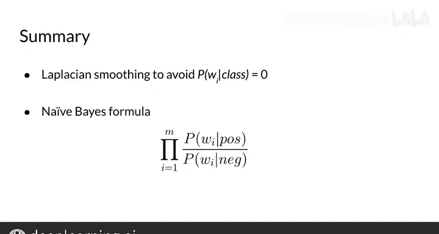

# 吴恩达《自然语言处理｜natural language processing》中英字幕 - P20：19_拉普拉斯平滑.zh_en - GPT中英字幕课程资源 - BV1Hc5ezDEWQ

Welcome back Sometimes you try to calculate the probability of a word happening after a word。😊。

To do that， you might want to count the number of times those two words showed up one after another。

 divided by the number of times the first word appeared。Now。

 what if the two words never showed up next to each other in the training corpus？

You get a probability of 0， and the probability of an entire sequence might go to 0。 Now。

 how can we fix this problem。 Let's take a look。Let's now dive into lapplian smoothing。

 a technique you can use to avoid your probabilities being0。

The expression used to calculate the conditional probability of a word。

 given the class is the frequency of the word in the corpus shown here as freak of word I comma class divided by the number of words in the corpus or N class。

Smoothing the probability function means that you will use a slightly different formula from the original。

 Now that I've added a one in the numerator。This little transformation avoids the probability being 0。

 However， it adds a new term to all the frequencies that is not correctly normalized by N class to account for this。

 You will add a new term in the denominator， V class。

That is the number of unique words in your vocabulary to account for that extra term added in the numerator。

 So now all the probabilities in each column will sum to one。This process is godlessplian， smoothing。

Going back to this example， let's use the formula on it。

The first thing you need to calculate is the number of unique words in your vocabulary。

 In this example， you have8 unique words。 So now let's calculate the probability for each word in the positive class。

For the word I， the positive class you get 3 plus1， divided by 13 plus 8。Which is 0。19。

For the negative class， you have 3 plus 1 divided by 12 plus 8， which is 0。2。

And then so on for the rest of the table。The numbers shown here have been rounded。

 but using this method， the sum of probabilities in your table will still be one。

Note that the word because no longer has a probability of 0。 Great， that's La Plaian smoothing。Now。

 you know why you have to use Laplaceian smoothing。 so your probabilities don't end up being 0。

 That's very cool。

You learned about Laplaceian smoothing and now understand why it is important to use smoothing in the next video you will learn about the log likelihood。

