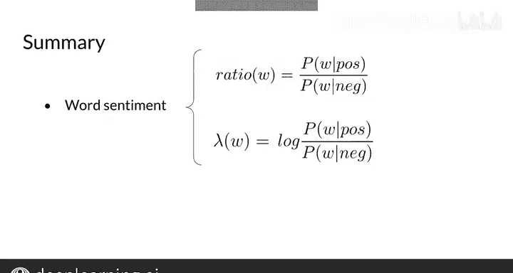

# 吴恩达《自然语言处理｜natural language processing》中英字幕 - P21：20_对数似然第1部分.zh_en - GPT中英字幕课程资源 - BV1Hc5ezDEWQ

In this video I will introduce you to log likelihoods these are just logarithms of the probabilities we're calculating from the last video。

 but they are way more convenient to work with and they appear throughout deep learning and thenLP。

Okay， so let's go back to the table you saw previously that contains the conditional probabilities of each word for positive or negative sentiment。

 words can have many shades of emotional meaning， but for the purpose of sentiment classification。

 they're simplified into three categories， neutral， positive and negative。

All can be identified by using their conditional probabilities。

These categories can be numerically estimated just by dividing the corresponding conditional probabilities of this table。

Now， let's see how this ratio looks for the words in your vocabulary。

So the ratio for the word I is 0。2 divided by 0。2。Or one， the ratio for the word M is， again， one。

The ratio for the word happy is 0。14 divided by 0。1 or 1。4。 do the same for because learning an NLP。

 the ratio is one。And for Sa and not， the ratio is 0。1 divided by 0。15 or 0。6。Again。

 neutral words have already shown your one。Positive words have a ratio larger than one。

 The larger the ratio， the more positive the words going to be。😊，On the other hand。

 negative words have a ratio smaller than one。 The smaller the value， the more negative the word。

In this week's assignment， you'll implement a function that filters words depending on their positivity or negativity。

You will find the expression shown here to be very helpful with that。

These ratios are essential and naive base for binary classification。

I'll illustrate why using an example you've seen before。

 recall earlier where you use the formula to categorize a tweet as positive if the product of the corresponding ratios of every word appears in the tweet is bigger than one。

 and we said it was negative if it was less than one。This is called the likelihood。

If you were to take a ratio between the positive and negative tweets。

You'd have what's called the prior ratio。 I haven't mentioned it till now because in the small example。

 you had exactly the same number of positive and negative tweets， making the ratio1。

In this week's assignment， you'll have a balanced dataset set。

 so you'll be working with a ratio of one in the future， though。

 when you're building your own application， remember that this term becomes important for unbalanced dataset sets with the addition of the prior ratio。

 you now have the full naive base formula for binary classification。A simple。

 fast and powerful method that you can use to establish a baseline quickly。 Now。

 it's a good time to mention some other important considerations for your implementation of naive base。

 Senment probability calculation requires multiplication of many numbers with values between 0 and1。

 carrying out such multiplications on a computer runs the risk of numerical underflow。

 when the number returned is so small， It can't be stored on your device。Luckily。

 there is a mathematical trick to solve this。 It involves using a property of logarithms recalled that the formula you using to calculate a score for naive base is the prior multiplied by the likelihood。

😊，The trick is to use a log of the score instead of the RA score。

This allows you to write the previous expression as the sum of the log prior and the log likelihood。

 which is a sum of the logarithms of the conditional probability ratio of all unords in your corpus。

Let's use this method to classify the tweet。I am happy， because I am learning。

Remember how you used the naive Bay inference condition earlier to get the sentiment score for your tweet。

Now you're going to do something very similar to get the log of your score。

What you need to calculate the log of the score is called in Lambda。

 This is the log of the ratio of the probability that your word is positive。

And you divide that by the probability that the word is negative。 Now。

 let's calculate Lambda for every word in our vocabulary。So for the word， I。

You get the logarithm of 0。05 divided by 0。05。Or the logarithm of one， which is equal to 0。 Remember。

 the tweet will be labeled positive if the product is larger than one。By this logic。

 I would be classified as neutral at0。For m， you take the log of 0。04 over 0。04。Which， again。

 is equal to 0。So you enter0 in the table。For happy， you get a lambda of 2。2。

 which is greater than 0， indicating a positive sentiment。From here on out。

 you can calculate the log score of the entire corpus just by summing out the lambdas。

You're almost done with the log likelihood， let's stop here and take a quick look back at what you did so far。

Words are often emotionally ambiguous， but you can simplify them into three categories and then measure exactly where they fall within those categories for binary classification。

You do so by dividing the conditional probabilities of the words in each category。

This ratio can be expressed as a logarithm as well， called Lambda。

And you can use that to reduce the risk of numerical under flow In this video。

 you learned about the ratio of positive words to negative words。 So the higher the ratio is。

 the more positive the words is going to be as the number of words we are using gets larger and larger。

 then we are very likely to get a product that is very close to 0。 Hence。

 we end up taking the log of that ratio。😊。

