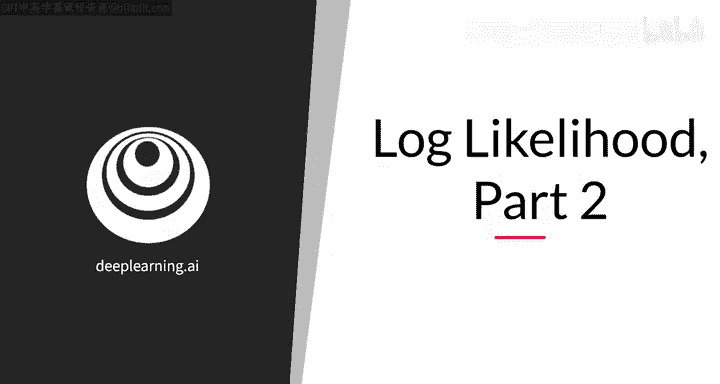
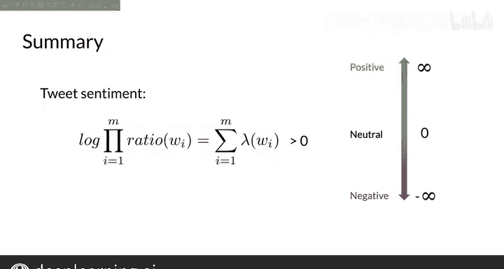

# 吴恩达《自然语言处理｜natural language processing》中英字幕 - P22：21_对数似然第2部分.zh_en - GPT中英字幕课程资源 - BV1Hc5ezDEWQ

We will continue from the previous video and show you how to do inference。

 Given your Lambda dictionary， the task is pretty straightforward。

 You have done most of the work to arrive at your log likelihood already。 Now， let's wrap up。😊。

Now you can calculate the log likelihood of the tweet as the sum of the lambdas from each word in the tweet。

 So for word I， you add 0 for M， you add 0 forward word happy， you add 2。2。Forwards， because I and M。

 you add 0 and forward learning， you add 1。1。 This sum is 3。3， and this value is higher than 0。

Remember how previously you saw that the tweet was positive if the product was bigger than one。

With the log of 1 equal to 0， the positive values indicate that the tweet is positive。

A value less than 0 would indicate that the tweet is negative。

 The log likelihood for this suite is 3。3， and since 3。3 is bigger than 0。The tweet is positive。

Notice that this score is based entirely on the words happy in learning。

 both of which carry a positive sentiment。 All the other words were neutral and in contribute to the score。

😊，See how much influence the power words have。Let's do a quick recap。

 You use your new skills to predict the sentiment of a tweet by summing all the lamb does for each word that's appeared in the tweet。

This score is called the log likelihood for the log likelihood。 The decision threshold is 0。

 instead of one。Positive tweets will have a positive lock likelihood above 0 and negative tweets will have a negative lock likelihood below 0。

 Well done。

Congratulations， now that you have a good understanding of how to compute the log likelihood and how to do inference。

 I will proceed to show you how to train a naive base model。😊。

