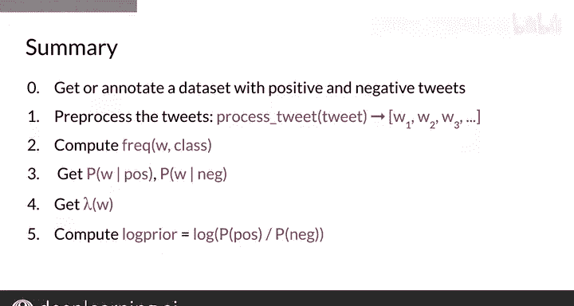

# 吴恩达《自然语言处理｜natural language processing》中英字幕 - P23：22_训练朴素贝叶斯.zh_en - GPT中英字幕课程资源 - BV1Hc5ezDEWQ

This week I'll show you how to train the naive based classifier in this context。

 we trained in something different than in logistic regression or deep learning。

 there is no greedy and descent we're discounting frequencies of words in a corpus。

You'll now be creating step by step， a naive base model for sentiment analysis using a corpus of tweets that you've already collected。

 That's awesome。😊，The first step for any supervised machine learning project is to gather the data to train and test your model for sentiment analysis of tweets。

 This step involves getting a corpus of tweets and dividing it into two groups。

 Po and negative tweets。 The next step is fundamental to your model success。

 The preprocessing step as described in the previous module consists of five smaller steps。

1 lowercase the text 2， remove punctuation URLls and handles，3， remove stop words，4。

 stemming or reducing words to their commont and5 Finally tokenizing or splitting your document into single words or tokens for the assignment in this week。

 it will be relatively straightforward to implement this processing pipeline。 But in the real world。

 you might find the gathering and processing of text takes up a big chunk of your project hours。

 Once you have a clean corpus of。Prossess tweets， you'll start by computing the vocabulary for each word and class like you did in the previous week。

 This process will produce a table like the one shown here。

 You can compute the sum of words and class in each corpus in this same step。

From this table of frequencies， you get the conditional probability or probability of word given class by using the Laplaceian smoothing formula。

 See how the number of unique words in V class is equal to 6。

 You only account for the words in the table， not the total number of words in the original corpus。

This produces a table of conditional probabilities for each word in each class。

 The table only contains values， greater than 0。For the fourth step。

 you'll get the Lada score for each word。Which is the log of the ratio of your conditional probabilities。

The fifth step is the estimation of the log prior to do this。

 youll need to count the number of positive and negative tweets。

And then the log prior is the log of the ratio of the number of positive tweets over the number of negative tweets and the upcoming assignment。

 youll be working with a balanced dataset set。 So the log prior is equal to 0。

 But for unbalanced dataset sets， this term will become important。In summary。

 training a naive based model can be divided into six logical steps。

 You get or annotate a dataset with positive and negative tweets。 Typically。

 it's better if your tweets match the same context that you want to use in the final model。

 Then you process the rotex to get a corpus of clean， standardized tokens。

 you compute the dictionary frequencies for each word and class。

 then compute the conditional probabilities of each word using the Laplian smoothing formula。

 you compute the lambda factor for each word， and finally you estimate the log prior of the model or how likely it is to see a positive tweet in your account。

Well， that was quite a lot。

Now， you have seen how to build the probability table needed to apply naive Base。

The next exciting thing we'll do is to classify your sentences。

