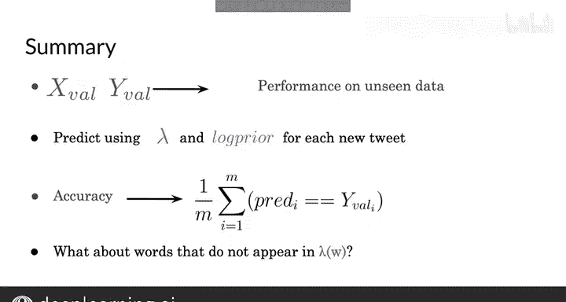

# 吴恩达《自然语言处理｜natural language processing》中英字幕 - P24：23_测试朴素贝叶斯.zh_en - GPT中英字幕课程资源 - BV1Hc5ezDEWQ

This part will be fun as you will apply the knife based classifier on real test examples。

 it is similar to what you did in the first video of the week。

 but we'll cover some special corner cases。

Once you have trained your model， the next step is to test it。

 and you do so by taking the conditional probabilities you just derived and you use them to predict the sentiment of new unseen tweets。

After that， you'll evaluate your model performance。

 and you will do so just like how you did it in the last week。

 you use your test set of annotated tweets。With the calculations you've done already。

 you have a table with the Lada score for each unique word in your vocabulary。

 and with your estimation of the log prior， you can predict sentiment on a new tweet。

This new tweet says I pass the NLP interview。You can use your model to predict if this is a positive or negative tweet。

So before anything else， you must pre processces this text， removing the punctuation。

 stemming the words， and tokenizing to produce a vector of words like this one。Now。

 you look up each word from the vector in your log likelihood table if the word is found such as I。

 pass， D and NLP， use sum over all the corresponding Lada terms。

The values that don't show up in the table of lambmbdas， like interview。

 are considered neutral and don't contribute anything to the score。

Your model can only give a score for words it seen before。

Now you add the log prior to account for the balance or imbalance of the classes in the dataset set。

 so this score sums up to 0。48。 Remember， if this score is bigger than 0。

 then the suite has a positive sentiment。So， yes， in your model and in real life。

 passing the NLP interview is a very positive thing。 You just predicted the sentiment of a new tweet。

 and that's awesome。😊，It's time to test the performance of your classifier on unseen data。

 just like you already did for a different scenario in the previous module。

 let's quickly review that process as applied to naive base。

 this week's assignment includes a validation set This data was set aside during training and is composed of a set of raw tweets So x vow and their corresponding sentiments Y vow you'll have to implement the accuracy function to measure the performance of your trained model represented by the Lada table and the log prior using these data first。

 imputee the score of each entry in X vow like you just did previously。

 then evaluate whether each score is greater than 0。

This produces a vector populated with zeros and ones。

 indicating if the predicted sentiment is negative or positive respectively。

 for each suite in the validation set。With your new predictions vector。

 you can compute the accuracy of your model over the validation sets。To do this part。

 you will compare your predictions against the true value for each observation from your validation data Yva。

If the values are equal and your prediction is correct， you'll get a value of1。And 0 of incorrect。

Once you have compared the values of every prediction with the true labels of your validation sets。

 you can compute the accuracy as the sum of this vector divided by the number of examples in the validation set。

Just like you did for the logistic regression， Okay。

 let's revisit everything you just did to test the performance of your naive base model。

 you use a validation set to allow you to predict that sentiment score for an unseen tweet using your newly trained model。

Then you compared your predictions with the true labels。

Provided in the validation set to get the percentage of tweets that were correctly predicted by your label。

Then you compared your predictions with the true labels provided in the validation set。

 and this allowed you to get the percentage of tweets that were correctly predicted by your model。

You also saw that words that don't appear in the Lambda table are treated as neutral words。

Now you know how to apply the naive based method to test examples in deco exercise at the end of the week you will use it to classify tweets Next I'll show you other things it can do。

