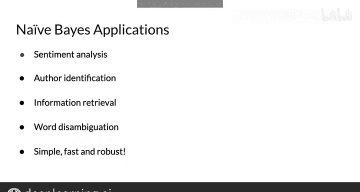

# 吴恩达《自然语言处理｜natural language processing》中英字幕 - P25：24_朴素贝叶斯的应用.zh_en - GPT中英字幕课程资源 - BV1Hc5ezDEWQ

Earlier in the week， you used a naive based method to classify tweets。

 but that can be used to do a number of things like identify who's an author with text。

 I'll give you a few ideas of what those things may be。😊。

When you use naive basease to predict the sentiments of a tweet。

 what you' are actually doing is estimating the probability for each class by using the joint probability of the words in classes。

 The naive based formula is as the ratio between these two probabilities。

 The product of the priors and the likelihoods。 You can use this ratio between conditional probabilities for much more than sentiment analysis for one。

 you could do author identity if you had two large corporal， each written by different authors。

 you could train a model to recognize whether a new document was written by one or the other。

 or if you had some works by Shakespeare and some works by hemingway。

 you could calculate the lambda for each word to predict how likely a new word is to be used by Shakespeare or alternatively by hemingway。

 This method also allows you to determine author identity。 Another common use as spam filtering。

Using information taken from the sender， subject and content。

 you could decide whether an email is spam or not。One of the earliest uses of naive base was filtering between relevant and irrelevant documents in a database。

 given sets of keywords in a query。In this case， you only needed to calculate the likelihood of the documents given the query。

You can't know beforehand what irrelevant or irrelevant document looks like。

So you can compute the likelihood for each document in your dataset and then sort the documents based on its likelihoods。

You can choose to keep the first M results or the ones that have a likelihood larger than a certain threshold。

 Finally， you can also use naive base forward this ambiguation， which is to say。

Breaking downwards for contextual clarity。Consider that you have only two possible interpretations of a given word within a text。

 Let's say you don't know if the word bank in your reading is referring to the bank of a river or to a financial institution to disambiguate your word。

 calculate the score of the document， Given that it refers to each one of the possible meanings。

In this case， if the text refers to the concept of river instead of the concept of money。

 then the score will be bigger than one。 That's cool， right。In summary。

 Bay rule and its naive approximation has a wide range of applications in sentiment analysis。

 author identification， information retrieval， and word disambiguation。It's a popular method。

 since it's relatively simple to train， use and interpret。

You'll be using the base rule and naive base again in the weeks ahead。 Now， you're fully equipped。

As you've seen in this video， naive Base can be used for many classification tasks next I'll show you the assumptions that underlie the naive based method。

