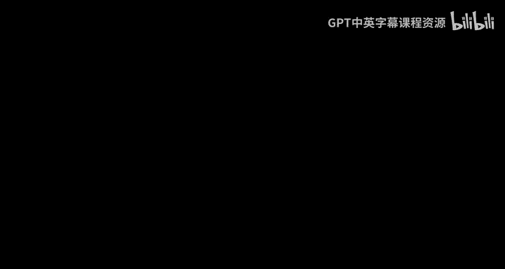
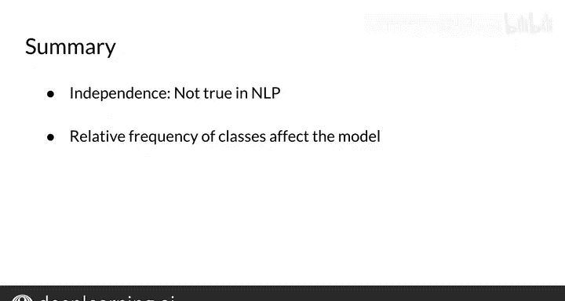

# 吴恩达《自然语言处理｜natural language processing》中英字幕 - P26：25_朴素贝斯的假设.zh_en - GPT中英字幕课程资源 - BV1Hc5ezDEWQ

Now I'll go into the assumptions underlying the knifeive base method。

The main one is independence of words in a sentence。

 and I'll tell you why this can be a big problem when the method is applied。

Naive B is a very simple model because it doesn't require setting any custom parameters。

 This method is referred to as naive because of the assumptions it makes about the data。

 The first assumption is independence between the predictors or features associated with each class。

 and the second has to do with your validation set。

Let's explore each of these assumptions and how they could affect your results。

To illustrate what independence between features looks like， let's look at the following sentence。

It is sunny and hot， in the Sahara desert。Nive Bees assumes that the words in a piece of text are independent of one another。

But as you can see， this typically isn't the case。 the word sunny and hot often appear together as they do in this example。

Taken together， they might also be related to the thing they are describing like a beach or a desert。

 So the words in a sentence are not always necessarily independent of one another。

 but naive Bays assume that they are。 This could lead you to under or overest deco conditional probabilities of individual words。

 when using naive Bay， for example， If your task was to complete the sentence。

 Its always called and snowy in blank。 naive Bays might assign equal probability to the words spring。

 summer， fall and winter。Even though from the context。

 you can see that winter should be the most likely candidate。

In the next courses of this specialization， you will be introduced to some more sophisticated methods that deal with this。

 Another issue with naive B is that it relies on the distribution of the training dataset sets。

A good dataset set will contain the same proportion of positive and negative tweets as a random sample would。

 however， most of the available annotated corpora are artificially balanced。

 just like the dataset you'll use for the assignment。In a real tweet stream。

 positive tweets tend to occur more often than their negative counterparts。

One reason for this is that negative tweets might contain content that is banned by the platform or muted by the user。

 such as inappropriate or offensive vocabulary。 assuming that reality behaves as your training corpus。

 This could result in a very optimistic or very pessimistic model。

 There is a lot more on this in the last video of this module。

 which analyze the sources of errors in naive base。

 Let's do a quick recap of all this new information。

The assumption of independence in naive B is very difficult to guarantee， but despite that。

 the model works pretty well in certain situations。 And for the assignment in this module。

 the relative frequency of positive and negative tweets in your training dataset sets needs to be balanced in order to deliver an accurate result。

 Now， you understand the assumptions that underlie the naive base method。

 What if it fails to perform well for some sentence。 in the next video。

 I'll show you what to do in such cases。

